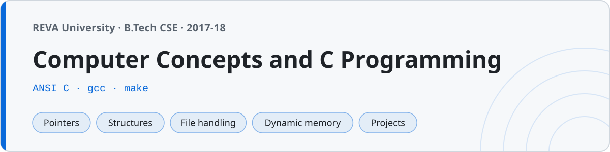

<p align="center"></p>

# Computer Concepts and C Programming

C programs I wrote while taking Computer Concepts and C Programming at **REVA University, Bengaluru** (B.Tech, first year). Everything from the first `printf` to the menu-driven projects we submitted at the end of the semester, plus the lab manual exercises in `lab/`.

219 programs in total. Nothing here is clever — it's the standard first-year progression, kept in one place so I can find it again.

## Structure

The folders are meant to be read in order. Each one assumes the one before it.

| Folder | What's in it | Programs |
|---|---|---|
| `01-basics/` | `printf`, variables, data types, operators, type sizes, integer division | 18 |
| `02-decision-making/` | `if`, `else-if` ladders, `switch`, ternary, the first calculator | 16 |
| `03-loops/` | `for` / `while` / `do-while`, factorial, primes, Fibonacci, GCD, base conversion | 24 |
| `04-patterns/` | Nested loops — triangles, pyramids, diamonds, Pascal's, Floyd's, butterfly | 22 |
| `05-arrays/` | Traversal, searching, the three sorts, frequency, rotation | 18 |
| `06-matrices/` | 2D arrays — add, multiply, transpose, symmetric, saddle point | 12 |
| `07-strings/` | Character arrays, `string.h`, and reimplementing `string.h` by hand | 18 |
| `08-functions/` | Prototypes, call by value vs reference, scope, storage classes | 12 |
| `09-recursion/` | Factorial, Fibonacci, GCD, Tower of Hanoi, recursive binary search | 10 |
| `10-pointers/` | Dereferencing, pointer arithmetic, pointers to functions, `const` placement | 12 |
| `11-structures/` | `struct`, nested structs, arrays of structs, `union`, `typedef`, `enum` | 10 |
| `12-file-handling/` | `fopen`/`fclose`, text and binary I/O, `fseek`/`ftell` | 10 |
| `13-dynamic-memory/` | `malloc`, `calloc`, `realloc`, `free`, dynamic 2D arrays | 6 |
| `14-external-libraries/` | Linking beyond libc — `math.h`, `time.h`, `stdlib.h`, `argv` | 8 |
| `15-projects/` | The bigger menu-driven programs | 7 |
| `lab/` | The 16 numbered exercises from the lab manual | 16 |

## Compiling

Every program is plain ANSI C and builds with `gcc`. Nothing needs an IDE.

```sh
gcc -std=c99 -Wall 03-loops/04_factorial.c -o factorial
./factorial
```

Programs that call into `math.h` need the math library linked explicitly, which is the mistake everyone makes once:

```sh
gcc -std=c99 -Wall 14-external-libraries/01_math_functions.c -o math -lm
./math
```

Without `-lm` you get `undefined reference to 'sqrt'` even though the header was included — the header declares the function, the library provides it. Every file in `14-external-libraries/` and every lab program that needs a flag carries its exact compile command as a comment on line 1.

To build everything at once into `bin/`:

```sh
make          # compiles all 219 into bin/
make clean    # removes bin/
```

The Makefile passes `-lm` to everything, which is harmless for the programs that don't need it.

## External libraries

`14-external-libraries/` is where the programs stop being self-contained:

- **`math.h`** (`-lm`) — `sqrt`, `pow`, `log`, `exp`, and a trig table that converts degrees to radians before calling `sin`. Also `03_roots_quadratic_math.c` and `04_distance_between_points.c`.
- **`stdlib.h` + `time.h`** — `rand()` seeded with `srand(time(NULL))`, used for the dice simulation and the number guessing game. Without the seed you get the same "random" numbers every run.
- **`time.h`** — `localtime` and `strftime` to print a formatted date.
- **`argv`** — `08_string_to_number.c` reads its number from the command line and converts it with `atoi` / `atof` / `strtol`.

## Projects

The five that took real time:

- **`01_calculator.c`** — menu driven, loops until you pick exit. The first program that wasn't over in one run.
- **`02_scientific_calculator.c`** — the same thing with `sqrt`, powers, trig and logs bolted on. Needs `-lm`.
- **`03_student_record_system.c`** — `struct student` in an array. Add, display, search by roll number, delete (which shifts everything left).
- **`04_bank_account_menu.c`** — deposit, withdraw, balance, mini statement. Rejects an overdraft.
- **`07_tic_tac_toe.c`** — two player on a 3×3 board, checks all eight win lines and detects a draw.

## Lab

`lab/` holds the numbered exercises from the lab manual, in the order they were assigned. Each file opens with the problem statement and the compile command, because the lab record required both.

The one worth reading is `lab09_sine_series.c` — it computes `sin(x)` from the Taylor series and prints the library `sin()` next to it so you can watch the series converge. Feed it 30 degrees and both print `0.500000`.

## A note on the code

These are first-year programs and they read like it. The prime check divides all the way to `n/2` instead of stopping at `√n`. Bubble sort has no early-exit flag. Buffers are `char str[100]` and nobody checks what `scanf` returned. I've left all of that alone — fixing it now would make it someone else's code.
