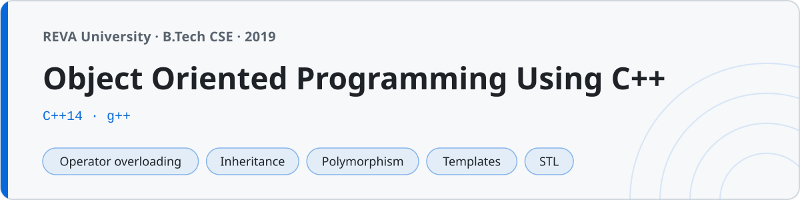

<p align="center"></p>

# Object Oriented Programming Using C++

C++ programs I wrote for **Object Oriented Programming Using C++** at **REVA University, Bengaluru** (B.Tech, 2019). The whole OOP progression — from `cout`/`cin` up through operator overloading, inheritance, virtual functions, templates, exceptions, file handling and the STL — plus the lab manual programs in `lab/`.

145 programs. Written following Balagurusamy, so the style is classic C++: `using namespace std;`, one class per file, nothing fancy.

## Structure

Folders in the order the topics were taught. Each builds on the one before.

| Folder | Topic | Files |
|---|---|---|
| `01-basics/` | `cout`/`cin`, data types, operators, control flow, references | 14 |
| `02-functions/` | Overloading, default args, inline, call by value/reference/pointer, recursion | 11 |
| `03-classes-and-objects/` | Classes, members, `this`, static members, friend functions and classes | 15 |
| `04-constructors-destructors/` | Default/parameterized/copy constructors, destructors, deep copy | 11 |
| `05-operator-overloading/` | Unary, binary, friend, `<<`/`>>`, `[]`, `=` | 12 |
| `06-inheritance/` | Single, multiple, multilevel, hierarchical, hybrid, virtual base | 13 |
| `07-polymorphism/` | Overriding, virtual functions, pure virtual/abstract, virtual destructors | 10 |
| `08-templates/` | Function and class templates, multiple params, specialization | 8 |
| `09-exception-handling/` | try/catch/throw, multiple catch, custom exceptions, rethrow | 8 |
| `10-file-handling/` | Text and binary I/O, objects to file, random access | 9 |
| `11-stl/` | vector, list, map, set, stack, queue, iterators, algorithms | 12 |
| `12-projects/` | Menu-driven programs and full classes (complex, matrix, string) | 6 |
| `lab/` | The 16 numbered lab-manual programs | 16 |

## Compiling

Every program is standalone. Compiled in the lab with `g++`:

```sh
cd 05-operator-overloading
g++ -std=c++14 BinaryPlusComplex.cpp -o complex
./complex
```

The file-handling programs write plain files (`data.txt`, `student.dat`) into the current directory. The STL folder is the only place that leans on `auto` and range-based `for` — everything before it is written the long way, the way it was taught first.

## The two lessons this course is really about

- **Deep copy.** A class that holds a `char*` (or any `new`-ed memory) needs its own copy constructor, or two objects end up sharing the same pointer and the destructor frees it twice. `04-constructors-destructors/DeepCopyString.cpp` and `12-projects/StringClass.cpp` do it properly; the commit history shows the version that didn't.
- **Virtual destructors.** Delete a derived object through a base pointer and the derived destructor only runs if the base destructor is `virtual`. `07-polymorphism/VirtualDestructor.cpp` prints both destructor messages because of that one keyword.

## Projects

The six in `12-projects/`:

- `StudentRecordSystem` / `BankingSystem` / `LibraryManagement` — menu-driven, class + records, `while(1)` + `switch`.
- `ComplexNumberClass` — a full `complex` class with `+ - *`, magnitude and `<<`.
- `MatrixClass` — matrix addition and multiplication through operator overloading.
- `StringClass` — a small `mystring` reimplementation with a proper deep copy, concat, length and compare.

## Lab

`lab/` holds the 16 numbered exercises from the lab manual, each opening with its problem statement and the compile command, because the lab record required both. `Lab14_FileObjectRecords` (writing student objects to a binary file and reading them back) and `Lab15_MatrixOperations` are the two everyone remembers from the practical exam.
