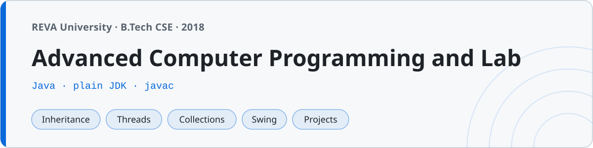

<p align="center"></p>

# Advanced Computer Programming (Java)

Java programs I wrote for **Advanced Computer Programming and Lab** at **REVA University, Bengaluru** (B.Tech, 3rd semester, 2018). Coming from a C background, this was the first real OOP course — everything from `System.out.println` to threads, collections and a working Swing calculator, plus the lab exercises in `lab/`.

172 programs. One class per file, filename matches the class, no packages except the one folder that teaches packages.

## Structure

Folders in the order the topics were taught:

| Folder | What's in it | Programs |
|---|---|---|
| `01-basics/` | Printing, variables, casting, Scanner input, operators | 14 |
| `02-control-flow/` | if/else, switch, loops, the usual number programs, patterns | 18 |
| `03-arrays/` | 1D and 2D arrays, searching, the three sorts, matrix operations | 13 |
| `04-strings/` | String methods, StringBuffer/StringBuilder, `==` vs `.equals` | 13 |
| `05-classes-and-objects/` | Constructors, `this`, `static`, overloading, encapsulation | 15 |
| `06-inheritance/` | extends, super, overriding, dynamic dispatch, abstract, final | 12 |
| `07-interfaces-and-packages/` | Interfaces, default methods, a real `mypack` package | 11 |
| `08-exception-handling/` | try/catch/finally, throw, throws, a custom exception | 10 |
| `09-multithreading/` | Thread, Runnable, join, synchronized, wait/notify | 10 |
| `10-collections/` | ArrayList, LinkedList, Vector, sets, maps, Comparator | 13 |
| `11-generics/` | Generic classes and methods, bounded types, a generic stack | 6 |
| `12-file-io/` | Readers/writers, byte streams, File class, serialization | 9 |
| `13-gui-swing/` | JFrame, events, layouts, a working calculator GUI | 8 |
| `14-projects/` | The big menu-driven programs | 6 |
| `lab/` | The 14 numbered lab exercises with their problem statements | 14 |

## Compiling and running

Everything is plain JDK — no build tool, no IDE project files. Compile a file, run the class:

```sh
cd 02-control-flow
javac Factorial.java
java Factorial
```

The one exception is the package demo, which has to be compiled from the folder root so `mypack` resolves:

```sh
cd 07-interfaces-and-packages
javac mypack/*.java PackageTest.java
java PackageTest
```

The Swing programs (`13-gui-swing/`, `lab/Lab14_EventHandling.java`) open a window, so they need a desktop session — everything else runs in a terminal.

The code was written on Java 8 in the lab and compiles unchanged on current JDKs. `Vector` and `Stack` are in the collections folder because they were still on the syllabus, not because anyone should use them.

## Things this course beat into me

- `==` on two strings compares references, not contents. `04-strings/StringCompare.java` exists because of the hour that lesson cost me.
- `scanner.nextInt()` doesn't consume the newline, so a following `nextLine()` reads an empty string. The fix (an extra `nextLine()`) is in `01-basics/ScannerInput.java`.
- Without `synchronized`, two threads incrementing the same counter 10000 times each don't produce 20000. `09-multithreading/SynchronizedDemo.java` prints the right answer; getting there took a while.
- The parent-class exception has to come last in a multi-catch, `super()` has to be the first line, and the compiler will remind you of both, loudly.

## Projects

The six in `14-projects/` are menu-driven console programs built around a class plus an `ArrayList` — a student record system, a bank account with a mini statement, a small library manager, a five-question quiz, a two-player tic-tac-toe with full win/draw detection, and a matrix calculator. `13-gui-swing/CalculatorGUI.java` is the same calculator idea with buttons.

## Lab

`lab/` holds the numbered exercises from the lab manual. Each file opens with the problem statement and the compile command, because the lab record required both. `Lab11_ThreadDemo` (three threads printing squares, cubes and randoms) is the one everyone remembers — the interleaved output finally makes threads feel real.
