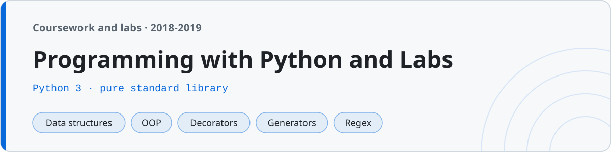

<p align="center"></p>

# Programming with Python and Labs

Learning Python from the ground up, in pure standard library — no frameworks, just the language. I picked this up in three stretches around coursework: the basics over a winter break (Dec 2018), the meat of it — data structures, functions, OOP, files — through the middle of 2019, and the advanced bits (decorators, generators, regex, a few projects) over the next winter break (Dec 2019).

113 small programs, each one runs with plain `python3`. Nothing here needs `pip install`.

## Layout

The folders go in learning order, which is also roughly the order I wrote them.

### Basics
| Folder | Covers |
|---|---|
| `01-basics/` | variables, data types, operators, I/O, type conversion |
| `02-control-flow/` | if/elif/else, loops, prime, factorial, Fibonacci, Armstrong |
| `03-strings/` | slicing, methods, palindrome, anagram, char frequency |
| `04-patterns/` | star/number/pyramid/Floyd/Pascal patterns |

### Intermediate
| Folder | Covers |
|---|---|
| `05-data-structures/` | lists, tuples, sets, dicts, nested, matrix, sort/search |
| `06-functions/` | args/kwargs, default/keyword, lambda, recursion, scope |
| `07-comprehensions/` | list/dict/set comprehensions, generator expressions |
| `08-oop/` | classes, inheritance, polymorphism, encapsulation, dunder methods, abstract classes |
| `09-files-exceptions/` | read/write, CSV, JSON, try/except/finally, custom exceptions |
| `10-modules/` | writing a module, importing, the `__name__` guard |

### Advanced
| Folder | Covers |
|---|---|
| `11-decorators/` | function decorators, decorators with args, `functools.wraps` |
| `12-generators-iterators/` | `yield`, generators, custom iterators, `itertools` |
| `13-functional/` | map/filter/reduce, closures, `partial`, higher-order functions |
| `14-regex/` | `re` — match, search, groups, substitution, validation |
| `15-stdlib/` | `collections`, `datetime`, `random`, `os`, `itertools` |
| `16-projects/` | calculator, number guessing, to-do list, bank account, quiz, contact book |

`notes/` has a Python quick reference and a practice bank; `lab/` has a manual listing every program.

## Running

Everything is plain Python 3:

```sh
python3 02-control-flow/prime.py            # reads a number, says prime or not
python3 04-patterns/pyramid.py              # reads rows, prints a pyramid
python3 08-oop/polymorphism.py              # shape areas via a common method
python3 16-projects/bank_account.py         # menu-driven, deposit/withdraw/balance
```

The programs that read input use `input()`; pipe it in for a non-interactive run:
```sh
echo 17 | python3 02-control-flow/prime.py      # -> 17 is prime
echo 153 | python3 02-control-flow/armstrong.py # -> 153 is an Armstrong number
```

Written for Python 3.6+ idioms (f-strings, no `match`/walrus), so it runs on anything reasonably modern.

## A note on the code

This is learner code and it looks like it — short names, top-level scripts for the small stuff, `if __name__ == "__main__"` only where a file is actually meant to be imported (the module and the projects), and comments only where I needed a reminder. The projects have the usual student rough edges (a bubble sort without the early-exit flag, a menu loop that trusts its input). I left all of that as it was — it's how I actually learned it.
