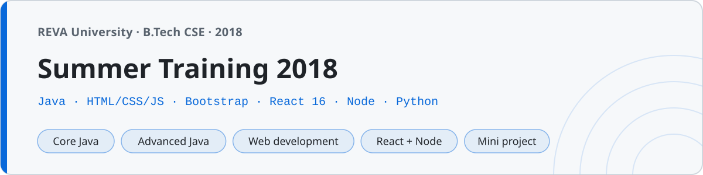

<p align="center"></p>

# Summer Camp 2018

Everything I wrote during a summer training program in Bengaluru, June to August 2018, between my second and third year at REVA University. Four tracks over ten weeks: Java (core and advanced), web development (HTML, CSS, JavaScript, Bootstrap), a React and Node introduction, and basic Python at the end.

131 files. It's a training-center repo, not a portfolio — small follow-along exercises, the day's topic, and a few things built to make sure it stuck. The last folder is the mini project I put together at the end.

## Tracks

| Folder | Track | Files |
|---|---|---|
| `01-core-java/` | Java from zero — syntax, loops, arrays, strings, first classes and objects | 28 |
| `02-advanced-java/` | Collections, generics, threads, lambdas and streams, files, regex, sockets, JDBC | 18 |
| `03-html-css/` | Tags, forms, tables, selectors, box model, flexbox, and a portfolio page | 14 |
| `04-javascript/` | Language basics, DOM, events, form validation, a todo list, a calculator, jQuery | 16 |
| `05-bootstrap/` | Bootstrap 4.1 — grid, components, navbar, cards, a landing page | 6 |
| `06-react/` | React 16 via CDN script tags, then a create-react-app todo project | 12 |
| `07-node/` | Node basics — modules, fs, http, events — and a small Express API | 11 |
| `08-python/` | Python 3 basics through file handling and three small programs | 20 |
| `09-mini-project/` | Contact Book — Bootstrap page + Express backend tying the web and node tracks together | 6 |

## Running things

**Java** — plain JDK, one class per file:

```sh
cd 01-core-java
javac FirstProgram.java && java FirstProgram
```

`JdbcDemo.java` compiles but needs the MySQL connector jar on the classpath (and a database) to actually run — that was the training-center setup, not mine.

**Web** — open the `.html` files in a browser. The Bootstrap, jQuery and React pages pull 2018-pinned versions from CDNs (Bootstrap 4.1.1, jQuery 3.3.1, React 16), so they need an internet connection.

**React project** — `06-react/todo-app/` is a create-react-app 1.x project (`react-scripts 1.1.4`). `npm install && npm start` worked on the 2018 toolchain it was written on; on a current Node it won't build without upgrading react-scripts, so read it as source.

**Node** — the plain scripts run with `node`. The API needs its dependencies first:

```sh
cd 07-node/notes-api
npm install
npm start          # GET/POST/DELETE on localhost:3000/notes
```

**Python** — `python3 08-python/01_hello.py` and so on.

**Mini project** — the Contact Book in `09-mini-project/` needs its dependencies, then serves the page and the API together:

```sh
cd 09-mini-project
npm install
npm start          # open http://localhost:3000
```

## What stuck

The trainer's line about Java 8 — "lambdas are the interview question now" — turned out to be true. The `02-advanced-java` streams files got reread a lot before campus placements.

`==` bit me twice in one summer: once in Java, comparing strings in a login exercise and getting `false` for equal values, and once in JavaScript, where `0 == ""` is somehow `true`. The `===` habit dates from this camp.

The web track went HTML → CSS → JS → Bootstrap → React in six weeks, which was too fast, and the React class-component lifecycle only made sense a year later. The CDN demos in `06-react/` (script tags + babel-standalone, the way it was taught before the build step) are still the clearest record of what a component actually is.

Python was the last week and felt like a holiday after Java — half the file count for the same ideas.
