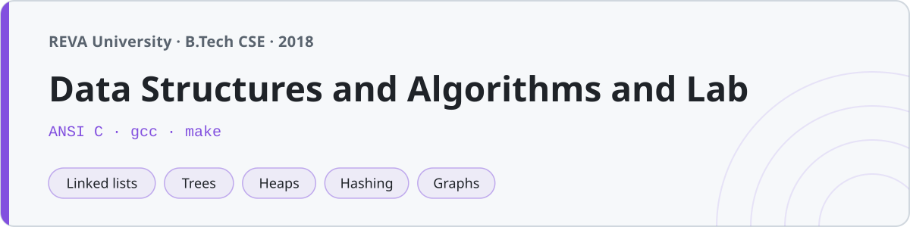

<p align="center"></p>

# Data Structures and Algorithms and Lab

C programs from Data Structures and Algorithms at **REVA University, Bengaluru** (B.Tech, third semester, 2018). Everything from asymptotic analysis and recursion up through graphs and the algorithm-design paradigms, plus the numbered lab exercises in `lab/`.

148 programs. This is the course where C stops being about printing patterns and starts being about pointers that actually go somewhere — linked lists, trees, graphs, and the classic algorithms on top of them. Notes for each topic live in that topic's `NOTES.md`.

## Structure

The folders build on each other, roughly the order the topics were taught.

| Folder | What's in it | Programs |
|---|---|---|
| `01-analysis/` | Big-O / Ω / Θ, counting operations, timing programs that show the growth curves | 3 |
| `02-recursion/` | Factorial, Fibonacci, Hanoi, permutations, Ackermann | 10 |
| `03-searching/` | Linear, binary (iterative + recursive), interpolation, first/last occurrence | 6 |
| `04-sorting/` | Bubble, selection, insertion, shell, merge, quick, heap, counting, radix, bucket | 12 |
| `05-stacks/` | Array + linked stack, infix/postfix/prefix conversion and evaluation | 12 |
| `06-queues/` | Linear, circular, linked, deque, priority queue, Josephus | 10 |
| `07-linked-lists/` | Singly / doubly / circular, Floyd's cycle, polynomials, sparse matrix | 18 |
| `08-trees/` | Binary tree, BST, traversals, AVL, expression tree, LCA, diameter | 16 |
| `09-heaps/` | Max/min heap, heap sort, priority queue, k-th largest, merge k sorted | 8 |
| `10-hashing/` | Chaining, linear / quadratic probing, double hashing, applications | 8 |
| `11-graphs/` | Matrix + list, BFS, DFS, Dijkstra, Prim, Kruskal, Bellman-Ford, Floyd-Warshall | 16 |
| `12-algorithms/` | Divide & conquer, greedy, dynamic programming, backtracking | 14 |
| `lab/` | The 15 numbered lab-manual exercises | 15 |

## Compiling

Plain ANSI C, builds with `gcc`. Nothing needs an IDE or an external library.

```sh
gcc -std=c99 -Wall 08-trees/02_bst.c -o bst
./bst
```

Most of the stack / queue / linked-list / tree / graph programs are menu-driven — a `while(1)` loop over a `switch`, the way they were written for the lab record. The sorts, searches and traversals just build a sample and run.

To build everything at once into `bin/`:

```sh
make          # compiles all 148 into bin/
make clean
```

## The graph programs

`11-graphs/` reads the graph from standard input. The unweighted ones take an adjacency matrix; the weighted ones take a cost matrix (`0` meaning "no edge" off the diagonal), and Kruskal and Bellman-Ford take an edge list because they iterate over edges. Each program's expected answer on a small sample graph was checked by hand — for example the sample used across BFS/DFS gives visit order `0 1 2 3 4` from vertex 0, and Dijkstra on the weighted version gives distances `0 4 7 10 8`.

## Lab

`lab/` holds the 15 exercises from the lab manual, in the order they were assigned — stack operations, expression conversion, the four kinds of linked list, BST, traversals, graph BFS/DFS, hashing, and the three O(n log n) sorts. Each file opens with the problem statement as a short comment, because the lab record wanted it there.

The one that took the longest was `lab09_binary_search_tree.c` — deleting a node with two children (replace it with its inorder successor) is the case everybody gets wrong the first time. Tested it by deleting the root and checking the inorder traversal stayed sorted with nothing missing.

## A note on the code

Third-year-of-school code, and it reads like it. Buffers are fixed at `[100]`, `scanf` return values go unchecked, bubble sort has no early-exit flag, and a few of the menu programs will spin if you pipe them input without ever choosing Exit. All left as written — it's the record of what I actually turned in.
