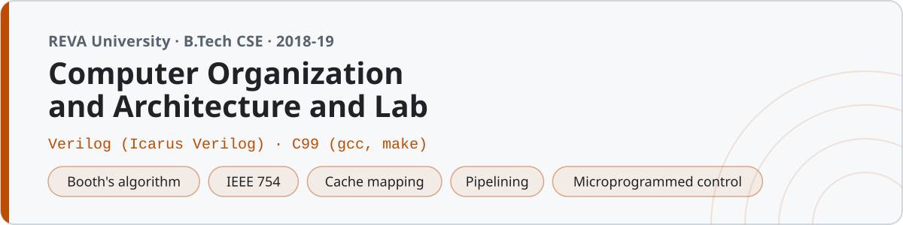

<p align="center"></p>

# Computer Organization and Architecture

Notes, simulations and lab work from Computer Organization and Architecture at **REVA University, Bengaluru** (B.Tech CSE, third semester, 2018). This is the course where the machine stops being magic — you find out what actually happens between pressing enter and seeing output.

Three kinds of things live here: revision notes for every unit (written to be read the night before an internal), C programs that trace the classic algorithms step by step the way you'd write them in an exam, and Verilog for every circuit — because drawing a full adder is one thing and watching your own testbench prove it is another. The college lab runs ModelSim; everything here also runs on [Icarus Verilog](http://iverilog.icarus.com/) at home.

## Structure

| Folder | Unit | What's in it |
|---|---|---|
| `01-number-systems-and-codes/` | Number systems | Conversions, 2's complement, BCD, Gray, Hamming SEC — notes + 5 C programs |
| `02-boolean-algebra-and-gates/` | Boolean algebra | K-maps, De Morgan, universal gates — notes, 2 C programs (one is a small Quine-McCluskey minimizer), gates in Verilog |
| `03-combinational-circuits/` | Combinational design | Adders (ripple + carry-lookahead), mux, decoder, comparator — 7 Verilog modules with testbenches |
| `04-sequential-circuits/` | Sequential design | D/JK/T flip-flops, counters, shift registers, Johnson counter — 7 Verilog modules with testbenches |
| `05-basic-computer-organization/` | Machine organization | Von Neumann, registers, the instruction cycle — and `acc_simulator.c`, a small accumulator machine that traces fetch-decode-execute |
| `06-instruction-set-and-addressing/` | ISA | 3/2/1/0-address formats, all the addressing modes — 2 C programs that walk them on a toy memory |
| `07-computer-arithmetic/` | Arithmetic | Booth's algorithm, restoring/non-restoring division, IEEE 754 — 4 C programs that print the same step tables the notes use |
| `08-processor-and-control/` | Control unit | Control sequences, hardwired vs microprogrammed — a 4-bit ALU in Verilog and a microprogrammed control simulator in C |
| `09-memory-organization/` | Memory | Cache mapping (direct/associative/set-associative), replacement, write policies — field splitter and a cache simulator in C |
| `10-io-and-pipelining/` | I/O and pipelining | Interrupts, DMA, 5-stage pipeline with hazards — notes + a pipeline space-time diagram generator |
| `notes/` | — | `quick-reference.md` (every formula and table on one page) and `exam-prep.md` (the questions that keep appearing) |
| `lab/` | — | The twelve lab experiments, one folder each |

## Running things

**C** — everything is plain C99:

```sh
gcc -std=c99 -Wall 07-computer-arithmetic/booth_multiplier.c -o booth
./booth
```

or build all twenty at once into `bin/` with `make` (`make clean` removes them).

**Verilog** — each design file `name.v` has a matching testbench `name_tb.v`, and each testbench carries its own run command as a comment. The general shape:

```sh
cd 04-sequential-circuits
iverilog -o counter counter4.v counter4_tb.v && vvp counter
```

Testbenches print their truth table or trace to the terminal and `$finish` — no waveform viewer needed, though you can add `$dumpfile`/`$dumpvars` and open GTKWave if you want the pretty picture.

Install Icarus Verilog with `brew install icarus-verilog` (or `apt install iverilog`).

## Lab

Twelve experiments. Each folder is the full record — aim, tools, theory, design, code, observations, result — and the observations block is the literal output of the testbench, not a retyped version of it.

| # | Experiment | Date | Language |
|---|---|---|---|
| 1 | Logic gates | 29/08/2018 | Verilog |
| 2 | Half and full adder | 05/09/2018 | Verilog |
| 3 | 4-bit adder-subtractor | 12/09/2018 | Verilog |
| 4 | Multiplexer and demultiplexer | 19/09/2018 | Verilog |
| 5 | Decoder and priority encoder | 03/10/2018 | Verilog |
| 6 | Magnitude comparator | 10/10/2018 | Verilog |
| 7 | Flip-flops (SR, D, JK, T) | 24/10/2018 | Verilog |
| 8 | Up/down and decade counters | 31/10/2018 | Verilog |
| 9 | Shift registers | 21/11/2018 | Verilog |
| 10 | 4-bit ALU | 28/11/2018 | Verilog |
| 11 | Booth's multiplication | 05/12/2018 | C |
| 12 | Cache mapping simulation | 07/12/2018 | C |

The lab copies of circuits that also appear in the unit folders are not identical files — they were written separately and differ in small ways, which is what happens when you type a thing twice.

## The programs worth reading first

- **`05-basic-computer-organization/acc_simulator.c`** — an 8-instruction accumulator machine (LDA/STA/ADD/SUB/JMP/JZ/OUT/HLT) with a program in its memory that multiplies by repeated addition. It prints PC, IR and ACC after every instruction, which is exactly the trace you do on paper in the exam, except the machine never misplaces a carry.
- **`07-computer-arithmetic/booth_multiplier.c`** — Booth's with the full A/Q/Q₋₁ step table. The arithmetic right shift has to carry the sign bit along; doing it with a plain logical shift is the classic mistake (ask me how I know).
- **`08-processor-and-control/microprogram_sim.c`** — a control store actually driving a datapath, micro-step by micro-step. Makes the hardwired-vs-microprogrammed section of the notes feel less abstract.
- **`02-boolean-algebra-and-gates/quine_mccluskey.c`** — wrote this after reading that K-maps stop working past four variables. It agrees with the K-map example in the notes, which was a relief.

## A note on the numbers

Every worked example in the notes was recomputed before it was written down, every C program compiles clean under `-Wall`, and every one of the 34 testbenches runs to `$finish` with the output shown in the lab records. The step tables printed by the arithmetic programs match the tables in the notes because the exam answer and the program output should be the same thing.
