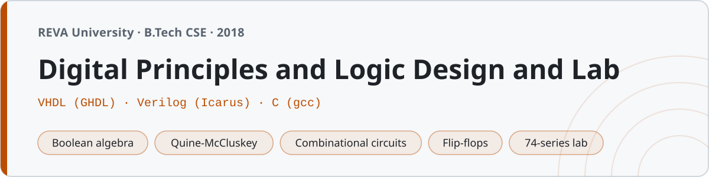

<p align="center"></p>

# Digital Principles and Logic Design and Lab

Coursework from Digital Principles and Logic Design at **REVA University, Bengaluru** (B.Tech, third semester, 2018). Unit notes, HDL designs, C simulations, and the 74-series lab records — everything from number systems to counters in one place.

The lab was taught in VHDL, so most of the HDL here is VHDL with self-checking testbenches. There are a handful of Verilog programs too (the lab also touched Verilog), a set of C programs that simulate the logic — which tied in nicely with the C course from first year — and the twelve breadboard experiments we actually wired up with 74-series ICs.

97 files. All the HDL and C is verified: it analyses, elaborates and runs.

## Structure

| Folder | Contents |
|---|---|
| `01-number-systems/` | Notes + C: base conversions, 1's/2's complement, complement subtraction |
| `02-binary-codes/` | Notes + C: BCD, gray, excess-3, parity |
| `03-boolean-algebra/` | Notes + C: laws, DeMorgan, minterms, truth-table generation |
| `04-logic-gates/` | Notes + C: gates and universal-gate realizations |
| `05-minimization/` | Notes + C: K-map theory and a working **Quine-McCluskey minimizer** |
| `06-combinational-circuits/` | Notes + C: adders, mux, decoder, comparator, 7-segment |
| `07-sequential-circuits/` | Notes + C: SR/D/JK/T flip-flops, characteristic & excitation tables |
| `08-registers-counters/` | Notes + C: shift registers, ripple/Johnson counters |
| `09-memory-and-plds/` | Notes + C: RAM/ROM, PROM/PLA/PAL, ROM-as-lookup |
| `vhdl/` | 21 VHDL designs, each with a self-checking testbench (42 files) |
| `verilog/` | 5 Verilog designs with testbenches |
| `lab/` | 12 breadboard experiments (74-series ICs), full lab records |
| `notes/` | Boolean identities, flip-flop tables, 74xx pinout reference, exam prep |

## Running the HDL

**VHDL** with GHDL — the testbenches are self-checking and print `all cases passed`:

```sh
cd vhdl
ghdl -a full_adder.vhd full_adder_tb.vhd
ghdl -e full_adder_tb
ghdl -r full_adder_tb
```

The structural 4-bit adder reuses the full adder, so analyse that first:

```sh
ghdl -a full_adder.vhd ripple_adder_4bit.vhd ripple_adder_4bit_tb.vhd
ghdl -e ripple_adder_4bit_tb && ghdl -r ripple_adder_4bit_tb
```

Everything targets the default GHDL standard (VHDL-93) and uses `ieee.numeric_std` for arithmetic — no `std_logic_arith`. Each design file carries its exact `ghdl` command on line one.

**Verilog** with Icarus Verilog — testbenches count errors and print `0 errors`:

```sh
cd verilog
iverilog -o full_adder.vvp full_adder.v full_adder_tb.v
vvp full_adder.vvp
```

**C** simulations with gcc, same as any C program:

```sh
gcc -std=c99 -Wall 05-minimization/quine_mccluskey.c -o qm
./qm
```

Install the tools with `brew install ghdl icarus-verilog` (or `apt install ghdl iverilog`).

## The Quine-McCluskey program

`05-minimization/quine_mccluskey.c` is the one worth a look — it reads a minterm list and prints the prime implicants and a minimized SOP. It groups by bit-count, combines terms differing in one bit, collects the prime implicants, then picks the essential ones and greedily covers the rest. It self-checks by expanding its answer back to minterms. On Σm(0,1,2,4,5) it prints `F = B' + A'C'`.

## Lab

Twelve breadboard experiments, each folder a full record — aim, ICs, pin diagram, theory, truth table, procedure, result.

| # | Experiment | IC | Date |
|---|---|---|---|
| 1 | Basic logic gates | 7408/7432/7404/7400/7402/7486 | 30/08/2018 |
| 2 | DeMorgan's theorems | 7400/7402/7404/7408/7432 | 06/09/2018 |
| 3 | Universal gates | 7400, 7402 | 13/09/2018 |
| 4 | Half & full adder | 7486, 7408, 7432 | 20/09/2018 |
| 5 | 4-bit adder | 7483 | 27/09/2018 |
| 6 | 8:1 multiplexer | 74151 | 11/10/2018 |
| 7 | 3:8 decoder | 74138 | 18/10/2018 |
| 8 | BCD to 7-segment | 7447 | 25/10/2018 |
| 9 | JK flip-flop | 7476 | 08/11/2018 |
| 10 | Decade counter | 7490 | 15/11/2018 |
| 11 | Shift register | 7495 | 22/11/2018 |
| 12 | Magnitude comparator | 7485 | 29/11/2018 |

The pin numbers in the records are the real datasheet pinouts, including the ones that trip everyone up — the 7483, 7490 and 7476 don't put VCC and GND on the corner pins, and forgetting that is why the circuit sits there doing nothing.
