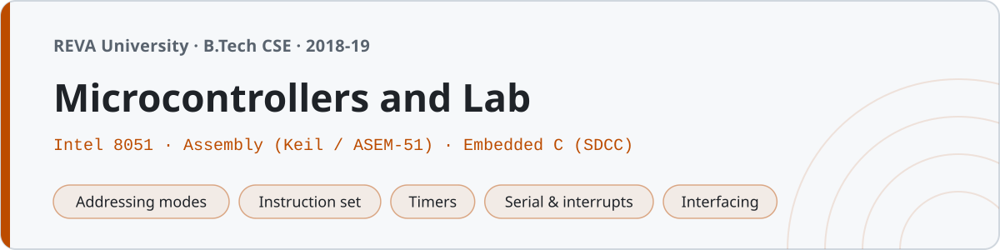

<p align="center"></p>

# Microcontrollers and Lab

Notes, assembly programs and embedded C from the Microcontrollers course at **REVA University, Bengaluru** (B.Tech CSE, fourth semester, 2018–19). The chip is the **Intel 8051** — the one everybody learns first, and the one where you finally see registers, ports, timers and interrupts as real things with addresses rather than boxes in a diagram.

Two languages live here. **Assembly** (Keil / ASEM-51 syntax, the way it's written in the lab and in Mazidi) for everything up to interrupts, and **embedded C** (compiled with [SDCC](https://sdcc.sourceforge.net/)) for the interfacing programs, because writing an LCD driver in assembly is a punishment nobody deserves twice.

## Structure

| Folder | Unit | What's in it |
|---|---|---|
| `01-introduction/` | Microcontroller basics | MPU vs MCU, the 8051 family, features, architecture — notes |
| `02-architecture-and-memory/` | Architecture & memory | Pinout, program/data memory, register banks, the SFR map, PSW, the stack — notes |
| `03-addressing-modes/` | Addressing modes | The five modes, with small assembly programs for each |
| `04-instruction-set/` | Instruction set | Data transfer, arithmetic, logical, branch, bit — notes + demo programs |
| `05-assembly-programming/` | Assembly basics | Directives, delay loops, subroutines, the first real programs |
| `06-arithmetic-programs/` | Arithmetic | 8- and 16-bit add/subtract, MUL, DIV, BCD, square — assembly |
| `07-data-manipulation/` | Data handling | Block move, largest/smallest, bubble sort, counting — assembly |
| `08-timers-and-counters/` | Timers | TMOD/TCON, the four modes, delays, square waves — notes + assembly |
| `09-serial-and-interrupts/` | Serial & interrupts | UART, baud rate, the six interrupts and their vectors — notes + assembly |
| `10-interfacing-embedded-c/` | Interfacing in C | LEDs, seven-segment, LCD, stepper, DAC — embedded C (SDCC) |
| `notes/` | — | `quick-reference.md` (every SFR, table and formula on one page) and `exam-prep.md` |
| `lab/` | — | The fourteen lab experiments, one folder each |

## Running things

**Embedded C** compiles with SDCC for the 8051 target:

```sh
cd 10-interfacing-embedded-c
sdcc -mmcs51 led_blink.c      # produces led_blink.ihx
```

Install it with `brew install sdcc` (or `apt install sdcc`). The `.ihx` is Intel HEX — burn it to a chip or load it into a simulator (s51/ucsim ships with SDCC, or use Keil/Proteus). SDCC drops a pile of intermediate files (`.lst .map .rel .sym .mem .asm`); they're gitignored.

**Assembly** is written for **Keil µVision** / ASEM-51 — standard 8051 mnemonics with `ORG`, `H`-suffix hex, SFR names and `END`, exactly as taught. Assemble in Keil, or with ASEM-51, then run in the Keil simulator or Proteus. Each `.asm` ends with a comment stating the result it produces so you can check it against the simulator:

```
; result: 40H = 17H (sum), 41H = 01H (carry)
```

I don't have Keil on this machine, so the assembly wasn't machine-assembled here — instead every program's result was re-derived by hand and checked, and the numbers in the notes and lab records were all recomputed. The embedded C, on the other hand, really does compile with SDCC.

## Lab

Fourteen experiments. Each folder is the full record — aim, tools, algorithm, program, result. The first eleven are assembly (data transfer through external interrupts); the last three are embedded C (LED blink, seven-segment, DAC waveform).

| # | Experiment | Date | Language |
|---|---|---|---|
| 1 | Block data transfer | 30/11/2018 | ASM |
| 2 | 8/16-bit addition & subtraction | 07/12/2018 | ASM |
| 3 | Multiplication & division | 14/12/2018 | ASM |
| 4 | Largest & smallest in an array | 04/01/2019 | ASM |
| 5 | Ascending & descending sort | 11/01/2019 | ASM |
| 6 | Counting (even/odd, +/−) | 18/01/2019 | ASM |
| 7 | Code conversion (BCD/ASCII/hex) | 25/01/2019 | ASM |
| 8 | Block exchange | 01/02/2019 | ASM |
| 9 | Square wave via timer | 08/02/2019 | ASM |
| 10 | Serial transmission (9600 baud) | 15/02/2019 | ASM |
| 11 | External interrupt | 22/02/2019 | ASM |
| 12 | LED blinking | 05/03/2019 | C |
| 13 | Seven-segment 0–9 | 12/03/2019 | C |
| 14 | DAC waveform | 19/03/2019 | C |

The lab copies of programs that also appear in the unit folders were written separately and differ a little, the way they do when you type a thing twice.

## The numbers that matter

Two calculations show up in every 8051 exam and both are worked out in the notes:

- **Timer reload** (12 MHz crystal, 1 µs per machine cycle): for a delay of *D* µs in mode 1, load `65536 − D` into TH:TL. A 1 ms delay → 65536 − 1000 = 64536 = 0FC18H, so TH0 = 0FCH, TL0 = 18H.
- **Baud rate** (11.0592 MHz, Timer1 mode 2): `TH1 = 256 − 11059200 / (384 × baud)`. For 9600 baud that's 256 − 3 = 253 = 0FDH — which is exactly why every 8051 board runs an 11.0592 MHz crystal instead of a round 12.

Every such value in the notes and lab records was recomputed before it was written down.
