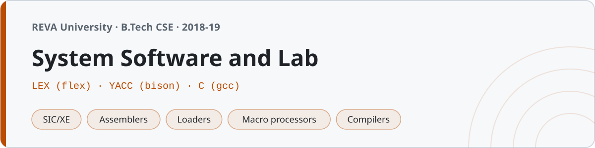

<p align="center"></p>

# System Software and Lab

Coursework from System Software at **REVA University, Bengaluru** (B.Tech, fourth semester, 2018–19). Theory notes on the SIC/XE machine, assemblers, loaders, linkers, macro processors and compilers, plus the lab — LEX programs, YACC programs, and C system programs.

The lab is the classic one: `flex` and `yacc` on one side, and the C implementations of the assembler passes, the macro processor and the loader on the other. All of it builds and runs.

## Structure

| Folder | Contents |
|---|---|
| `01-introduction/` | System vs application software, the components |
| `02-machine-architecture/` | SIC and SIC/XE — registers, formats, addressing modes |
| `03-assemblers/` | Two-pass assembler, OPTAB/SYMTAB/LOCCTR, object program, relocation |
| `04-loaders-linkers/` | Absolute, bootstrap, relocating, linking loaders, dynamic linking |
| `05-macro-processors/` | Definition/expansion, DEFTAB/NAMTAB/ARGTAB, conditional expansion |
| `06-compilers/` | Phases of a compiler, grammars, analysis vs synthesis |
| `07-lex/` | The LEX tool — regex, program structure, yytext/yywrap |
| `08-yacc/` | The YACC tool — CFGs, shift-reduce parsing, LEX integration |
| `lab/lex/` | Part A — 12 LEX programs |
| `lab/yacc/` | Part B — 8 YACC programs |
| `lab/c/` | Part C — two-pass assembler, macro processor, absolute loader |
| `notes/` | SIC/XE reference, LEX/YACC reference, exam prep |

## Building the lab

**LEX** (`lab/lex/`):
```sh
flex wc.l && gcc lex.yy.c -o wc
./wc < input
```

**YACC** (`lab/yacc/`) — with a LEX lexer, generate the token header first:
```sh
yacc -d calculator.y && flex calculator.l && gcc y.tab.c lex.yy.c -o calc
echo "2+3*4" | ./calc        # = 14
```
The small grammars (aⁿbⁿ, balanced parentheses) define `yylex()` inline, so they need no `.l`:
```sh
yacc -d anbn.y && gcc y.tab.c -o anbn
```

**C system programs** (`lab/c/`):
```sh
gcc -std=c99 -Wall pass1.c -o pass1 && ./pass1     # SYMTAB + program length
gcc -std=c99 -Wall pass2.c -o pass2 && ./pass2     # object program
```

Everything targets the system flex 2.6.4 and bison 2.3 (classic YACC), so no bison-3-only features. Install with `apt install flex bison` (already present on macOS as `flex`/`bison`).

## The two-pass assembler

`lab/c/pass1.c` and `lab/c/pass2.c` are the ones worth reading. Pass 1 reads the SIC source (`input.txt`) and the opcode table (`optab.txt`), assigns addresses with a location counter, builds the symbol table, and reports the program length. Pass 2 turns the intermediate file into the object program. On the standard COPY example:

```
Program length = 0012
FIRST 1000 · ALPHA 1009 · ONE 100C · BETA 100F

H^COPY  ^001000^000012
T^001000^0F^031009^18100C^0C100F^000005^000001
E^001000
```

`macro_processor.c` expands macro definitions with positional parameters, and `absolute_loader.c` reads an H/T/E object program and lays the bytes into a memory image.

## A note on the LEX/YACC programs

These are the standard lab exercises — word count, vowel/consonant count, keyword vs identifier, comment counting, a tokenizer (Part A); a desk calculator, expression and declaration validators, and the aⁿbⁿ / aᵐbⁿ / balanced-parenthesis grammars (Part B). Each source carries its exact build command on the first line.
