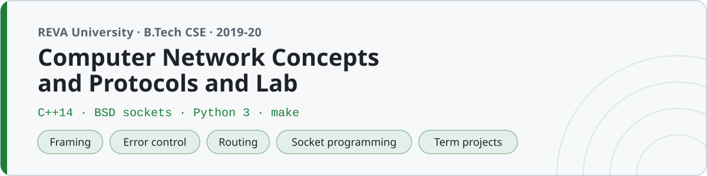

<p align="center"></p>

# Computer Network Concepts and Protocol and Lab

C++ and Python code from Computer Network Concepts and Protocols at **REVA University, Bengaluru** (B.Tech, fifth semester, 2019–20). This is the course where the algorithms meet the wire — sockets, protocols, framing, error control, routing — so most of it is real networking code you can actually run, not just diagrams.

C++ for the protocol logic and the socket programming (BSD sockets), Python for the network tools where the `ipaddress` and `socket` modules do the heavy lifting.

## Structure

The folders follow the layers, bottom to top, then the tools, security, labs and projects.

| Folder | What's in it | Lang |
|---|---|---|
| `01-introduction/` | OSI & TCP/IP models, IP classes, MAC, delays | C++ |
| `02-data-link-layer/` | Framing (bit/char stuffing), CRC, checksum, Hamming | C++ |
| `03-flow-and-error-control/` | Stop-and-wait, Go-Back-N, Selective Repeat, sliding window | C++ |
| `04-mac-sublayer/` | ALOHA, CSMA/CD, CSMA/CA, token passing | C++ |
| `05-network-layer/` | Subnetting/CIDR, Dijkstra, Bellman-Ford, distance/link-state routing, ARP | C++ |
| `06-transport-layer/` | Leaky/token bucket, TCP congestion control, 3-way handshake, RTT | C++ |
| `07-application-layer/` | HTTP, DNS, DHCP, URL/cookie/base64 | C++ / Python |
| `08-socket-programming/` | TCP & UDP client-server, concurrent (fork), select(), file transfer | C++ |
| `09-network-tools/` | Subnet calculator, port scanner, packet parser, checksum | Python |
| `10-network-security/` | Caesar, Vigenère, rail-fence, RSA, Diffie-Hellman, SHA | C++ / Python |
| `lab/` | The 15 numbered lab programs | C++ / Python |
| `projects/` | Three term projects (chat, file transfer, HTTP server) | C++ |

Each topic folder has a `NOTES.md` explaining the layer or concept.

## Building and running

The C++ programs use BSD sockets, which work on macOS and Linux as-is:

```sh
g++ -std=c++14 -Wall 08-socket-programming/01_tcp_server.cpp -o srv
g++ -std=c++14 -Wall 08-socket-programming/02_tcp_client.cpp -o cli
./srv &        # start the server first
./cli          # then the client
```

The Python tools are standard-library only (no pip installs):

```sh
python3 09-network-tools/01_subnet_calculator.py 192.168.1.0/26
```

To build every C++ program at once into `bin/`:

```sh
make          # compiles all the .cpp into bin/
make clean
```

### One socket gotcha

Every server here calls `::bind(...)` rather than `bind(...)`. With `using namespace std;`, plain `bind` resolves to `std::bind` (from `<functional>`) and the socket bind won't compile — the `::` forces the global one. Same reason `05-network-layer` avoids a variable named `distance`. Little things you only learn by hitting them.

## Socket programming and projects

`08-socket-programming/` is the core: TCP and UDP client-server pairs, an echo server, a `fork()`-per-client concurrent server, a `select()`-based multiplexed server, and a chunked file transfer. Each uses its own port (9101–9107) so several can run at once, and every server sets `SO_REUSEADDR` so a quick re-run doesn't hit "address already in use".

The three projects in `projects/` are the bigger builds:

- **project-1-multi-client-chat** — a `select()`-based chat server that broadcasts each message to all other connected clients.
- **project-2-file-transfer** — sends a file over TCP with a small `size filename` header; the received copy is byte-identical to the original.
- **project-3-mini-http-server** — a minimal HTTP/1.0 server that serves files from its directory (`200`/`404`/`403`), testable with `curl http://127.0.0.1:9303/index.html`.

All of them, and the socket labs, were tested on loopback (`127.0.0.1`) — nothing here talks to an external host.

## A note on the code

Fifth-semester code — `using namespace std;`, short names (`s`, `fd`, `cli`, `srv`, `buf`), fixed buffers, error checks only where a socket call actually burned me once. It's the code as submitted, gotchas and all, not a tidied-up rewrite.
