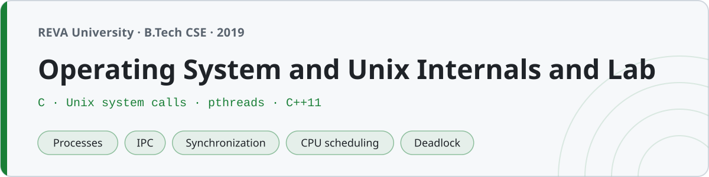

<p align="center"></p>

# Operating System and Unix Internals and Lab

Coursework from Operating Systems and Unix Internals at **REVA University, Bengaluru** (B.Tech, fifth semester, 2019). Unit notes on the core OS concepts, and the lab — Unix system programming in C and the OS algorithm simulations in C++.

The point of this one was to actually *see* the concepts run: fork a process and watch it become a zombie, race two threads on a counter and watch updates get lost, then put a mutex on it and watch the number come out right. Everything here builds and runs.

## Structure

| Folder | Topic | Language |
|---|---|---|
| `01-introduction/` | OS overview, Unix architecture, system calls, dual mode | notes |
| `02-process-management/` | fork, exec, wait, zombie, orphan, process tree | C |
| `03-signals/` | signal, sigaction, alarm, kill, ignore | C |
| `04-ipc/` | pipes, FIFO, shared memory, message queues | C |
| `05-threads/` | pthread create/join, args, parallel sum | C |
| `06-synchronization/` | race, mutex, producer-consumer, readers-writers, dining philosophers, semaphore | C |
| `07-cpu-scheduling/` | FCFS, SJF, Round Robin, Priority | C++ |
| `08-memory-management/` | first/best/worst fit, FIFO/LRU/Optimal paging | C++ |
| `09-deadlock/` | Banker's algorithm, deadlock detection | C++ |
| `10-disk-scheduling/` | FCFS, SSTF, SCAN, C-SCAN, LOOK | C++ |
| `lab/` | lab manual indexing every program | — |
| `notes/` | system-call reference, exam prep | — |

## Building and running

**C (Unix system programming):**
```sh
cc 02-process-management/fork_basic.c -o fork_basic && ./fork_basic
cc 05-threads/thread_sum.c -lpthread -o thread_sum && ./thread_sum      # sum of 1..100 = 5050
```

The IPC programs come in pairs — start the reader/receiver first, then the writer/sender:
```sh
cc 04-ipc/fifo_reader.c -o r && cc 04-ipc/fifo_writer.c -o w
./r & ./w
```

**C++ (OS algorithms):** each reads its input, so pipe it in for a quick run:
```sh
c++ -std=c++11 07-cpu-scheduling/fcfs.cpp -o fcfs
printf '3\n0 24\n0 3\n0 3\n' | ./fcfs        # avg WT = 17, avg TAT = 27
```

Every source carries its exact build/run line on the first comment line.

## Notes on the code

A couple of things in here are the kind of thing you only learn by getting it wrong first:

- **Flush before you fork.** `printf` to a pipe is fully buffered, so the buffer gets *duplicated* into the child and printed twice. `process_tree.c` calls `fflush(stdout)` before each `fork()` for exactly this reason, and the child programs flush before `_exit`/`exec` so their output isn't lost.
- **`sem_init` doesn't work on macOS.** Unnamed POSIX semaphores return −1 here, so `semaphore_demo.c` uses a POSIX *named* semaphore (`sem_open`), which is portable. The System V shared-memory and message-queue programs use the classic `shmget`/`msgget` interface.

## The algorithm simulations

These are the ones with numbers you can check. The page-replacement programs run the standard 20-page reference string on 3 frames and give **FIFO 15, LRU 12, Optimal 9** faults. Banker's algorithm produces the textbook safe sequence **P1 P3 P4 P0 P2**. The disk-scheduling programs, for the classic queue with the head at 53, give **FCFS 640, SSTF 236, SCAN 331, C-SCAN 382, LOOK 299** cylinders of head movement.
