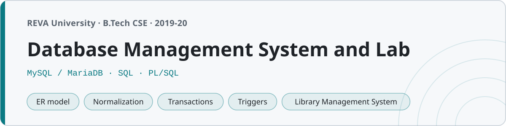

<p align="center"></p>

# Database Management System and Lab

Notes, SQL and a course project from the DBMS course at **REVA University, Bengaluru** (B.Tech CSE, fifth semester, 2019–20). This is the course that turns "a table of data" into keys, dependencies, normal forms, transactions and query plans — the theory underneath every application that stores anything.

Everything that is SQL actually runs. The college lab uses **MySQL**, so all the SQL here is written in MySQL dialect and was executed against MySQL/MariaDB before being committed — the query outputs pasted into the lab records are the real thing, not typed from memory.

## Structure

| Folder | Unit | What's in it |
|---|---|---|
| `01-introduction/` | DBMS basics | File system vs DBMS, ANSI-SPARC three-schema architecture, data models — notes |
| `02-er-model/` | ER modelling | Entities, relationships, cardinality, EER, ER→table mapping — notes |
| `03-relational-model/` | Relational model | Keys, integrity constraints, relational algebra (with the SQL equivalents) |
| `04-sql-basics/` | SQL — DDL/DML | CREATE/ALTER/DROP, constraints, INSERT/UPDATE/DELETE, basic SELECT |
| `05-sql-queries/` | SQL — querying | Joins, subqueries, aggregates, GROUP BY/HAVING, set operations, views |
| `06-normalization/` | Normalization | Functional dependencies, closure, candidate keys, 1NF→BCNF with worked decompositions |
| `07-transactions/` | Transactions | ACID, schedules, conflict serializability, TCL (COMMIT/ROLLBACK/SAVEPOINT) |
| `08-concurrency-control/` | Concurrency | 2PL, timestamp ordering, deadlock (wait-die/wound-wait), isolation levels |
| `09-plsql-procedural/` | Procedural SQL | Stored procedures, functions, cursors, triggers, exception handlers |
| `10-indexing-and-storage/` | Storage & indexing | File organization, B+ trees, hashing, indexes and query processing |
| `notes/` | — | `quick-reference.md` (SQL + normal forms + algebra on one page) and `exam-prep.md` |
| `lab/` | — | The twelve lab experiments, one folder each |
| `project/` | — | **Library Management System** — the graded course project |

## Running the SQL

Everything runs on MySQL or MariaDB. A typical unit or lab folder has a schema file and the working file; load the schema first:

```sh
mysql -u root                 # or: mariadb -u root
```
```sql
SOURCE 05-sql-queries/emp_dept.sql;   -- the sample schema
SOURCE 05-sql-queries/joins.sql;      -- the queries
```

Most units use the classic **emp / dept** teaching schema (14 employees, 4 departments) so the query results are consistent everywhere — the same `emp_dept.sql` rows appear across the units and labs that need them. Stored procedures, functions, cursors and triggers are MySQL-flavoured (`DELIMITER //`, `CREATE PROCEDURE`, `FOR EACH ROW`, `SIGNAL SQLSTATE`); the notes point out the Oracle PL/SQL equivalents (`%TYPE`, `DBMS_OUTPUT`) so both are familiar.

## Lab

Twelve experiments, in the order they were done across the semester. Each folder is the full record — aim, tools, schema, the queries with their **actual output**, and the result.

| # | Experiment | Date |
|---|---|---|
| 1 | DDL — schema with constraints | 25/09/2019 |
| 2 | DML — insert / update / delete | 02/10/2019 |
| 3 | Simple queries (WHERE, LIKE, BETWEEN…) | 16/10/2019 |
| 4 | Aggregate functions & GROUP BY | 23/10/2019 |
| 5 | Joins | 06/11/2019 |
| 6 | Subqueries & set operations | 13/11/2019 |
| 7 | Views | 27/11/2019 |
| 8 | PL/SQL blocks (control flow) | 04/12/2019 |
| 9 | Cursors | 11/12/2019 |
| 10 | Procedures & functions | 18/12/2019 |
| 11 | Triggers | 08/01/2020 |
| 12 | Exception handling | 15/01/2020 |

## Project — Library Management System

The `project/` folder is a complete mini-application: a normalized (3NF) schema for members, books, authors, publishers, copies, loans and fines; realistic sample data; reporting queries (overdue books, most-borrowed, fines per month); views; and the stored procedures and triggers that make it work — `issue_book` and `return_book` (which computes the overdue fine and updates copy availability), plus a trigger that keeps the available-copy count correct and one that blocks issuing to a member with unpaid fines. The project README walks through the ER design and how to load it. It loads and runs end-to-end on MySQL.

## A note on the SQL

Every schema creates, every query returns the rows the record says it does, and every procedure, function, cursor and trigger compiles and runs — all checked against MySQL/MariaDB before committing, and the lab result tables are the real output. The sample data is deliberately ordinary (names, cities, salaries you'd actually see) rather than `foo`/`bar`, because that's how it was in the lab.
