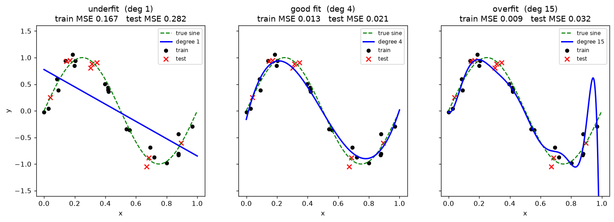
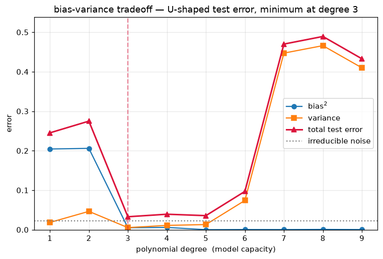

# Unit 1 — Introduction to Machine Learning

## What machine learning actually is

In ordinary programming you write the rules and the computer applies them. You hand it
`if amount > 50000 and country != home: flag as fraud`. That works until fraud patterns
change, and then you are back editing rules forever. Some problems have too many rules to
ever write down — nobody can spell out the pixels that make a photo a cat.

Machine learning flips the arrow. Instead of rules → answers, you feed the machine
**examples of answers** and it works out the rules itself. You show it thousands of
transactions already labelled fraud / not-fraud, and it learns a function that separates
them. Change the data, retrain, the rules update on their own.

Tom Mitchell's definition is the one examiners want:

> A program learns from experience **E** with respect to task **T** and performance measure
> **P**, if its performance at T, measured by P, improves with E.

For spam filtering: T = mark mail spam / not-spam, P = fraction correctly marked,
E = a pile of emails already sorted by the user. More sorted mail (E) → higher accuracy (P).

Use ML when the rules are unknown or too numerous, when the pattern drifts over time, or when
you must personalise to each user. For a fixed, well-understood rule (compute GST on a bill),
plain code is better — don't reach for ML where an `if` will do.

## Features, labels, instances

Think of the data as a spreadsheet.

- **Instance** (or sample / example) — one row. One patient, one email, one house.
- **Feature** (or attribute) — one input column. Age, word-count, square-footage. The vector
  of features for one instance is written **x**.
- **Label** (or target) — the answer column you want to predict, written **y**. Price, spam/ham.

A dataset of *m* instances each with *n* features is a matrix **X** of shape (m, n) and a
target vector **y** of length m. Nearly all of this course is: given rows of **X** and their
**y**, learn a function `f` so that `f(x) ≈ y` on rows you have never seen.

## The three kinds of learning

**Supervised** — the data comes *with* labels. You learn the mapping x → y. Two sub-types by
what y looks like:
- **Regression** — y is a continuous number. Predict house price, tomorrow's temperature, a
  patient's blood-sugar.
- **Classification** — y is a category. Spam/ham, which of ten digits, benign/malignant tumour.

**Unsupervised** — no labels, only **X**. You look for structure.
- **Clustering** — group similar instances. Customer segments, grouping news articles by topic.
- **Dimensionality reduction** — squeeze many features into a few that keep most of the
  information. Compress 784 pixel values to 2 for plotting, or speed up a downstream model.

**Reinforcement** — an agent takes actions in an environment and learns from a reward signal,
not from labelled examples. A robot learning to walk, a program learning to play chess by
winning and losing. There is no "correct answer" per step, only reward that arrives later.

| Type | Data given | Goal | Example |
|------|-----------|------|---------|
| Supervised — regression | X, continuous y | predict a number | house price |
| Supervised — classification | X, categorical y | predict a class | spam / ham |
| Unsupervised — clustering | X only | group similar rows | customer segments |
| Unsupervised — dim. reduction | X only | fewer, richer features | PCA to 2-D |
| Reinforcement | states + rewards | best action policy | game-playing agent |

## The ML pipeline

A project is not just `model.fit`. The whole loop:

1. **Data** — gather it, and understand what each column means.
2. **Preprocess** — clean missing values, encode categories to numbers, **scale** features so
   no one column dominates by sheer range.
3. **Split** — carve off a test set *before* looking at anything, so evaluation is honest.
4. **Train** — fit the model on the training set.
5. **Evaluate** — measure P on data the model has not seen.
6. **Tune** — adjust hyperparameters (tree depth, k, regularisation) and repeat.
7. **Deploy** — ship it, then monitor, because real-world data drifts.

> Géron's line that stuck with me: most of the effort is steps 1–2, not the modelling. The
> fancy algorithm is the easy part.

## Train, validation, and test — three separate piles

You split the data into three disjoint sets:

- **Training set** — the model fits its parameters on this.
- **Validation set** — you pick hyperparameters by checking here (which depth, which k). The
  model never fits its weights on it, but *you* use it to make choices, so it is "seen".
- **Test set** — locked away, touched **once**, at the very end, for the final honest score.

The golden rule: **never let the test set influence any decision**. The moment you tune to the
test set, its score stops predicting real-world performance. If data is scarce, k-fold
cross-validation reuses the training data as its own rotating validation set (Unit 11).

## Generalization — the whole point

We do not care how well a model memorises the training data. We care how it does on **new**
data. That ability is **generalization**, and it is the single idea the rest of the course
circles back to. Two ways to fail it:

- **Underfitting** — the model is too simple to capture the pattern. It does badly on training
  *and* test data. High **bias**.
- **Overfitting** — the model is so flexible it memorises the noise in the training data. Tiny
  training error, large test error. High **variance**.

`overfitting_demo.py` fits polynomials of degree 1, 4, and 15 to 30 noisy points drawn from a
sine wave:



Read it left to right. Degree 1 is a straight line — it cannot bend to the sine at all, so both
errors stay high (**underfit**). Degree 4 follows the true curve closely and the test crosses
sit near the line (**good fit**). Degree 15 threads almost every training dot but throws a wild
spike near x = 0.9 chasing noise — its curve is nonsense between the points (**overfit**).

The printed numbers make it precise:

| Degree | Train MSE | Test MSE | Verdict |
|--------|-----------|----------|---------|
| 1 | 0.167 | 0.282 | both high → underfit |
| 4 | 0.013 | 0.021 | small gap → good |
| 15 | 0.009 | 0.032 | train lowest, test 3.6× bigger → overfit |

Notice degree 15 has the *lowest* training error of all three and still generalises worse than
degree 4. Low training error alone means nothing — the train–test **gap** is the tell.

## Bias, variance, and irreducible error

Imagine training your model on many different random samples of data. For a fixed test point,
the expected squared error splits into exactly three pieces:

```
E[(y − f̂(x))²]  =  Bias[f̂(x)]²  +  Var[f̂(x)]  +  σ²
```

- **Bias** = E[f̂(x)] − f(x). How far the *average* prediction sits from the truth. A model too
  simple to represent the pattern has high bias. This is underfitting.
- **Variance** = E[(f̂(x) − E[f̂(x)])²]. How much the prediction jumps around as the training
  sample changes. A flexible model that reshapes itself to each sample has high variance. This
  is overfitting.
- **σ²** = **irreducible error**. Noise in the data itself (measurement error, randomness). No
  model can beat it — it is the floor.

There is a **tradeoff**: simple models have high bias, low variance; complex models have low
bias, high variance. Lowering one usually raises the other. The best model minimises their
sum, not either alone.

`bias_variance.py` makes this visible. For each polynomial degree it refits on 300 fresh noisy
samples and measures bias², variance, and total error at test points:



- **bias²** (blue) starts high — degrees 1 and 2 cannot bend into a sine — then collapses to
  near zero once the polynomial is flexible enough (degree ≥ 3).
- **variance** (orange) stays low and flat while the model is simple, then climbs steeply as
  high-degree curves start chasing noise.
- **total test error** (red) is their sum plus the noise floor: it falls, bottoms out, then
  rises — the famous **U-shape**. The dip (here degree 3–5) is the sweet spot. Left of it you
  are underfitting; right of it, overfitting.

That U is the mental picture to keep: the goal is to sit at the bottom of the U, not as far
right (complex) as you can go.

## Model capacity

**Capacity** is how complex a function a model can represent. More capacity → it can fit more
intricate patterns, but also more noise. It is the knob that slides you along the U:

- polynomial **degree** — higher degree, more wiggles.
- decision-tree **depth** — deeper tree, finer splits.
- k in **k-NN** — *smaller* k means higher capacity (k = 1 memorises every point).
- **regularisation** strength — more regularisation *lowers* effective capacity.

Too little capacity underfits; too much overfits. You tune capacity on the validation set to
land at the bottom of the U. More training data lets you afford more capacity safely, because
data pins the flexible model down.

## Parametric vs non-parametric

| | Parametric | Non-parametric |
|---|---|---|
| Parameters | fixed number, set by the model | grows with the data |
| Learns | a fixed-form function (e.g. a line) | keeps/uses the data directly |
| Examples | linear & logistic regression, naive Bayes | k-NN, decision trees, kernel SVM |
| Training | summarise data into weights, then discard it | little or no upfront fitting |
| Data need | works with less data | usually wants more |
| Flexibility | limited by the chosen form | adapts its shape to the data |

Parametric models commit to a shape (a line has two numbers, slope and intercept, no matter how
much data you feed). Non-parametric models let the data decide the shape, so their complexity
scales with the dataset — powerful, but hungrier for data and memory.

## Worked reasoning — reading train/test errors

Suppose three models on the same problem report:

| Model | Train error | Test error |
|-------|-------------|------------|
| A | 0.30 | 0.32 |
| B | 0.05 | 0.08 |
| C | 0.01 | 0.29 |

Which is best? **Ans:** B. Model A has high error on both sets — it never learned the pattern
(underfit, high bias). Model C nails the training data but falls apart on test — it memorised
noise (overfit, high variance; the 0.28 gap is the giveaway). Model B has low error on both and
a small gap, so it generalises. Always compare *both* numbers and the gap between them, never
training error alone.

## Solved short-answer

**Q1. Give the formal (Mitchell) definition of learning and identify T, P, E for a chess
program that improves by playing itself.**
**Ans:** A program learns from experience E w.r.t. task T and measure P if its P on T improves
with E. Here T = playing chess, P = fraction of games won, E = the games it plays against
itself. As it plays more games (E), its win rate (P) rises.

**Q2. A model gives 99% accuracy on training data and 71% on test data. Name the problem, the
underlying cause in bias/variance terms, and two fixes.**
**Ans:** Overfitting. The model has low bias but high variance — it fit the noise in the
training set, so it does not generalise. Fixes: reduce capacity (shallower tree / lower
polynomial degree / stronger regularisation), or get more training data; simplifying features
or early stopping also help.

**Q3. Why can the test error never go below the irreducible error σ², no matter how good the
model is?**
**Ans:** σ² is noise in the data-generating process itself — randomness and measurement error
that is not a function of x. Since even the true f(x) plus this noise is what we observe, no
predictor can undo it; it sets the floor of the U-shaped error curve. Only bias and variance are
reducible by choosing a better model.
