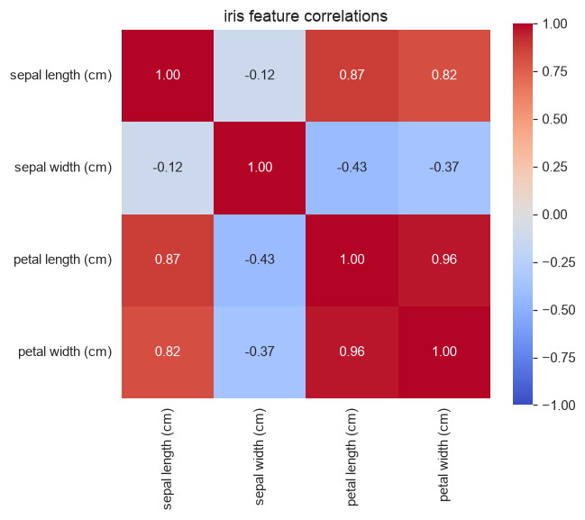
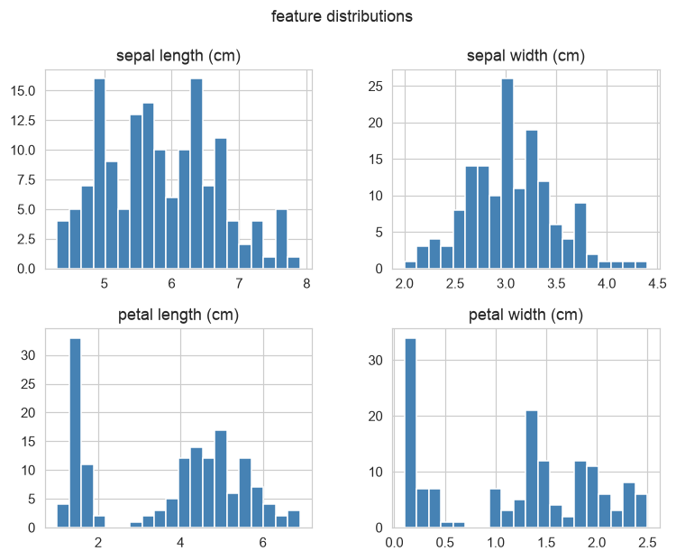
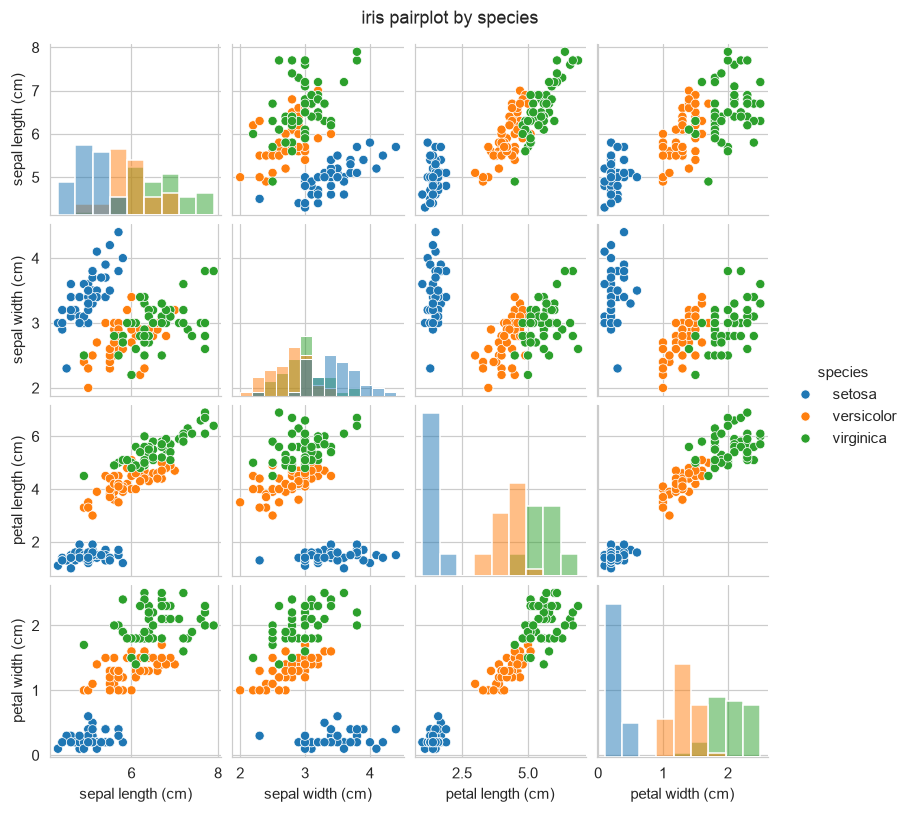

# Unit 2 — Data Preprocessing

A model is only as good as the matrix you hand it. Raw data almost never arrives as a clean numeric
table: there are blank cells, text categories like "France"/"Spain", and columns on wildly different
scales (age in the tens, salary in the tens of thousands). Preprocessing is the work of turning that
mess into `X` (a numeric feature matrix) and `y` (a label vector) that an algorithm can actually
learn from. Géron calls it the least glamorous and most time-consuming part of the job, and he is
right — most of a real project is here, not in `model.fit`.

The pipeline for a supervised problem is almost always the same five moves:

1. Load into a pandas DataFrame and *look* at it (`head`, `info`, `describe`, `value_counts`).
2. Deal with missing values (drop, or impute).
3. Encode categorical columns into numbers (label vs one-hot).
4. Split into train and test — **before** any fitting that learns from the data.
5. Scale the features (fit the scaler on train only), if the model needs it.

## 1. Loading and inspecting

pandas reads a CSV into a DataFrame with `pd.read_csv`, and sklearn's built-in sets come straight in
with `load_iris(as_frame=True).frame`. The first thing to do is never to model — it is to inspect.

| method              | what it tells you                                              |
|---------------------|----------------------------------------------------------------|
| `df.head()`         | the first rows — sanity-check columns loaded right             |
| `df.info()`         | dtypes and non-null counts — spots missing values and text cols |
| `df.describe()`     | count/mean/std/min/quartiles/max per numeric column            |
| `df.value_counts()` | frequency of each category — class balance for the target      |

On iris, `describe()` immediately shows the scale story: petal length runs 1.0–6.9 while sepal width
sits in 2.0–4.4, and `value_counts()` on the species gives a perfectly balanced 50/50/50. Balance
matters — a 95/5 split changes how you split, which metric you trust, and whether accuracy means
anything at all.

## 2. Missing values

Two questions: how do you *find* them, and what do you *do* with them.

Find them with `df.isnull().sum()` — a per-column count of holes. On the small worked table below,
`age` and `salary` each have one blank.

Then choose:

- **Drop** — `dropna()` removes rows (or columns) with holes. Fine when only a handful of rows are
  affected and data is plentiful. Wasteful, or outright dangerous, when many rows have one missing
  field each — you can throw away most of your data.
- **Impute** — fill the hole with a plausible value. `SimpleImputer` does this cleanly:
  - `strategy="mean"` — numeric, roughly symmetric columns.
  - `strategy="median"` — numeric but skewed, or with outliers (the mean gets dragged; the median
    does not).
  - `strategy="most_frequent"` — the mode, the only sensible choice for a categorical column.

> Rule of thumb from Ng's course: median for anything with a long tail or an outlier — income,
> house price, counts. Mean only when the column is already tidy.

Imputation is a *learned* transform — the mean it fills with comes from the data — so the same
train-only discipline as scaling applies (Section 6).

## 3. Encoding categorical variables

Models do arithmetic; they cannot multiply a weight by the word "Germany". Text categories must
become numbers, and *how* you do it matters.

**Label encoding** maps each category to an integer: `{France:0, Germany:1, Spain:2}`. One column,
compact. The trap: it invents an ordering. The model now thinks Spain (2) > Germany (1) > France (0),
and that 2 is "twice" 0. For a genuinely ordered variable (`low < medium < high`) that is exactly
what you want. For an unordered *nominal* variable like country, it is a lie the model will try to
fit.

**One-hot encoding** avoids the lie by giving each category its own 0/1 column. `country` with three
values becomes `country_France`, `country_Germany`, `country_Spain`, exactly one of which is 1 per
row. No false ordering, at the cost of extra columns (a problem only when a column has hundreds of
categories).

| situation                              | use                          |
|----------------------------------------|------------------------------|
| the **target** `y` (any classifier)    | label encode → 0,1,2,…       |
| ordinal feature (`cold<warm<hot`)      | label / ordinal encode       |
| nominal feature (country, colour)      | one-hot encode               |
| nominal with hundreds of levels        | one-hot is unwieldy → other schemes |

In code: `LabelEncoder` for the target `purchased` → a single 0/1 vector; `OneHotEncoder` for the
`country` feature → three indicator columns. See `preprocessing.py`.

## 4. Train/test split and stratification

You judge a model on data it has never seen, so hold out a slice — typically 20–30% — as the test
set with `train_test_split(..., test_size=0.25, random_state=1)`. The `random_state` makes the split
reproducible; without it every run reshuffles and your numbers wobble.

`stratify=y` keeps each class's proportion the same in both halves. On wine (three classes in roughly
40/33/27 proportion) a stratified split reproduces `{1:0.40, 0:0.33, 2:0.27}` in *both* train and
test — the code prints exactly that. Without stratification a random split can hand you a test set
missing a rare class entirely, and then the test score is measuring the wrong thing.

> `stratify` keeps the class balance in both splits. On imbalanced data it is not optional.

## 5. Feature scaling — why, and the two ways

Many algorithms measure distances or take gradient steps, and both are wrecked by columns on
different scales. In wine, `proline` has a raw training std of about **317** while other features sit
near 1. In a k-NN distance, proline alone would decide every neighbour and the other twelve features
would be noise. Standardizing fixes this by putting every column on the same footing.

**Standardization (z-score)** — centre to mean 0, scale to std 1:

```
z = (x - μ) / σ
```

where μ is the column mean and σ its standard deviation. After it, a column has mean 0 and std 1;
values are unbounded but typically land in [-3, 3]. This is the default, and what `StandardScaler`
does.

**Min-max normalization** — squash to a fixed range, usually [0, 1]:

```
x' = (x - x_min) / (x_max - x_min)
```

Bounded output, but sensitive to outliers (one huge value stretches everyone else toward 0). Use it
when you need a fixed range — image pixels, or a neural net input layer. `MinMaxScaler` does this.

Which models care:

| model family                         | needs scaling? | why                                   |
|--------------------------------------|:--------------:|---------------------------------------|
| k-NN, k-means                        | yes            | Euclidean distance is scale-dominated |
| SVM (rbf / linear)                   | yes            | margin + kernel depend on scale       |
| logistic / linear reg via gradient descent | yes      | uneven scales make the descent crawl  |
| PCA                                  | yes            | variance is scale-dependent           |
| decision tree, random forest, GBM    | **no**         | splits are threshold-based, scale-free |
| naive Bayes                          | no             | per-feature distributions, no distance |

> The one to memorise for the exam: **trees don't care about scale, distances do.**

## 6. Data leakage — the one that costs marks

The scaler learns μ and σ from data. If you `fit` it on the *whole* dataset and then split, the test
rows' statistics have already leaked into the training transform — your test score is optimistic and
lies. The fix is an order-of-operations rule:

**Split first. Fit the scaler on the training set only. Then `transform` both train and test with
that same fitted scaler.**

`preprocessing.py` shows the tell-tale: after fitting `StandardScaler` on train, the *training*
proline has mean 0.00 and std 1.00 (by construction), but the *test* proline comes out mean 0.13,
std 0.97 — not exactly 0/1, precisely because the scaler never saw the test data. That small
mismatch is correct; forcing it to 0/1 would be the leak.

> Cost me marks in IA1: I scaled before splitting. The train accuracy looked wonderful and the
> examiner circled it. Split first, always.

## Worked example — standardize a column by hand

Take one column: `x = [2, 4, 4, 4, 5, 5, 7, 9]` (n = 8).

Mean: μ = (2+4+4+4+5+5+7+9) / 8 = 40 / 8 = **5**.

Variance (population, the σ StandardScaler uses):

```
σ² = [(2-5)² + 3·(4-5)² + 2·(5-5)² + (7-5)² + (9-5)²] / 8
   = [9 + 3 + 0 + 4 + 16] / 8 = 32 / 8 = 4     →   σ = 2
```

Now z = (x − 5) / 2 for each value:

| x    | 2    | 4    | 4    | 4    | 5   | 5   | 7   | 9   |
|------|------|------|------|------|-----|-----|-----|-----|
| z    | −1.5 | −0.5 | −0.5 | −0.5 | 0.0 | 0.0 | 1.0 | 2.0 |

The transformed column has mean 0 and std 1 — check: the z's sum to 0. That is all `StandardScaler`
does, once per column.

## EDA on iris (see `eda.py`)

The correlation heatmap: petal length and petal width move together almost perfectly (**0.96**), and
both track sepal length (0.87, 0.82). Sepal width is the odd one out — mildly *negative* with the
petals. Highly correlated features carry redundant information, which is the motivation for PCA in
Unit 9.



The histograms show why petals matter: petal length and petal width are visibly *bimodal* — one
tight clump near zero (setosa's tiny petals) and a broader spread for the other two species. Sepal
measurements overlap far more.



The pairplot makes the separability plain: colour by species and setosa (blue) splits off cleanly on
any petal axis, while versicolor and virginica overlap a little. This is exactly why iris is the
"hello world" of classification — a decision boundary is almost trivial to draw.



## Solved problems

**Q1.** A dataset has 10,000 rows; one column, `income`, is missing in 40% of them and is heavily
right-skewed. Drop the rows, or impute — and with what?

**Ans:** Do not drop — losing 40% of the data is unacceptable. Impute. Because income is skewed with
a long right tail, the mean is pulled up by the rich few, so use the **median**
(`SimpleImputer(strategy="median")`). Fit the imputer on the training set only.

---

**Q2.** A `city` feature has values {Bangalore, Delhi, Mumbai}. A classmate label-encodes it to
{0,1,2} and feeds it to a k-NN. What goes wrong, and what should they do?

**Ans:** Label encoding invents an order and a magnitude — the model now believes Mumbai (2) is
"twice" Delhi and "more than" Bangalore, and k-NN's distance treats these fake gaps as real. City is
nominal, so use **one-hot encoding**: three 0/1 columns, no spurious ordering.

---

**Q3.** You standardize the whole dataset, then split into train/test, then report test accuracy.
Name the mistake and its effect.

**Ans:** **Data leakage.** The scaler's μ and σ were computed using the test rows too, so information
from the test set has leaked into the training pipeline. The reported test accuracy is optimistically
biased. Correct order: split first, `fit` the scaler on train only, then `transform` both.

---

**Q4.** Which of these need feature scaling before training: (a) random forest, (b) SVM with an rbf
kernel, (c) k-means, (d) a decision tree?

**Ans:** (b) and (c) need it — the SVM kernel and k-means both rely on distances, which are dominated
by large-range columns. (a) and (d) do not: tree splits compare one feature against a threshold at a
time, so a monotone rescaling changes nothing.
