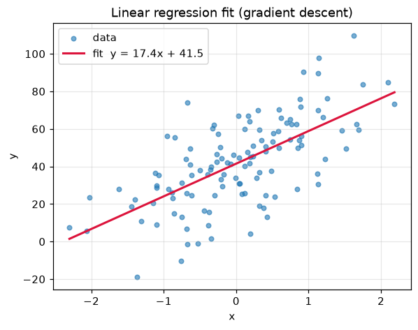
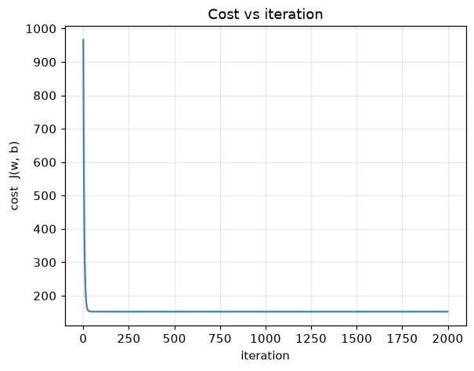
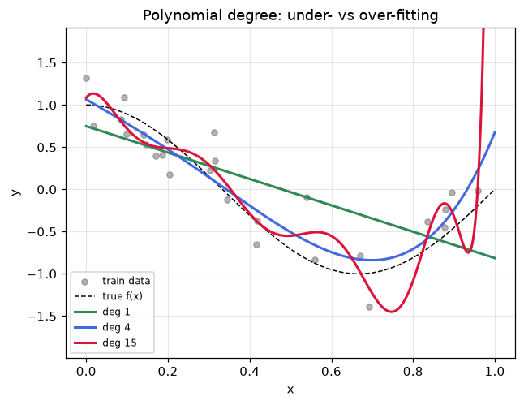
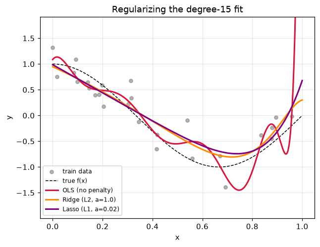

# Unit 3 — Linear Regression

Regression predicts a **continuous** number: the price of a house, tomorrow's temperature,
a student's marks. The task is to draw the line (or plane, or curve) that runs through the
cloud of points as closely as possible, and then use it to predict `y` for a new `x`.

Everything downstream in ML — logistic regression, neural nets — reuses the machinery here:
a hypothesis, a cost, and gradient descent to minimise the cost. So this unit is worth getting
into the bones.

## Simple linear regression — one feature

One input `x`, one output `y`. The hypothesis is a straight line:

```
h(x) = w·x + b
```

- `w` — the weight (slope). How much `y` moves per unit of `x`.
- `b` — the bias (intercept). Where the line crosses the y-axis.

Given `w = 17.4, b = 41.5`, a point with `x = 2` is predicted as `h = 17.4(2) + 41.5 = 76.3`.
Training means finding the `w, b` that make `h(x)` closest to the real `y` across all the data.

## Multiple linear regression — many features

Real problems have several inputs: size, bedrooms, age, distance-to-city. Each gets its own weight:

```
h(x) = w1·x1 + w2·x2 + ... + wn·xn + b  =  w·x + b
```

`w` and `x` are now vectors of length `n`, and `w·x` is their dot product. Stack all `m` training
examples as rows of a matrix `X` (shape `m × n`) and it is one matrix product `Xw + b`. The line
becomes a plane in 3-D and a hyperplane beyond — but it is still **linear**: `h` is a weighted sum
of the features.

## The cost function — MSE

We need a single number that says how wrong the current `w, b` are. Use the mean of the squared
errors, with a `1/2` in front to make the derivative clean:

```
J(w, b) = (1 / 2m) · Σ (h(x_i) − y_i)²        summed over i = 1..m
```

- `h(x_i) − y_i` is the residual for example `i` — prediction minus truth.
- Squaring makes every error positive and punishes big misses harder than small ones.
- `1/m` averages it; the `1/2` cancels the 2 that drops out when we differentiate.

`J` is a bowl-shaped (convex) surface over `w, b`. One lowest point, no local traps. Our job is to
reach the bottom of the bowl.

## Gradient descent

Start anywhere on the bowl and repeatedly step downhill. The gradient points uphill, so we move
against it. The update, run every iteration until `J` stops shrinking:

```
w := w − α · ∂J/∂w
b := b − α · ∂J/∂b
```

The partial derivatives of the MSE work out to:

```
∂J/∂w = (1/m) · Σ (h(x_i) − y_i) · x_i
∂J/∂b = (1/m) · Σ (h(x_i) − y_i)
```

- `α` — the **learning rate**. Too small and it crawls; too big and it overshoots and diverges.
  Typical starting guess `0.01`–`0.1`.
- **Convergence**: watch `J` per iteration. It should fall smoothly and flatten out. If it climbs,
  `α` is too large.

> Ng kept saying it: feature-scale before gradient descent or it crawls. When features have wildly
> different ranges the bowl becomes a long thin valley and GD zig-zags. Cost me marks in IA1.

### One step by hand

Data `(1, 2), (2, 2.5), (3, 3.5)`, start `w = 0, b = 0`, `α = 0.1`, `m = 3`.

All predictions are `h = 0`, so residuals are `−2, −2.5, −3.5`.

```
J        = (1/6)[(-2)² + (-2.5)² + (-3.5)²] = 22.5/6      = 3.75
∂J/∂w    = (1/3)[(-2)(1) + (-2.5)(2) + (-3.5)(3)] = -17.5/3 = -5.833
∂J/∂b    = (1/3)[-2 - 2.5 - 3.5]                = -8/3     = -2.667
w := 0 − 0.1(-5.833) = 0.583
b := 0 − 0.1(-2.667) = 0.267
```

Both weights moved up, which is right — the line needs a positive slope and a positive intercept.
Repeat a few thousand times and it settles on the least-squares line.

## The normal equation — solving it in one shot

Because the MSE is convex and quadratic, we can jump straight to the minimum by setting the gradient
to zero and solving. With a column of ones folded into `X` to absorb `b`, the closed form is:

```
w = (Xᵀ X)⁻¹ Xᵀ y
```

No learning rate, no iterations, no scaling needed. The catch is the `(Xᵀ X)⁻¹` — inverting an
`n × n` matrix costs about `O(n³)`. Fine for a few hundred features, painful for tens of thousands.

| | Gradient descent | Normal equation |
|---|---|---|
| Learning rate `α` | needs tuning | none |
| Iterations | many | one solve |
| Feature scaling | needed | not needed |
| Cost with `n` features | `O(k·n)` per iter | `O(n³)` |
| Very large `n` | scales well | too slow / `XᵀX` singular |
| Choose when | `n` large, or streaming data | `n` small (say `< 10⁴`) |

`linear_regression_scratch.py` does both on the same data and prints them side by side — the
gradient-descent `w, b`, the normal-equation `w, b`, and sklearn's `LinearRegression`. All three
agree to several decimals, which is the check that the from-scratch loop is correct.




The cost curve drops steeply then flattens — the signature of a healthy learning rate.

## Evaluating a regression

Accuracy is a classification word. For regression we measure how far predictions land from truth.

| Metric | Formula | Reads as |
|---|---|---|
| MSE | `(1/m) Σ (y − ŷ)²` | mean squared error; units are `y²` |
| RMSE | `√MSE` | back in the units of `y`; the everyday number |
| MAE | `(1/m) Σ \|y − ŷ\|` | mean absolute error; ignores the squaring, so less swayed by outliers |
| R² | `1 − SS_res / SS_tot` | fraction of variance explained; `1` is perfect, `0` is no better than the mean |

`SS_res = Σ(y − ŷ)²` and `SS_tot = Σ(y − ȳ)²`, where `ȳ` is the mean of `y`. R² can go **negative**
when a model is worse than just predicting `ȳ` — which is exactly what an overfit curve does on the
test set.

## Polynomial regression

A straight line cannot follow a curve. Add powers of the feature as new features:

```
h(x) = w0 + w1·x + w2·x² + ... + wd·xⁿ
```

The trick: this is **still linear regression**. It is linear in the *parameters* `w`, even though it
is a curve in `x`. We just feed `[x, x², ..., xⁿ]` into the same machinery (`PolynomialFeatures` in
sklearn). Degree `d` is the knob for how bendy the curve is allowed to be.



Degree 1 (green) is a flat line that misses the curve — **underfit**. Degree 4 (blue) tracks the true
function nicely. Degree 15 (red) threads every training point and whips off the chart near the
edge — **overfit**. The printed R² tells the same story:

```
degree  1:  train R2 = 0.544   test R2 = 0.272
degree  4:  train R2 = 0.832   test R2 = 0.742
degree 15:  train R2 = 0.875   test R2 = 0.216
```

Train R² only ever climbs with degree — a wigglier curve fits the training noise better. Test R²
rises then crashes. The gap between train and test is the tell-tale of overfitting.

## Bias–variance and degree

Remember: high bias = underfit (both errors high); high variance = overfit (train low, test high).

| Degree | Bias | Variance | Symptom |
|---|---|---|---|
| too low (1) | high | low | underfit — misses the shape, train and test both poor |
| about right (4) | low | low | good — train and test both strong and close |
| too high (15) | low | high | overfit — near-perfect train, poor test |

The sweet spot minimises **test** error, not train error. Pick degree by cross-validation, not by
how well it hugs the training points.

## Regularization — Ridge and Lasso

Instead of throwing away the flexible degree-15 model, keep it but **penalise large weights**. Add a
penalty term to the cost so the optimiser is pushed toward smaller, tamer coefficients:

```
Ridge (L2):  J = MSE + α · Σ w_j²          shrinks weights toward zero
Lasso (L1):  J = MSE + α · Σ |w_j|         drives some weights exactly to zero
```

- `α` is the regularization strength. `α = 0` is plain regression; larger `α` means a smoother,
  stiffer fit.
- **Ridge** shrinks all weights smoothly but rarely to exactly zero — good when every feature
  matters a little.
- **Lasso** has corners in its `|w|` penalty that snag weights at zero, so it does automatic
  **feature selection** — good when you suspect many features are useless.



Same degree-15 basis, three ways of handling the weights:

```
OLS (no penalty)     test R2 = 0.216   nonzero coefs = 15/15
Ridge (L2, a=1.0)    test R2 = 0.741   nonzero coefs = 15/15
Lasso (L1, a=0.02)   test R2 = 0.699   nonzero coefs = 2/15
```

OLS (crimson) wiggles wildly; Ridge (orange) and Lasso (purple) both smooth it back toward the true
curve and recover the test R². Lasso got there using just 2 of the 15 coefficients — it zeroed the
rest. Code: `polynomial_ridge_lasso.py`.

## Solved problems

**1. One gradient-descent step.** For data `(1, 2), (2, 2.5), (3, 3.5)` with `w = b = 0` and
`α = 0.1`, compute the first update.

**Ans:** residuals are `−2, −2.5, −3.5`. `∂J/∂w = (1/3)(−17.5) = −5.833`,
`∂J/∂b = (1/3)(−8) = −2.667`. So `w := 0 − 0.1(−5.833) = 0.583` and `b := 0 − 0.1(−2.667) = 0.267`.
The starting cost is `J = 22.5/6 = 3.75`.

**2. Compute R².** True `y = [3, 5, 7, 9]`, predicted `ŷ = [2.8, 5.2, 6.9, 9.1]`.

**Ans:** `ȳ = 6`. `SS_res = 0.2² + 0.2² + 0.1² + 0.1² = 0.10`.
`SS_tot = (−3)² + (−1)² + 1² + 3² = 20`. `R² = 1 − 0.10/20 = 0.995`. Nearly perfect.

**3. Fit a line by the normal equation.** Points `(1, 1), (2, 2), (3, 2)`.

**Ans:** design matrix `X = [[1,1],[1,2],[1,3]]`, `y = [1, 2, 2]`.
`XᵀX = [[3, 6], [6, 14]]`, `Xᵀy = [5, 11]`, `det(XᵀX) = 6`.
`(XᵀX)⁻¹ = [[14, −6], [−6, 3]] / 6`, so `θ = (XᵀX)⁻¹ Xᵀy = [0.667, 0.5]`.
The fitted line is `y = 0.5x + 0.667`.

**4. Ridge vs Lasso — which for feature selection?**

**Ans:** Lasso. Its L1 penalty has corners at zero that push weak coefficients to exactly zero, so
the surviving nonzero weights name the features that matter. Ridge only shrinks — it keeps every
feature, just smaller.
