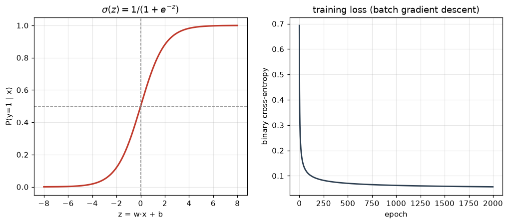
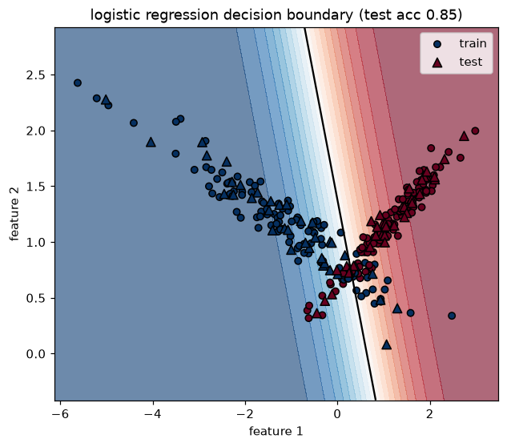

# Unit 4 — Logistic Regression

Linear regression predicts a number. But a lot of the questions we actually care about are
yes/no: is this tumour malignant, will this email bounce, does this customer churn. Those are
**classification** problems, and logistic regression is the workhorse for the two-class case.

The name is a little misleading — it has "regression" in it, but the output is a class. What it
actually regresses is a *probability*, and then we threshold that probability to get a label.

## From regression to classification

Suppose we just used linear regression for a 0/1 target. The line `w·x + b` runs off to +∞ and
−∞, so it happily predicts 3.7 or −1.2 for something that is supposed to be a probability. One
outlier far out on the x-axis can also tilt the whole line and move the boundary. Neither is
acceptable when the answer has to live in [0, 1].

So we keep the linear score `z = w·x + b` — that part is fine, it's a weighted vote of the
features — and then **squash** it into (0, 1) with a function that never leaves that range.

## The sigmoid

The squashing function is the logistic sigmoid:

```
σ(z) = 1 / (1 + e^(−z))
```

- `z → +∞`  ⇒ `σ → 1`
- `z → −∞`  ⇒ `σ → 0`
- `z = 0`   ⇒ `σ = 0.5`

It's a smooth S-curve, monotone increasing, symmetric about (0, 0.5). Big positive score means
"very likely class 1", big negative score means "very likely class 0", and near the middle it's
unsure. One tidy fact we'll use in the derivative:

```
σ'(z) = σ(z) · (1 − σ(z))
```



The left panel is the curve. The right panel is the training loss falling as gradient descent
runs — more on that below.

## The hypothesis

We model the probability that the label is 1 given the features:

```
P(y = 1 | x) = σ(w·x + b) = ŷ
P(y = 0 | x) = 1 − ŷ
```

Symbols, all of them:

| Symbol | Meaning |
|--------|---------|
| `x`    | one example, a vector of `n` features |
| `w`    | weight vector, one number per feature |
| `b`    | bias / intercept (a scalar) |
| `z`    | the linear score `w·x + b` |
| `ŷ`    | predicted probability `σ(z)`, a number in (0,1) |
| `y`    | the true label, 0 or 1 |
| `m`    | number of training examples |

To turn `ŷ` into a class we threshold at 0.5 (by default):

```
predict 1  if ŷ ≥ 0.5   (equivalently z ≥ 0)
predict 0  if ŷ < 0.5
```

## The decision boundary

The boundary is the set of points where the model is exactly on the fence, `ŷ = 0.5`, which
happens precisely when `z = 0`:

```
w·x + b = 0
```

That's the equation of a **line** (in 2D), a **plane** (3D), a **hyperplane** in general. So plain
logistic regression can only draw a *straight* boundary. On one side `z > 0` and we predict 1, on
the other `z < 0` and we predict 0. If the classes need a curved separator you have to add
polynomial features or move to a kernel method (SVM, Unit 7).



Colour is the predicted probability of class 1 — deep red near 1, deep blue near 0. The black
line is the 0.5 contour, i.e. the decision boundary. Circles are training points, triangles are
test points; almost all sit on the correct side.

## The cost function — log loss, not MSE

Why not just reuse the mean-squared error from linear regression? Because with the sigmoid inside,
MSE `(σ(w·x+b) − y)²` is **non-convex** in `w` — it has bumps and flat regions, and gradient
descent can get stuck in a local minimum. We want a bowl-shaped cost with a single bottom.

The fix comes from maximum likelihood. For a single example the likelihood of the true label is
`ŷ` if `y = 1` and `1 − ŷ` if `y = 0`. Write both cases in one line and take the negative log:

```
loss(ŷ, y) = −[ y·log(ŷ) + (1 − y)·log(1 − ŷ) ]
```

This is the **binary cross-entropy** / **log loss**. Read it as two half-formulas:

- if `y = 1`, only `−log(ŷ)` survives → cost blows up as `ŷ → 0` (confident and wrong = huge penalty)
- if `y = 0`, only `−log(1 − ŷ)` survives → cost blows up as `ŷ → 1`

Average over the whole training set:

```
J(w, b) = −(1/m) · Σ [ yᵢ·log(ŷᵢ) + (1 − yᵢ)·log(1 − ŷᵢ) ]
```

This `J` is convex, so gradient descent finds the global minimum.

> Cross-entropy punishes *confident* mistakes far harder than MSE does. A model that says 0.99
> when the truth is 0 pays almost nothing under MSE (error ~1) but pays a near-infinite log loss.

## Gradient descent

The gradient works out to something remarkably clean. Even though the sigmoid is nonlinear, the
`σ'` term cancels against the log in the loss, and you're left with:

```
∂J/∂w = (1/m) · Xᵀ (ŷ − y)
∂J/∂b = (1/m) · Σ (ŷ − y)
```

where `X` is the `m × n` data matrix and `ŷ − y` is the vector of residuals. It's the *same form*
as the linear-regression gradient — residual times input, averaged. That's not a coincidence; both
fall out of the exponential-family / GLM framework.

Update rule, `α` = learning rate:

```
w ← w − α · ∂J/∂w
b ← b − α · ∂J/∂b
```

Repeat for a fixed number of epochs (or until `J` stops moving). Two practical notes:

- **Feature-scale first.** If one column ranges 0–1000 and another 0–1, gradient descent zig-zags
  and crawls. Standardise (mean 0, sd 1) and it converges fast.
- Pick `α` sensibly: too big and `J` oscillates or diverges, too small and you wait forever.

> Ng kept saying it: feature-scale before gradient descent or it crawls. The breast-cancer
> columns run from 0.01 to 4000-odd, so `StandardScaler` is not optional here.

## Worked example — one gradient-descent step by hand

Take a single example, `x = [2.0, 1.0]`, true label `y = 1`, and start from `w = [0, 0]`, `b = 0`.

1. Score: `z = 0·2 + 0·1 + 0 = 0`
2. Probability: `ŷ = σ(0) = 0.5`
3. Loss: `−[1·log(0.5) + 0] = −log(0.5) = 0.693`
4. Residual: `ŷ − y = 0.5 − 1 = −0.5`
5. Gradient (m = 1): `∂J/∂w = x·(ŷ−y) = [2·(−0.5), 1·(−0.5)] = [−1.0, −0.5]`,  `∂J/∂b = −0.5`
6. Update with `α = 0.1`:
   `w = [0,0] − 0.1·[−1.0,−0.5] = [0.10, 0.05]`,  `b = 0 − 0.1·(−0.5) = 0.05`

Check it moved the right way: new `z = 0.10·2 + 0.05·1 + 0.05 = 0.30`, so `ŷ = σ(0.30) = 0.574`.
The probability of class 1 rose from 0.500 to 0.574 — exactly what we want, since the true label
was 1. One step, small nudge; two thousand of them and the model is trained.

## Multiclass — beyond two classes

Sigmoid handles two classes. For `K` classes there are two standard extensions:

- **One-vs-rest (OvR).** Train `K` separate binary classifiers, "class k vs everything else".
  At predict time run all `K` and take the one with the highest score. Simple, works well, what
  sklearn's `LogisticRegression` does by default for many solvers.
- **Softmax (multinomial).** One model with a weight vector per class; the scores go through

  ```
  softmax(z)_k = e^(z_k) / Σⱼ e^(z_j)
  ```

  which gives a proper probability distribution over the `K` classes (they sum to 1). Trained with
  the multiclass cross-entropy. Preferred when the classes are mutually exclusive.

| Approach     | Models | Probabilities sum to 1? | Use when |
|--------------|--------|-------------------------|----------|
| One-vs-rest  | K      | no (calibrate if needed)| quick, K small, classes overlap |
| Softmax      | 1      | yes                     | mutually-exclusive classes |

## Regularised logistic regression

Same overfitting story as linear regression: with many features the weights can blow up and the
model memorises the training set. Add a penalty on the weights to the cost.

- **L2 (ridge):** add `λ·Σ wⱼ²` — shrinks weights smoothly, the usual default.
- **L1 (lasso):** add `λ·Σ |wⱼ|` — drives some weights to exactly 0, so it also selects features.

In sklearn the strength is `C = 1/λ`, so **small C = strong regularisation**. That inversion trips
people up in the exam — remember it's a reciprocal.

## Solved problems

**Q1. The model outputs ŷ = 0.8 for an example whose true label is y = 0. What is the log loss for
this single example?**

**Ans:** `loss = −[y·log(ŷ) + (1−y)·log(1−ŷ)] = −[0 + 1·log(1 − 0.8)] = −log(0.2) = 1.609`. It's
a fairly confident wrong answer, so the penalty is large — much larger than the `(0.8−0)² = 0.64`
that MSE would have charged.

**Q2. A trained model has w = [1.5, −2.0] and b = 0.5. For x = [1, 1], does it predict class 1?**

**Ans:** `z = 1.5·1 + (−2.0)·1 + 0.5 = 0`. So `ŷ = σ(0) = 0.5`, exactly on the boundary. At the
default threshold `ŷ ≥ 0.5` it predicts **class 1**, but this point sits right on the decision line
`w·x + b = 0` — the model has no confidence either way.

**Q3. Why can't a single logistic regression separate the XOR pattern (points (0,0),(1,1) in one
class and (0,1),(1,0) in the other)?**

**Ans:** Its decision boundary is a straight line, and no single line can put (0,0) & (1,1) on one
side while keeping (0,1) & (1,0) on the other — XOR is not linearly separable. You'd need an added
interaction feature `x₁·x₂`, or a nonlinear model (kernel SVM, a small neural net).

## Code

- `logistic_regression_scratch.py` — sigmoid, binary cross-entropy and batch gradient descent
  coded from numpy, trained on the breast-cancer data. It prints the scratch test accuracy
  (~0.98) next to sklearn's `LogisticRegression` (~0.99), and the cosine between the two weight
  vectors (~0.99) to show they learned essentially the same direction. Saves `sigmoid.png`.
- `decision_boundary.py` — fits `LogisticRegression` on a 2-feature `make_classification` set and
  plots the straight boundary with the points on top. Saves `decision_boundary.png`.

Remember: logistic regression = linear score → sigmoid → probability → threshold. Straight
boundary, convex log-loss cost, gradient `Xᵀ(ŷ−y)/m`. Scale first.
