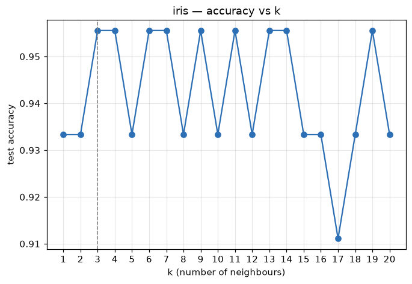
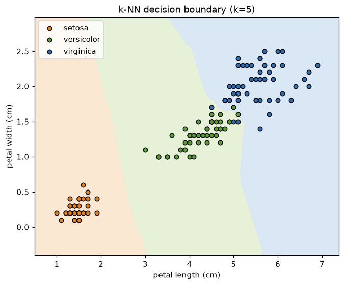

# Unit 5 — k-Nearest Neighbours and Naive Bayes

Two classifiers that sit at opposite ends of a spectrum. k-NN does *no* training at all — it keeps
the data and answers at query time. Naive Bayes builds a tiny probability model up front and throws
the data away. Both are simple, both are fast to reason about, and both still hold their own on the
right problem (k-NN when the boundary is irregular, NB when the input is text).

---

## Part A — k-Nearest Neighbours

### The idea

You want to label a new point. Look at the `k` training points closest to it and let them vote. The
majority class wins. That's the whole algorithm. There is no model to fit — k-NN is a **lazy
learner**: it memorises the training set and defers all the work to prediction time.

Contrast with everything else so far. Linear/logistic regression learn weights, decision trees learn
splits — those are **eager** learners that compress the data into parameters. k-NN keeps every point.
The "boundary" it draws is implicit: it's wherever the nearest-neighbour vote flips.

Symbols used below: `x` = the query point, `xᵢ` = a training point, `yᵢ` = its label, `k` = how many
neighbours vote, `n` = number of training points, `d` = number of features.

### Distance — how "near" is measured

Everything hinges on a distance. For two points `a` and `b` with `d` features:

- **Euclidean** (L2) — straight-line distance, the usual default:
  `dist(a,b) = √( Σⱼ (aⱼ − bⱼ)² )`
- **Manhattan** (L1) — sum of absolute gaps, "city-block" distance:
  `dist(a,b) = Σⱼ |aⱼ − bⱼ|`

Euclidean is the common choice; Manhattan is steadier when features are on odd scales or there are
outliers. Both are special cases of the **Minkowski** distance `(Σⱼ |aⱼ − bⱼ|^p)^(1/p)` with `p=2`
and `p=1`.

### Why scaling matters

The distance adds up per-feature gaps, so a feature with a big numeric range dominates it. Petal
length spans a few centimetres; if one column ran 0–1000 it would drown out everything else and the
vote would be decided by that column alone. Standardise first (`z = (x − μ) / σ`) so every feature
contributes on equal footing.

> Learned this the annoying way in the scratch code — without `StandardScaler` the wide-range column
> just swamps the distance and accuracy drops. Scale, *then* find neighbours.

### The effect of k

`k` is the one knob, and it trades noise against smoothness.

- **Small k** (k=1): the boundary hugs every point. One mislabelled or noisy neighbour flips the
  answer. Low bias, **high variance** — it overfits.
- **Large k**: the vote averages over a big neighbourhood, the boundary goes smooth, fine structure
  is lost. High bias, **low variance** — it underfits. Push `k → n` and it just predicts the overall
  majority class for everything.

The sweet spot is in between. Use an odd `k` for two classes so a vote can't tie. On iris the sweep
over `k = 1..20` lands on **k=3**:

The sawtooth is real, not noise — accuracy genuinely wobbles as each new neighbour tips borderline
test points one way or the other. k=17 dips because by then the neighbourhood reaches into the
overlapping versicolor/virginica region.

### The decision boundary

On the two petal features the three species almost fall apart on their own. k-NN carves the plane
into three regions; the border is jagged because it follows the local vote rather than any straight
line or smooth curve:

setosa (left) is linearly separable from the rest; versicolor and virginica overlap slightly near
petal-length ≈ 5, which is exactly where the few misclassifications live.

### The curse of dimensionality

k-NN leans on the idea that "near" means "similar". In high dimensions that idea breaks. As `d`
grows, points spread out until *every* pair is roughly equidistant — the nearest neighbour is barely
nearer than the farthest, so the vote stops meaning anything. Distances concentrate. The practical
fixes: drop irrelevant features, or reduce dimensions first (PCA, Unit 9). k-NN is happiest with a
handful of informative features, not hundreds of weak ones.

### Cost

No training cost, but each prediction scans all `n` training points to find the `k` closest — `O(n·d)`
per query. That gets slow on big data. Real libraries speed it up with a **KD-tree** or **ball-tree**
so the search skips most points; sklearn picks one automatically.

---

## Part B — Naive Bayes

### Bayes' theorem

The engine underneath. For a class `c` and a feature vector `x`:

`P(c | x) = P(x | c) · P(c) / P(x)`

Read it as: posterior = likelihood × prior / evidence. We want the class with the highest posterior.
`P(x)` is the same for every class, so it drops out of the comparison — we just pick the class
maximising `P(x | c) · P(c)`. `P(c)` is the **prior** (how common the class is); `P(x | c)` is the
**likelihood** (how typical this input is for that class).

### The "naive" assumption

`P(x | c)` over many features is hard — you'd need the full joint distribution. Naive Bayes makes one
bold simplification: **given the class, the features are independent**. Then the joint likelihood
factorises into a product of per-feature terms:

`P(x | c) = Πⱼ P(xⱼ | c)`

It's "naive" because features usually *aren't* independent (petal length and width clearly move
together). But the assumption keeps the model tiny and, remarkably, the class ranking often survives
even when the probabilities themselves are off. To dodge floating-point underflow from multiplying
many small numbers, do it in **log-space**: `log P(c) + Σⱼ log P(xⱼ | c)`.

### Gaussian NB — for continuous features

When features are real numbers, model each one per class as a normal (Gaussian) distribution. During
training, for each class `c` and feature `j`, just estimate a mean `μ` and variance `σ²` from the
training rows of that class. The likelihood of a value `x` is then:

`P(xⱼ | c) = (1 / √(2π σ²)) · exp( −(xⱼ − μ)² / (2σ²) )`

That's all the fitting there is: count the priors, compute per-class means and variances. Prediction
plugs `x` into the formula for every class and takes the biggest log-posterior. The from-scratch
version does exactly this and matches sklearn's `GaussianNB` — both hit **0.9778** on the iris test
split.

### Multinomial NB — for text

For text you don't have continuous values, you have **word counts**. Multinomial NB models a document
as a bag of words and asks: how likely is this word, given the class? The per-word likelihood is the
count of that word in class `c` over the total words in class `c`:

`P(word | c) = count(word, c) / Σ_w count(w, c)`

**Laplace (add-one) smoothing** fixes the zero-count trap: a word never seen in the spam training set
would give `P(word | spam) = 0` and wipe the whole product to zero. Add 1 to every count:

`P(word | c) = ( count(word, c) + 1 ) / ( Σ_w count(w, c) + V )`

where `V` is the vocabulary size. Now no probability is ever exactly zero.

### Why NB is strong for text

Text has thousands of features (one per word) and not that many documents. k-NN chokes on that (curse
of dimensionality) and logistic regression needs care, but Naive Bayes barely notices — it just
counts words, trains in one pass, and the independence assumption is a decent-enough fit for language.
Spam filters were built on it for a reason: fast, cheap, and hard to beat as a baseline.

---

## KNN vs Naive Bayes

| | **k-NN** | **Naive Bayes** |
|---|---|---|
| Type | lazy, instance-based | eager, probabilistic |
| Training | none (stores data) | one pass — counts / means & vars |
| Prediction cost | `O(n·d)` per query — scans all points | `O(d·classes)` — very fast |
| Key assumption | nearby points share a label | features independent given the class |
| Needs scaling? | yes (distance-based) | no |
| Handles high-d? | poorly (distances concentrate) | well (esp. text) |
| Output | a vote, no probability by default | a genuine posterior probability |
| Main knob | `k`, the distance metric | smoothing, the likelihood family |

Rough rule: **irregular boundary, few good features → k-NN. Text or high-dimensional counts → NB.**

---

## Worked example 1 — Bayes' theorem by hand

A disease affects 1% of people. A test is 90% sensitive (`P(+ | disease) = 0.9`) and has a 5% false
positive rate (`P(+ | healthy) = 0.05`). You test positive. What's the chance you actually have it?

Priors: `P(D) = 0.01`, `P(H) = 0.99`. Evidence:

`P(+) = P(+|D)·P(D) + P(+|H)·P(H) = 0.9·0.01 + 0.05·0.99 = 0.009 + 0.0495 = 0.0585`

Posterior:

`P(D | +) = P(+|D)·P(D) / P(+) = 0.009 / 0.0585 ≈ 0.154`

**Only ~15%.** The disease is so rare that the flood of false positives from the healthy 99% swamps
the true positives. This is the base-rate effect, and it's exactly the prior × likelihood tug-of-war
Naive Bayes runs for every class.

## Worked example 2 — k-NN classification by hand

Training points (one feature `x`, label): (1, A), (2, A), (3, A), (6, B), (7, B), (8, B). Classify a
query at **x = 4** with k=3.

Distances to the query: `|4−1|=3`, `|4−2|=2`, `|4−3|=1`, `|4−6|=2`, `|4−7|=3`, `|4−8|=4`.
The three smallest: x=3 (dist 1, **A**), x=2 (dist 2, **A**), x=6 (dist 2, **B**).
Votes: A=2, B=1 → **predict A**.

Now try k=5: neighbours are x=3(A), x=2(A), x=6(B), x=1(A), x=7(B) → A=3, B=2 → still **A**, but
closer. Bump the query to x=5 with k=3 and the nearest three are x=6(B), x=3(A)... x=7(B) → B wins.
The boundary between A and B sits right around x=4.5, midway between the clusters — precisely what the
decision-boundary figure shows in 2-D.

---

## Solved problems

**Q1. Why must features be scaled before k-NN but not before Naive Bayes?**
**Ans:** k-NN decides everything from distances, and a distance sums per-feature gaps — a large-range
feature dominates the sum and hijacks the vote, so all features must be standardised to a common
scale. Gaussian NB fits a separate mean and variance *per feature*, so each feature is judged on its
own scale and rescaling changes nothing. Distance-based methods need scaling; per-feature probability
models don't.

**Q2. A word in the test document never appeared in the training data for a class. What happens
without smoothing, and what fixes it?**
**Ans:** Its likelihood `P(word | c)` is 0, and since NB multiplies the per-word likelihoods, the
whole product collapses to 0 for that class — one unseen word vetoes the class entirely. Laplace
(add-one) smoothing adds 1 to every count and `V` (vocabulary size) to the denominator, so no
probability is ever exactly zero and a single new word can't nuke the prediction.

**Q3. You set k = n (all training points). What does k-NN predict, and what is this an example of?**
**Ans:** Every query gets the same answer — the majority class of the whole training set — because
all `n` points always vote. The model ignores the input completely. It's the extreme underfitting /
high-bias end of the k trade-off: maximum smoothing, zero sensitivity to where the query actually is.

---

## Code in this folder

- `knn_scratch.py` — k-NN from scratch (vectorised distance matrix, majority vote), checked against
  `KNeighborsClassifier` (both 0.9333 at k=5), then a sweep `k=1..20` → best k=3. Saves
  `k_vs_accuracy.png`.
- `knn_boundary.py` — the k=5 decision boundary on the two petal features → `knn_boundary.png`.
- `naive_bayes.py` — Gaussian NB from scratch (priors + per-feature mean/var + Gaussian likelihood in
  log-space), matches `GaussianNB` (both 0.9778).

Remember: k-NN scales its features and stores the data; Naive Bayes counts up a model and forgets the
data. Different philosophies, same job.
