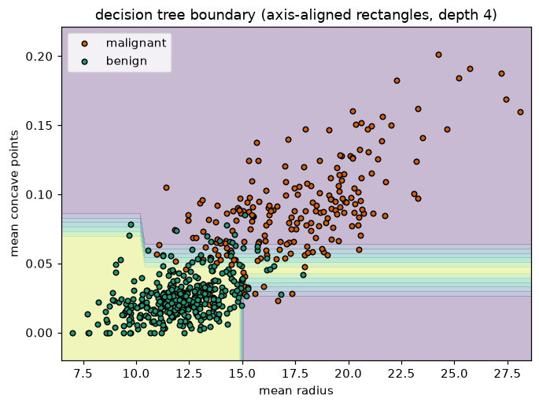
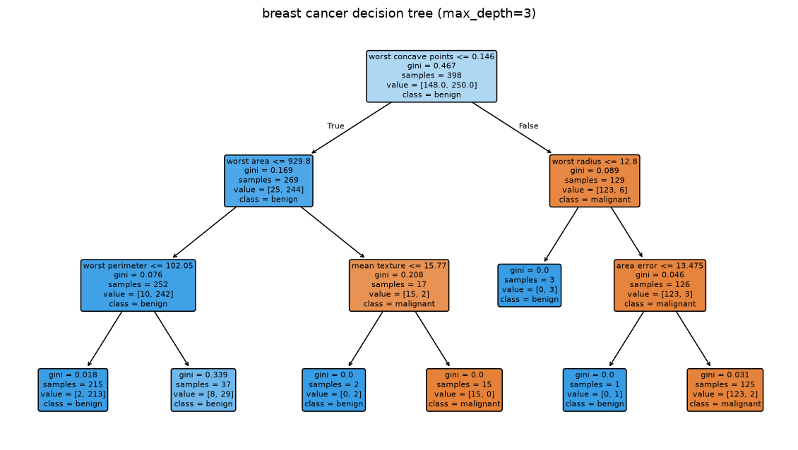
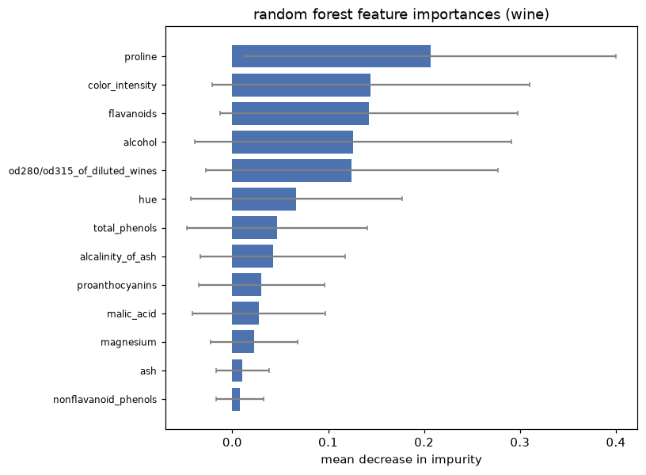

# Unit 6 — Decision Trees and Ensembles

A decision tree asks a sequence of yes/no questions about the features and reads the
answer off a leaf. "Is petal width < 0.8? then it's setosa." It is the closest thing in
ML to how a person actually reasons, which is why it is easy to draw and easy to explain
to a non-technical examiner. The whole unit is: how the tree decides *which* question to
ask, why one deep tree is fragile, and how averaging many trees fixes that.

## The idea — recursive partitioning

Start with all the training data at the root. Pick a feature and a threshold that best
separates the classes. That splits the data into two children. Repeat on each child. Stop
when a node is pure (one class) or a stopping rule fires. Each split is an **axis-aligned
cut** — a vertical or horizontal line in feature space — so a tree carves the plane into
rectangles and paints each rectangle with the majority class.



Look at the staircase. A straight diagonal boundary would separate these two classes far
more smoothly, but a tree can only cut parallel to the axes, so it approximates the
diagonal with steps. More depth = more, smaller steps = a closer (but noisier) fit.

## Choosing a split — impurity

"Best" split = the one that makes the children **purer** than the parent. We need a number
for impurity. Two are standard.

**Entropy** (from information theory) measures disorder. For a node with class
proportions p_1, ..., p_k:

```
H(S) = - Σ p_i · log2(p_i)
```

A pure node has H = 0 (no surprise). A 50/50 two-class node has H = 1 (maximum surprise).

**Information gain** is how much entropy drops when we split S on attribute A into subsets
S_v (one per value v of A):

```
Gain(S, A) = H(S) - Σ (|S_v| / |S|) · H(S_v)
```

The second term is the entropy of the children, weighted by how many examples land in
each. ID3 picks the attribute with the **largest** gain at every node.

**Gini impurity** is the alternative CART uses. It is the chance you'd mislabel a random
example if you labelled it by the node's class distribution:

```
Gini(S) = 1 - Σ p_i²
```

Also 0 when pure, 0.5 at a 50/50 two-class node. Gini and entropy almost always pick the
same split; Gini skips the `log`, so it is a touch faster. That is the only practical
difference.

| Criterion | Formula | Pure node | 2-class max | Used by |
|-----------|---------|-----------|-------------|---------|
| Entropy   | -Σ pᵢ log2 pᵢ | 0 | 1.0 | ID3, C4.5 |
| Gini      | 1 - Σ pᵢ²      | 0 | 0.5 | CART, sklearn default |

## Worked example — information gain on PlayTennis

The classic table: 14 days, decide whether to play tennis from Outlook, Temperature,
Humidity, Wind. Nine days Yes, five No.

Root entropy:

```
H(S) = -(9/14) log2(9/14) - (5/14) log2(5/14)
     = -(0.643)(-0.637) - (0.357)(-1.485)
     = 0.410 + 0.530 = 0.940
```

Now split on **Outlook** (values Sunny, Overcast, Rain):

- Sunny — 5 days, 2 Yes / 3 No → H = -(2/5)log2(2/5) - (3/5)log2(3/5) = 0.971
- Overcast — 4 days, 4 Yes / 0 No → H = 0  (already pure)
- Rain — 5 days, 3 Yes / 2 No → H = 0.971

Weighted child entropy:

```
(5/14)(0.971) + (4/14)(0) + (5/14)(0.971) = 0.693
Gain(Outlook) = 0.940 - 0.693 = 0.247
```

Do the same for the other three attributes and you get:

| Attribute   | Gain  |
|-------------|-------|
| **Outlook** | **0.247** |
| Humidity    | 0.152 |
| Wind        | 0.048 |
| Temperature | 0.029 |

Outlook wins, so it becomes the root — exactly what `information_gain.py` prints. Its
Overcast branch is already pure (all Yes) and becomes a leaf; Sunny and Rain get split
again on their best remaining attribute. That recursion *is* ID3.

> In IA1 I lost a mark writing Gain as H(children) - H(S). It's parent minus children —
> gain is always ≥ 0 because splitting can't increase disorder.

## Overfitting — the fatal weakness of one tree

Left unchecked, a tree keeps splitting until every leaf is pure. That means it memorises
the training set, including its noise. `decision_tree.py` shows this on breast cancer:

```
             depth   train    test
  unpruned       6   1.000   0.942
  max_depth=3    3   0.970   0.953
```

The unpruned tree scores a perfect 1.000 on training but **0.942** on the test set. The
shallow depth-3 tree is worse on training (0.970) yet **better** on test (0.953). The deep
tree fit noise; the shallow tree fit signal. This is the bias–variance trade-off in one
table — a single tree is a low-bias, high-variance model.

Ways to hold it back (regularisation / pruning):

- `max_depth` — cap how many questions deep the tree can go.
- `min_samples_leaf` / `min_samples_split` — refuse to split tiny nodes (a leaf of 1 is
  almost always memorised noise).
- `ccp_alpha` — cost-complexity pruning: grow the full tree, then snip back the branches
  that don't pay for themselves.



Each box shows the split test, its gini, the sample count, and the class vote. Notice the
tree splits on `worst concave points` first, then `worst area`, `worst radius` — the tree
does its own feature selection by picking the most informative attribute at each node.

## Ensembles — wisdom of the crowds

One tree is a single opinionated expert. Ask a *crowd* of trees and average their votes,
and the crowd usually beats any individual — as long as the members make **different**
mistakes that cancel out. Two ways to build a diverse crowd: build them in parallel
(bagging) or build them in sequence, each fixing the last one's errors (boosting).

### Bagging — bootstrap aggregating

Draw B bootstrap samples (sample the training rows with replacement), train one tree on
each, and average their predictions (majority vote for classification). Each tree sees a
slightly different dataset, so each overfits differently. Averaging cancels the
independent errors: variance drops by roughly a factor of B while bias stays put. That is
why bagging fixes exactly the thing a single tree is bad at — variance.

### Random Forest — bagging plus feature subsampling

Bagged trees are still correlated: if one feature is dominant, every tree splits on it
first and they all look alike, so averaging helps less. Random Forest adds a second
shot of randomness — at **each split** it considers only a random subset of features
(√p of the p features is the usual rule). This forces trees to be different, decorrelates
them, and averaging then bites much harder. RF is the reliable default: little tuning,
strong accuracy, and it comes with feature importances for free.



Each bar is a feature's **mean decrease in impurity** — total gini drop across every split
that used it, averaged over all trees. On wine, `proline`, `color_intensity` and
`flavanoids` carry the classification; the error bars are the spread across trees. This is
the everyday reason people reach for a forest: the accuracy *and* a ranked list of what
mattered.

### Boosting — learn from mistakes, in sequence

Boosting trains weak learners (usually shallow trees, even depth-1 "stumps") one after
another, each focused on what the previous ones got wrong.

**AdaBoost** keeps a weight on every training example. Start uniform. After each stump,
raise the weight of the misclassified points and lower the rest, so the next stump pays
attention to the hard cases. The final prediction is a weighted vote — more accurate
stumps get a louder say.

**Gradient Boosting** reframes this as gradient descent on the loss. Each new tree is fit
to the **residuals** (the negative gradient) of the current model, then added with a small
learning rate. Slower and touchier to tune than RF, but with careful settings it is often
the most accurate classical model — the idea behind XGBoost / LightGBM.

The split: bagging/RF reduce **variance** (average away the overfit); boosting reduces
**bias** (each round chips away error the model still makes). RF you can hand almost any
data; boosting rewards tuning but can overfit if you let it run too long.

## Comparison

`ensembles.py` on wine (30% test), all with the seed fixed:

```
model               train   test
Decision Tree       1.000   0.963
Bagging             1.000   0.981
Random Forest       1.000   1.000
AdaBoost            1.000   0.981
Gradient Boosting   1.000   0.981
```

Every ensemble beats the lone tree. Same training score (1.0) across the board, but the
ensembles generalise better — the point of the whole unit.

| Method | Build | Reduces | Trees | Tuning | Notes |
|--------|-------|---------|-------|--------|-------|
| Single tree | one | — | 1 | prune it | interpretable, high variance |
| Bagging | parallel | variance | deep, independent | little | vote over bootstraps |
| Random Forest | parallel | variance | deep, decorrelated | little | + feature subsampling, importances |
| AdaBoost | sequential | bias | stumps, weighted | some | reweights hard examples |
| Gradient Boosting | sequential | bias | shallow, additive | lots | fits residuals, most accurate |

## Solved problems

**Q1. A node has 8 positives and 2 negatives. Give its entropy and Gini impurity.**

**Ans:** p_+ = 0.8, p_- = 0.2.
H = -(0.8)log2(0.8) - (0.2)log2(0.2) = 0.8(0.322) + 0.2(2.322) = 0.258 + 0.464 = **0.722**.
Gini = 1 - 0.8² - 0.2² = 1 - 0.64 - 0.04 = **0.32**. Both say the node is fairly pure but
not perfectly.

**Q2. Two candidate splits of a 10-example node (6 Yes, 4 No). Split A → [4Yes/0No] and
[2Yes/4No]. Split B → [3Yes/2No] and [3Yes/2No]. Which does a tree pick?**

**Ans:** Parent H = -(0.6)log2(0.6) - (0.4)log2(0.4) = 0.971.
Split A children: H(4/0)=0, H(2Y,4N)=-(1/3)log2(1/3)-(2/3)log2(2/3)=0.918. Weighted =
(4/10)(0) + (6/10)(0.918) = 0.551. Gain_A = 0.971 - 0.551 = **0.420**.
Split B: both children are 3/2, H = 0.971 each, weighted = 0.971. Gain_B = **0.000**.
Split A — it creates a pure child; B leaves both children as impure as the parent, so it
buys nothing. The tree always chases the split with a pure (or purer) child.

**Q3. Why does a Random Forest usually beat a single decision tree?**

**Ans:** A single tree is low-bias but high-variance — small changes in the data give a
very different tree, and an unpruned one memorises noise (train 1.0, test lower). A forest
trains many trees on bootstrap samples *and* limits each split to a random feature subset,
so the trees are diverse and make **uncorrelated** errors. Averaging their votes cancels
those errors, cutting variance while keeping the low bias. On wine the tree scored 0.963
and the forest 1.000 for exactly this reason. The cost is interpretability — you can draw
one tree, not a hundred.

## Code

- `information_gain.py` — entropy and information gain from scratch on PlayTennis; prints
  each attribute's gain and picks Outlook as the root (mirrors ID3).
- `decision_tree.py` — sklearn tree on breast cancer: unpruned vs `max_depth=3` to show
  overfitting, gini-vs-entropy root split, `tree.png` and `tree_boundary.png`.
- `ensembles.py` — tree vs Bagging vs Random Forest vs AdaBoost vs Gradient Boosting on
  wine, plus the RF `feature_importance.png`.
