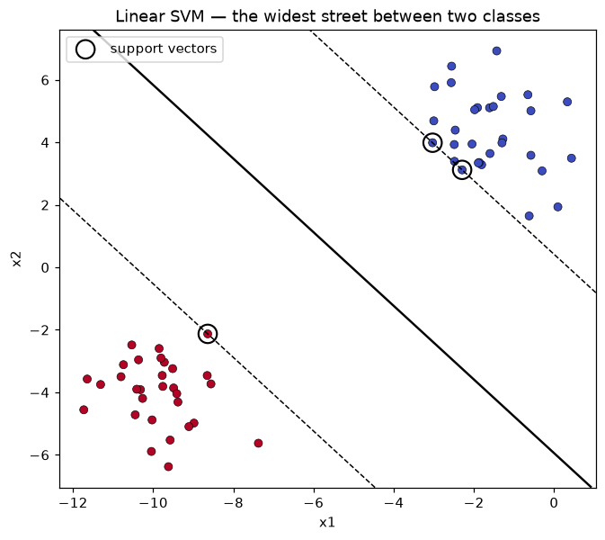
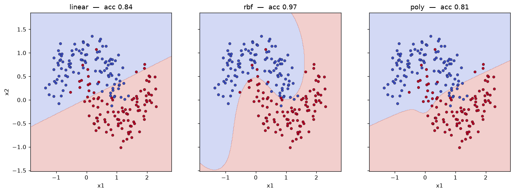

# Unit 7 — Support Vector Machines

## The picture: the widest street

Logistic regression and the perceptron are happy with *any* line that separates the
two classes. If the data is linearly separable there are infinitely many such lines,
and they pick one almost at random depending on where gradient descent stops. An SVM
asks a sharper question: of all the separating lines, which one leaves the **most room**
on either side?

Imagine driving the fattest possible street down the gap between the two classes. The
street's centre line is the decision boundary; the kerbs touch the nearest points of
each class. SVM finds the street of maximum width. The wider the street, the more slack
we have before a new point crosses to the wrong side — that is why a large margin tends
to generalise well.

The points that the kerbs rest on are the **support vectors**. They are the only points
that matter: delete every other point and re-train, and you get exactly the same street.
That is a strong property — the model is defined by a handful of borderline cases, not
by the bulk of the data.

## The hyperplane and the margin

A linear decision boundary in `d` dimensions is a hyperplane

```
w·x + b = 0
```

where `w` is the weight vector (perpendicular to the plane), `x` is a point, and `b` is
the bias (offset from the origin). We classify with the sign:

```
f(x) = sign(w·x + b)
```

Label the classes `y ∈ {-1, +1}` (SVMs use ±1, not 0/1 — it makes the algebra clean).
We are free to rescale `w` and `b`, so we fix the scale by demanding that the nearest
points satisfy `w·x + b = +1` on the positive side and `w·x + b = -1` on the negative
side. Those two parallel planes are the kerbs (the *gutters*). The centre street is the
`= 0` plane sitting exactly between them.

The distance between the two gutters — the **margin width** — works out to

```
margin = 2 / ||w||
```

`||w||` is the length of the weight vector. Wider street means smaller `||w||`. So
maximising the margin is the same as **minimising `||w||`** (equivalently `½||w||²`,
which is nicer to differentiate), subject to every point staying on the correct side:

```
minimise   ½ ||w||²
subject to y_i (w·x_i + b) ≥ 1   for every training point i
```

The constraint `y_i (w·x_i + b) ≥ 1` just says "correct side, and outside the gutter."
This is the **hard-margin** SVM: it insists on perfect separation.



The solid line is `w·x + b = 0`, the dashed lines are the ±1 gutters, and the three
circled points are the support vectors sitting on them. See `svm_margin.py`.

## Soft margin — the C parameter

Real data overlaps. If even one point is on the wrong side, the hard-margin problem has
no solution. So we let points break the rule, but charge a penalty. Introduce a **slack**
`ξ_i ≥ 0` for each point (how far it intrudes past its gutter) and pay for the total
slack:

```
minimise   ½ ||w||²  +  C · Σ ξ_i
subject to y_i (w·x_i + b) ≥ 1 - ξ_i,   ξ_i ≥ 0
```

`C` is the knob that trades the two goals:

- **Large C** — slack is expensive, so the model works hard to classify every training
  point correctly. Narrow margin, follows the data closely, risks **overfitting**.
- **Small C** — slack is cheap, so the model tolerates some misclassifications for a
  wider, smoother margin. **More regularisation**, risks underfitting.

> C is basically 1/λ from the regularised models. Big C = trust the data, small C =
> trust the margin. Mixed these up in IA2 and got the bias/variance story backwards.

A point with `ξ_i = 0` sits on or outside its gutter (fine). `0 < ξ_i < 1` is inside the
street but still correctly classified. `ξ_i > 1` is misclassified. Only points with
`ξ_i ≥ 0` and lying on/inside the margin end up as support vectors.

## The kernel trick — bending the boundary

A straight line cannot separate two interleaving moons or one class ringed by another.
The classic fix: map the data into a higher-dimensional space where it *does* separate
linearly, draw the flat hyperplane there, and it comes back as a curved boundary in the
original space.

The catch is that the mapping `φ(x)` can be huge (even infinite-dimensional), so we never
want to compute it. The **kernel trick** rescues us: the whole SVM only ever touches the
data through **dot products** `x_i · x_j`. A kernel is a function that returns the dot
product in the mapped space *without visiting it*:

```
K(x_i, x_j) = φ(x_i) · φ(x_j)
```

Swap every `x_i · x_j` for `K(x_i, x_j)` and you get a non-linear SVM for the price of a
linear one. This is the single idea that makes SVMs powerful.

### The common kernels

| Kernel | `K(x, z)` | What it does |
|--------|-----------|--------------|
| Linear | `x·z` | plain hyperplane, no mapping |
| Polynomial | `(γ x·z + r)^d` | curved boundary, degree `d` controls the bend |
| RBF (Gaussian) | `exp(-γ ||x - z||²)` | smooth local bumps, the go-to default |
| Sigmoid | `tanh(γ x·z + r)` | rarely used, behaves like a shallow net |

The **RBF / Gaussian** kernel is the workhorse. It measures similarity by distance: two
points close together give `K ≈ 1`, far apart give `K ≈ 0`. Every support vector plants a
little bump, and the boundary is the ridge where the bumps of the two classes balance.

**What gamma does.** `γ` sets the reach of each bump — the inverse width of the Gaussian.

- **Small γ** — wide bumps, each support vector influences a large region. Smooth,
  almost-linear boundary. Too small and it underfits.
- **Large γ** — narrow bumps, influence is local. The boundary wiggles tightly around
  individual points. Too large and it overfits, islands forming around single points.

So `C` and `γ` together control complexity: `C` from the margin/slack side, `γ` from the
kernel-reach side. You tune them jointly, usually by grid search with cross-validation.



Same make_moons data, three kernels. Linear can only cut a straight line and stalls at
0.84; the RBF boundary curves around each moon and reaches 0.97; the cubic poly barely
manages 0.81 here — a degree-3 curve just doesn't match the two-crescent shape, so it does
no better than the straight line. RBF is the right kernel for this data. See `kernels.py`.

## A worked margin calculation

Suppose training on a 2D set gives `w = (1, 1)` and `b = -3`. Then:

- Decision boundary: `x1 + x2 - 3 = 0`, i.e. the line `x1 + x2 = 3`.
- `||w|| = √(1² + 1²) = √2 ≈ 1.414`.
- Margin width: `2/||w|| = 2/1.414 ≈ 1.414`.
- The gutters are `x1 + x2 = 4` (positive) and `x1 + x2 = 2` (negative).

Classify the point `x = (3, 3)`:

```
w·x + b = 1·3 + 1·3 - 3 = 3  >  0   →  class +1
```

Its signed distance from the boundary is `(w·x + b)/||w|| = 3/1.414 ≈ 2.12`, so it sits
comfortably outside the positive gutter — an easy, confident point, not a support vector.

## Feeling out gamma with one number

The RBF kernel value for `x = (1, 0)` and `z = (2, 0)`, where `||x - z||² = 1`:

| γ | `K = exp(-γ · 1)` |
|-----|------------------|
| 0.1 | 0.905 (still fairly similar) |
| 1 | 0.368 |
| 5 | 0.0067 (essentially unrelated) |

At `γ = 5` two points a single unit apart already look like strangers — that is the
narrow, wiggly boundary you get from large gamma.

## SVM for regression (SVR) — a quick note

The same margin idea flips around for regression. Instead of a street *separating*
classes, SVR fits a tube of width `ε` around the regression line and only penalises
points that fall **outside** the tube. Points inside the ε-tube cost nothing (the
ε-insensitive loss); points outside pay in proportion to how far out they are, with `C`
again controlling the trade-off. The prediction is a flat line in feature space, so with
an RBF kernel you get smooth non-linear curve fitting. Use `SVR` in sklearn — same
`C`, `gamma`, `kernel` knobs, plus `epsilon`.

## When SVMs shine

| Situation | SVM a good fit? |
|-----------|-----------------|
| Small-to-medium data (up to ~10k rows) | yes — the quadratic solver is happy here |
| High-dimensional features (text, genes) | yes — margins cope well when `d > n` |
| Clear margin between classes | yes — that is exactly what it optimises |
| Very large datasets (100k+ rows) | poor — training scales badly, prefer SGD / trees |
| Need calibrated probabilities | weak — SVM outputs a score, not a probability |
| Lots of label noise / heavy overlap | so-so — soft margin helps but trees may beat it |

Always **scale the features** before an SVM (StandardScaler). The RBF kernel uses raw
distances, so a column measured in thousands would swamp one measured in fractions.

| vs other classifiers | SVM | Logistic regression | Decision tree | k-NN |
|----------------------|-----|---------------------|---------------|------|
| Boundary | max-margin, kernelisable | linear | axis-aligned splits | local |
| Handles non-linear | yes, via kernel | no (needs feature eng.) | yes | yes |
| Scales to big n | no | yes | yes | slow at predict |
| Interpretable | low | medium | high | low |
| Needs scaling | yes | helpful | no | yes |

## Solved problems

**Q1.** You are given a 2D dataset where one class forms a ring completely surrounding
the other class at the centre. You try a linear SVM and get ~55% accuracy. Which kernel
should you switch to, and why?

**Ans:** Use the **RBF (Gaussian) kernel**. The classes are not linearly separable — no
straight line can wrap a ring around a central blob, which is why the linear kernel is
barely above chance. The RBF kernel maps the points by distance, so the inner cluster and
the outer ring become separable by a closed curve (a circle) in the original space.
Polynomial degree 2 would also work here since a circle is a quadratic, but RBF is the
safer default. Scale the features first.

**Q2.** In a soft-margin SVM, a classmate sets `C = 1000` and reports 100% training
accuracy but only 78% on the test set. What is happening and what would you change?

**Ans:** Large `C` makes slack very expensive, so the model refuses to misclassify any
training point and draws a narrow, contorted margin that memorises the training data —
classic **overfitting** (train high, test low, high variance). **Lower `C`** so the model
tolerates a few training errors in exchange for a wider, smoother margin that generalises
better. Tune `C` with cross-validation rather than eyeballing.

**Q3.** With an RBF kernel and fixed `C`, you sweep `gamma` from small to large. Describe
what happens to the decision boundary and the risk at each extreme.

**Ans:** `gamma` is the reach of each support vector's bump.

- **Small gamma:** wide bumps, each support vector influences a large area, giving a
  smooth, nearly linear boundary. Too small and the model **underfits** (high bias) —
  both train and test accuracy are low.
- **Large gamma:** narrow bumps, influence is very local, so the boundary tightens into
  little islands around individual points. Too large and the model **overfits** (high
  variance) — train accuracy near perfect, test accuracy drops.

The sweet spot is a middle `gamma` found by cross-validation, usually searched jointly
with `C` over a log-spaced grid.
