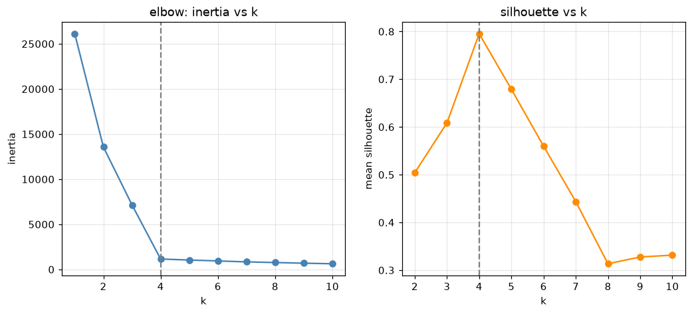
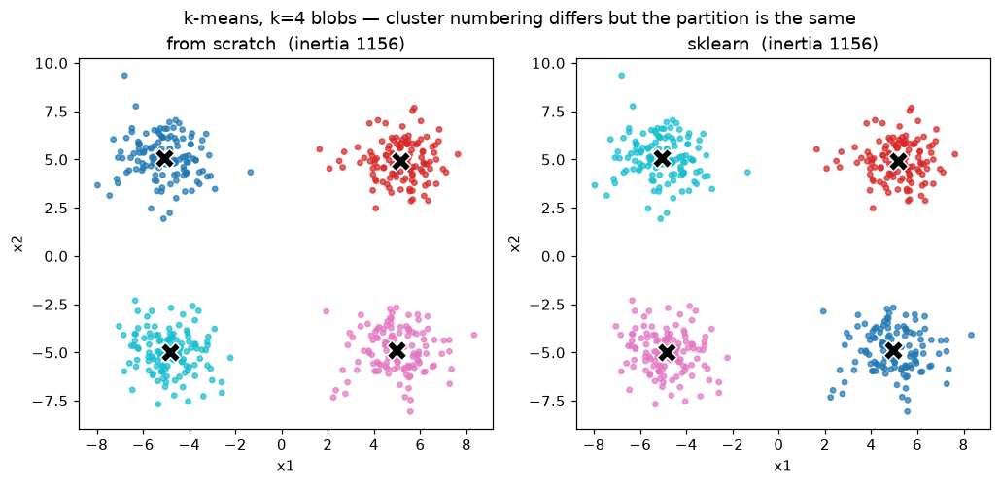
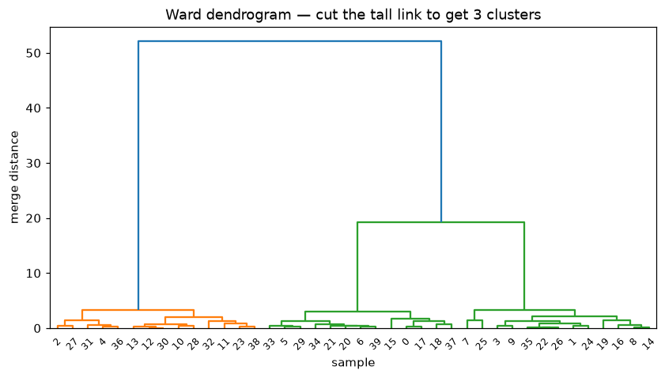
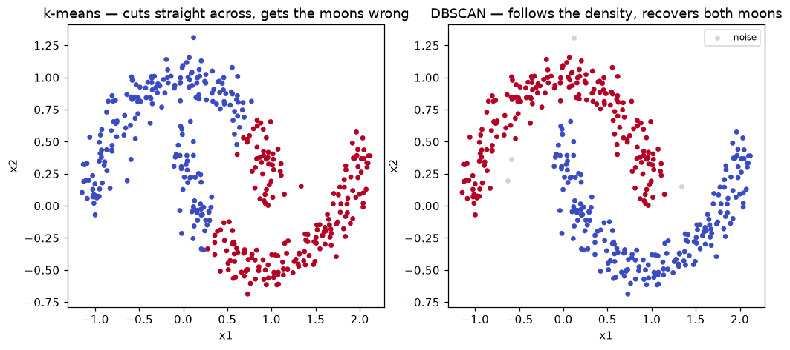

# Unit 8 — Clustering

Up to now every model was *supervised*: each row came with a label `y`, and the job was to
predict it. Clustering is the first **unsupervised** method — the data is just `X`, no labels,
and the task is to find structure on our own: groups of rows that are similar to each other and
different from the rest. Customer segments, grouping documents by topic, compressing colours in an
image, finding outliers — all clustering.

The catch is there is no answer key. Nothing tells us we got it "right"; we judge a clustering by
how tight and well-separated the groups look, using an internal score, not accuracy.

## k-means — the workhorse

The idea in one line: pick `k` cluster centres, and repeatedly (1) hand each point to its nearest
centre, then (2) move each centre to the mean of the points it now owns. Repeat until nothing moves.

**The algorithm**

1. **Init** — choose `k` initial centroids (randomly, or with k-means++, below).
2. **Assign** — give every point to the nearest centroid (squared Euclidean distance).
3. **Update** — recompute each centroid as the mean of the points assigned to it.
4. **Repeat** 2–3 until the assignments stop changing (convergence).

Each step can only lower (or hold) the objective, so it always converges — but to a *local*
optimum, not necessarily the best one. That is why the init matters.

**The objective — inertia (within-cluster SSE)**

k-means is minimising the total squared distance from each point to its centroid:

    J = Σ_j Σ_{x in C_j}  ‖x − μ_j‖²

- `C_j` — the set of points in cluster `j`
- `μ_j` — the centroid (mean) of cluster `j`
- `‖x − μ_j‖²` — squared Euclidean distance from point `x` to its centroid

sklearn calls `J` the **inertia_**. Smaller is tighter. Step 2 minimises `J` over the assignment
(nearest centroid), step 3 minimises `J` over the centroids (the mean is the point that minimises
SSE) — that alternation is why it works.

One value of `J` on its own means nothing — it depends on `n`, the scale of the features, and `k`.
It is only useful *compared* across runs on the same data (e.g. the elbow, or picking the best of
several inits).

> Note the mean is exactly the SSE-minimiser: d/dμ Σ‖x−μ‖² = 0 gives μ = mean(x). k-means is
> baked around squared Euclidean distance for this reason — swap the distance and the mean stops
> being the right update.

### Worked example — one full run by hand

Six points on a line: `2, 4, 5, 10, 12, 13`, and `k = 2`. Start the centroids at `μ1 = 4`,
`μ2 = 12`.

*Iteration 1 — assign* (distance = |x − μ|):

| x  | to μ1=4 | to μ2=12 | goes to |
|----|---------|----------|---------|
| 2  | 2       | 10       | C1      |
| 4  | 0       | 8        | C1      |
| 5  | 1       | 7        | C1      |
| 10 | 6       | 2        | C2      |
| 12 | 8       | 0        | C2      |
| 13 | 9       | 1        | C2      |

*Iteration 1 — update:* μ1 = (2+4+5)/3 = **3.67**, μ2 = (10+12+13)/3 = **11.67**.

*Iteration 2 — assign* against the new centres: 2, 4, 5 are still closer to 3.67; 10, 12, 13 still
closer to 11.67. The assignment did not change → **converged** in 2 iterations.

Final inertia: each cluster is `(2−3.67)² + (4−3.67)² + (5−3.67)² = 4.67`, and the same 4.67 on the
right, so `J = 9.33`.

### Choosing k

k-means will not tell you how many clusters there are — you pass `k` in. Two standard ways to pick:

- **Elbow method.** Run k = 1, 2, 3, … and plot inertia. It always drops as `k` grows (more centres
  = tighter), but the drop flattens once you pass the true number. The "elbow" — where the curve
  bends from steep to shallow — is a good `k`.
- **Silhouette score.** For a point, let `a` = its mean distance to others in *its own* cluster and
  `b` = its mean distance to the *nearest other* cluster. Its silhouette is

      s = (b − a) / max(a, b),        −1 ≤ s ≤ 1

  Close to 1 = snug in its cluster and far from the rest; near 0 = on a boundary; negative = probably
  in the wrong cluster. Average `s` over all points and pick the `k` with the highest mean.

On the four blobs both agree — inertia bends hard at k=4 and the silhouette peaks there. The actual
sweep from `elbow_silhouette.py`:

| k | inertia | silhouette |
|---|---------|------------|
| 2 | 13575 | 0.504 |
| 3 | 7158  | 0.609 |
| **4** | **1156** | **0.795** |
| 5 | 1043  | 0.679 |
| 6 | 943   | 0.560 |

Inertia collapses from 7158 to 1156 going 3→4, then barely moves (1156→1043) going 4→5 — that flat
tail *is* the elbow. Silhouette climbs to 0.795 at k=4 and falls after: splitting a real blob in two
makes points near the artificial split less well-separated, dragging the average down.

The elbow is the more eyeballed of the two; silhouette gives an actual number to maximise, so when
they disagree I trust the silhouette.

**One catch — scale your features first.** Every method here works on distances, so a feature
measured in the thousands (say, salary) will dominate one measured 0–1 (say, a ratio) and the
clusters will effectively ignore the small-range column. Standardise (`StandardScaler`, mean 0 / std
1) before clustering unless the columns are already comparable. The blobs here are already on the
same scale, so I skip it — but on real tabular data it is the first step.

### Limitations (and the fixes)

- **You must supply k.** No getting around it for plain k-means; use the elbow/silhouette above.
- **Assumes round, similar-sized clusters.** It draws straight (Voronoi) boundaries and uses the
  mean, so elongated, crescent, or nested shapes get chopped up. See the two moons under DBSCAN.
- **Sensitive to initialisation.** A bad random start lands in a poor local optimum. Two guards:
  run it several times and keep the lowest inertia (`n_init` in sklearn), and start smart with
  **k-means++** — pick the first centre at random, then each next centre with probability
  proportional to its squared distance from the nearest chosen centre, so seeds spread out. This is
  sklearn's default init.

The from-scratch version (k-means++ init, then the assign/update loop) lands on the **exact same
inertia** as sklearn on the blobs — same partition, just a different cluster numbering:

See `kmeans_scratch.py` (scratch vs sklearn, inertia match) and `elbow_silhouette.py` (the sweep).

## Hierarchical (agglomerative) clustering

No `k` needed up front — instead build a whole tree of nested clusters and cut it wherever you like.

**Agglomerative** = bottom-up. Start with every point as its own cluster, then repeatedly merge the
two *closest* clusters, until only one remains. "Closest" depends on the **linkage**:

| Linkage   | Distance between clusters A and B | Tends to give |
|-----------|-----------------------------------|---------------|
| Single    | min pairwise distance             | long, chained clusters (can straggle) |
| Complete  | max pairwise distance             | compact, roughly equal-diameter clusters |
| Average   | mean of all pairwise distances    | a balance of the two |
| Ward      | increase in within-cluster SSE from merging | tight, similar-sized clusters (default choice) |

**The dendrogram** records every merge: leaves are points, and the height of each join is the
distance at which those two clusters merged. Tall vertical links = clusters that stayed apart a long
time (well separated); short links = points that merged early (very similar).

**Cutting it.** Draw a horizontal line across the dendrogram; the number of vertical lines it crosses
is the number of clusters. Cut low → many small clusters; cut high → few big ones. Cut through the
*tallest* gap between merges and you get the most natural grouping. Here the two topmost links are by
far the tallest, so cutting there gives 3 clean clusters:

See `hierarchical_dbscan.py` (scipy `linkage` for the dendrogram, sklearn `AgglomerativeClustering`
for the labels).

## DBSCAN — density-based

k-means and hierarchical both struggle with odd shapes and with outliers. **DBSCAN** clusters by
*density*: a cluster is a dense region of points, and sparse gaps separate clusters. It needs no `k`
and it labels genuine outliers as noise.

Two parameters:

- **eps (ε)** — the neighbourhood radius. Two points are neighbours if within `eps`.
- **min_samples** — how many points must lie within `eps` (including the point itself) for it to be
  *dense*.

Every point is then one of three kinds:

- **Core** — has at least `min_samples` neighbours within `eps`.
- **Border** — fewer than `min_samples` neighbours, but sits within `eps` of a core point.
- **Noise** — neither; not in any cluster.

A cluster grows outward from a core point through chains of cores, sweeping in their borders. Because
it follows the density rather than fitting round blobs, it recovers **arbitrary shapes** and drops
outliers as noise. On the two moons k-means slices straight across and gets both wrong; DBSCAN traces
each crescent and flags a few stray points as noise:

The price is that `eps` needs tuning (too small → everything is noise; too large → clusters merge)
and it struggles when clusters have very different densities.

**Picking eps.** The usual trick: for each point find the distance to its `min_samples`-th nearest
neighbour, sort those distances, and plot them. The curve is flat then bends sharply upward — the
"knee" is where points stop being in dense regions, and that knee height is a good `eps`. On the
moons `eps=0.16, min_samples=5` gave the two crescents plus 4 noise points; nudging `eps` up to 0.20
swallowed the noise and eventually merged the moons into one cluster.

## Compare table

| | k-means | Hierarchical (agglomerative) | DBSCAN |
|---|---|---|---|
| Need to pick k? | yes | no (cut the tree after) | no |
| Cluster shape | spherical, similar size | depends on linkage | arbitrary |
| Handles noise/outliers? | no (every point assigned) | no | yes (explicit noise) |
| Key parameters | k, n_init | linkage, where to cut | eps, min_samples |
| Cost (n points) | ~O(n·k·iters), fast | ~O(n²·log n), heavy | ~O(n·log n) with an index |
| Output | k flat clusters + centroids | a full dendrogram | clusters + noise, no centroids |
| Best when | round well-separated groups, big n | you want the nested tree / small n | odd shapes, outliers present |

## Solved problems

**1. Silhouette of a point.** A point in cluster A has mean distance `a = 1.0` to its own cluster and
mean distance `b = 4.0` to the nearest other cluster. Its silhouette?

**Ans:** `s = (b − a)/max(a,b) = (4 − 1)/4 = 0.75`. Close to 1 — the point is well inside its cluster
and far from the neighbours, a confident assignment.

**2. DBSCAN point types.** With `eps = 1` and `min_samples = 3`: point P has 4 points within radius 1
(counting itself); Q has 2, one of which is P; R has only itself within radius 1. Classify each.

**Ans:** P has ≥ 3 in its neighbourhood → **core**. Q has < 3 but lies within `eps` of the core P →
**border**. R has no neighbours and is near no core → **noise**.

**3. Cutting a dendrogram.** The last three merges of a Ward dendrogram happen at heights 5, 6, and
22. You cut just below 22. How many clusters, and why cut there?

**Ans:** Cutting below the single height-22 merge but above the 5 and 6 merges crosses **2** vertical
lines → 2 clusters. You cut at the largest gap (between 6 and 22) because that big jump means the two
groups it joins are far more separated than anything merged below — the most natural split.

**4. Why does k-means fail on the moons?** One line.

**Ans:** k-means assigns by nearest centroid, so its boundaries are straight lines and its clusters
are convex blobs. Each moon is a long curved (non-convex) shape, so the straight split cuts across
both crescents instead of following them — DBSCAN, which grows clusters along density, does not.
