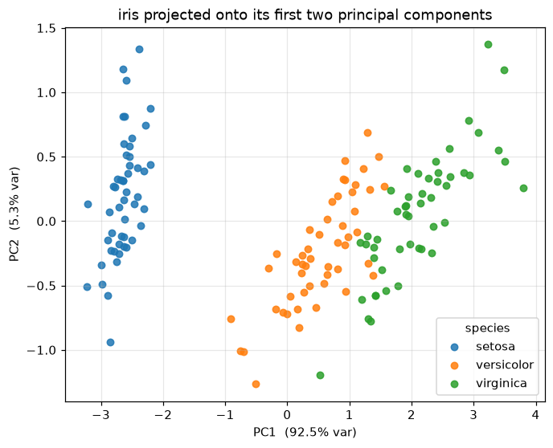
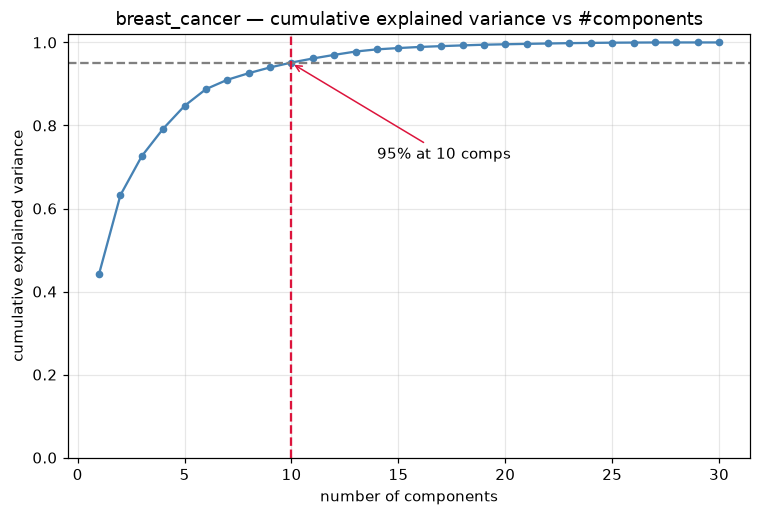
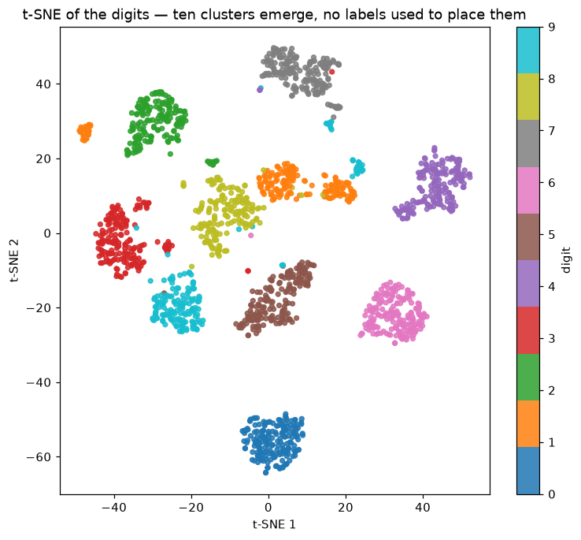

# Unit 9 — Dimensionality Reduction

Most of the datasets so far had a handful of features. Real ones do not: a 28×28 image is 784
numbers, a gene-expression row is 20,000, a bag-of-words document tens of thousands. Carrying that
many features is expensive, hard to plot, and — less obviously — it *hurts accuracy*. This unit is
about squeezing a wide dataset down to a few well-chosen dimensions while throwing away as little as
possible.

## The curse of dimensionality

Adding features sounds like it should only ever help — more information, surely a better model. Past
a point it does the opposite, because volume grows exponentially with dimension and the same points
spread thinner and thinner.

A way to feel it: to cover 10% of the *volume* of a 10-D unit cube you need a cube of side
`0.1^(1/10) ≈ 0.8` — you reach across 80% of every axis just to trap a tenth of the space. The
fallout:

- **Distances lose contrast.** k-NN, k-means, RBF kernels all lean on distance, and in high `d` the
  nearest and farthest points sit almost the same distance away.
- **Data gets sparse**, so models **overfit**, fitting noise in directions with barely any data.
- **Everything slows down** and nothing plots — you cannot eyeball a 30-D cloud.

> The phrase is Bellman's. The exam one-liner I kept: in high dimensions your data is all corners and
> no middle, every point a lonely outlier.

## Why reduce dimensions

Four reasons, and be clear which one you are after because it changes the tool:

- **Visualisation** — collapse to 2-D/3-D to *see* clusters, outliers and class overlap; t-SNE's home.
- **Speed and memory** — fewer features, faster training, smaller model. PCA to 50 dims before a
  classifier is routine.
- **Denoising** — low-variance directions are mostly noise; dropping them can *raise* test accuracy.
- **Fighting overfitting** — fewer inputs means fewer parameters and less room to memorise.

## PCA — the intuition

Principal Component Analysis is the workhorse. The idea in one sentence: **find the directions along
which the data varies the most, and keep only those.**

Picture a flat, tilted ellipse of points floating in 3-D. Almost all the spread is along the long
axis; a bit along the short axis; hardly any in the thin direction perpendicular to the sheet. PCA
finds those axes — longest spread first — and lets you drop the thin ones. Project onto the two
longest and the 2-D picture has lost almost nothing, because there was almost nothing in the
direction you threw away.

Why *variance*? Because variance is information here — a direction where all the points look the same
separates nothing; where they spread out is where the differences live. PCA keeps spread, discards
flatness. The new axes are the **principal components** (PCs): ordered (PC1 has the most variance,
PC2 next, ...), mutually **orthogonal**, each a linear mix of the original features.

## PCA — the mechanics

Four steps, and the from-scratch code in `pca_scratch.py` is exactly these:

**1. Centre the data.** Subtract each feature's mean, `Xc = X - mean(X)`, so the cloud sits at the
origin — PCA measures spread *around the centre*, and without centring PC1 just points at the mean.

**2. Build the covariance matrix.** For centred data, `C = (Xcᵀ Xc) / (n - 1)`, a `d × d` matrix. The
diagonal `C[i,i]` is the variance of feature `i`; the off-diagonal `C[i,j]` is how features `i` and
`j` move together, so correlated features show up as large off-diagonals.

**3. Eigen-decompose it.** Solve `C v = λ v`. Each **eigenvector** `v` is a principal direction; its
**eigenvalue** `λ` is the variance along that direction. Because `C` is symmetric the eigenvectors
come out orthogonal — that is why the PCs are at right angles. Sort them so `λ₁ ≥ λ₂ ≥ …`. (In code,
`np.linalg.eigh` on the covariance; sklearn uses the SVD of `Xc`, giving identical directions more
stably.)

**4. Project onto the top `k`.** Stack the top `k` eigenvectors as columns of `W` and map `Z = Xc W`.
Now every row is `k` numbers instead of `d` — the reduced dataset.

## Explained variance ratio

Each eigenvalue is a variance, so the fraction of total spread PC `i` captures is `λ_i / (λ₁ + … +
λ_d)`, and the ratios sum to 1. On iris, `pca_scratch.py` prints:

```
  PC   scratch  sklearn
  PC1   0.9246   0.9246
  PC2   0.0531   0.0531
  PC3   0.0171   0.0171
  PC4   0.0052   0.0052
```

The from-scratch eigen-decomposition matches sklearn's SVD to four decimals, and the projections
agree once you fix the sign (`v` and `-v` are both valid, so a PC can come out flipped). The first
two components already hold **97.8%** of the variance, which is why iris draws so cleanly in 2-D —
setosa a clean island, versicolor and virginica touching but barely overlapping, all from four
features squeezed to two:



## How to pick k

Two standard rules: **variance threshold** — keep enough components to reach, say, 95% of the total
variance, reading it off the *cumulative* explained-variance curve; or **the elbow** — the curve
rises steeply then flattens, and the bend is a natural cut-off. `explained_variance.py` runs PCA on
breast_cancer (30 features, scaled first because they span wildly different ranges) and prints:

```
PC1 alone: 44.3%
components for 90% variance: 7
components for 95% variance: 10
first 10 components carry 95.2%
```

So 30 features compress to **10** with 95% of the variance kept — a 3× reduction almost for free. The
knee is around 5–7 components; by 10 the curve is flat and the tail past ~15 is noise.



> Always scale before PCA when features are in different units. PCA chases variance, and an unscaled
> "area" column in the hundreds dwarfs a "smoothness" column in the hundredths by size, not by
> importance.

## PCA is unsupervised and linear — know the limits

Two properties worth stating plainly, because they are where PCA fails:

- **Unsupervised.** PCA never looks at `y`. It keeps the directions of biggest variance, *usually* the
  useful ones — but if the class-separating direction is low variance, PCA can throw it away. (When
  you specifically want the discriminating direction, that is LDA, which *is* supervised.)
- **Linear.** Every PC is a straight-line combination of features, so PCA can only rotate and project,
  never unroll a curved manifold. A Swiss roll or two interleaving moons will not straighten out under
  PCA however many components you keep — and that second limit is exactly what the non-linear methods
  are for.

## t-SNE — for looking, not for features

t-SNE (t-distributed Stochastic Neighbour Embedding) is a **visualisation** method. It embeds
high-dimensional data into 2-D by keeping *neighbourhoods* intact — points close in the original
space stay close in the picture — turning distances into probabilities and minimising the mismatch
(a KL divergence) between the high-D and 2-D neighbour distributions.

`tsne_vis.py` runs it on the digits (PCA to 30 dims first — the standard denoise-and-speed step —
then t-SNE to 2-D):



Ten clean islands, one per digit, and the labels were only used to *colour* the plot, never to place
the points — where a linear PCA scatter of digits is a fuzzy blob, t-SNE pulls the groups apart.

**What t-SNE is bad at — and these cost marks:**

- **Only for viz.** Do *not* feed t-SNE coordinates into a classifier — there is no `transform` for
  new points; the embedding is a one-off layout of *this* data.
- **Distances between clusters are meaningless.** How far apart two islands sit, and their sizes, are
  artefacts — do not read them as "these classes are more different."
- **`perplexity` matters.** Roughly the neighbour count each point considers (5–50 typical); too small
  shatters into specks, too large merges clusters.
- **Slow and non-convex.** `O(n²)`-ish and stochastic, so set `random_state`. (UMAP is the faster
  modern cousin with the same job.)

## Feature selection vs feature extraction

Two different ways to end up with fewer features, often confused:

- **Feature selection** — *keep a subset of the original columns*, drop the rest. The survivors are
  still real, named features ("age", "tumour radius"), so the model stays interpretable. Done by
  filters (correlation, chi²), wrappers (RFE), or embedded methods (L1 / Lasso zeroing coefficients).
- **Feature extraction** — *build new features* as combinations of the originals. PCA is extraction:
  PC1 is a blend of all `d` columns, so it is compact but no longer directly interpretable.

| | Feature selection | Feature extraction |
|---|---|---|
| Output | subset of original features | new combined features |
| Interpretable? | yes — real named columns | usually not (mixed) |
| Example | Lasso, RFE, chi² filter | PCA, LDA, autoencoder |
| Keeps original meaning | yes | no |

Rule of thumb: **selection** when you need to explain the model or know features are irrelevant;
**extraction** when features are correlated and you just want a compact, denoised representation.

## PCA vs t-SNE at a glance

| | PCA | t-SNE |
|---|---|---|
| Goal | preserve global variance | preserve local neighbourhoods |
| Linear? | linear | non-linear |
| Supervised? | no | no |
| Deterministic? | yes | no (seed it) |
| New data (`transform`) | yes | no |
| Use for features? | yes | no — viz only |
| Speed | fast | slow |
| Best at | compression, denoising | seeing clusters |

## Worked example — 2-D → 1-D PCA by hand

**Centre.** Four points **(1, 1), (2, 3), (3, 2), (4, 4)**; mean `(2.5, 2.5)`. Centred points:

```
(-1.5, -1.5)   (-0.5, 0.5)   (0.5, -0.5)   (1.5, 1.5)
```

**Covariance** (denominator `n − 1 = 3`):

```
var(x) = [(-1.5)² + (-0.5)² + 0.5² + 1.5²]/3 = 5/3 = 1.667   (var(y) same by symmetry)
cov(x,y) = [2.25 − 0.25 − 0.25 + 2.25]/3     = 4/3 = 1.333

C = | 1.667  1.333 |
    | 1.333  1.667 |
```

**Eigenvalues.** For a matrix `[[a, b], [b, a]]` they are `a + b` and `a − b`, so `λ₁ = 3.000` and
`λ₂ = 0.333`. Explained variance: `λ₁ / (λ₁ + λ₂) = 3.0 / 3.333 = 90%` on PC1, 10% on PC2.

**Eigenvectors.** `a + b` pairs with `(1, 1)`, `a − b` with `(1, −1)`; normalise:

```
v₁ = (1, 1)/√2  = (0.707, 0.707)     ← PC1, the diagonal the points spread along
v₂ = (1, −1)/√2 = (0.707, −0.707)    ← PC2
```

**Project onto PC1** (`z = Xc · v₁`):

```
(-1.5, -1.5)·v₁ = -2.121
(-0.5,  0.5)·v₁ =  0.000
( 0.5, -0.5)·v₁ =  0.000
( 1.5,  1.5)·v₁ =  2.121
```

Four 2-D points become four numbers `[-2.121, 0, 0, 2.121]`, keeping 90% of the variance; the two
middle points collapse together because they only differed along the dropped direction. Every line
here is reproduced by `np.linalg.eigh` in `pca_scratch.py`.

## Solved problems

**Q1.** A dataset has 1000 features. PCA shows the first 20 components capture 98% of the variance.
Your friend says "great, so the other 980 features are useless — delete those columns." What is wrong
with that statement?

**Ans:** They are confusing **components** with **features**. The 20 principal components are not 20
of the original columns — each PC is a linear combination of *all* 1000 features, so every column
contributes to those 20 PCs and none can be deleted. What you can do is *replace* the 1000 features
with the 20 PC scores (feature **extraction**), keeping 98% of the variance in 20 new numbers.
Deleting original columns would be feature **selection**, which PCA does not perform.

**Q2.** You run PCA on a dataset without scaling. One feature is measured in metres (range ~0–2) and
another in millimetres (range ~0–2000). PC1 comes out almost entirely aligned with the millimetre
feature. Explain, and give the fix.

**Ans:** PCA maximises **variance**, and variance depends on units. The millimetre feature has values
a thousand times larger, so its variance is about a million times larger, and PC1 simply chases that
one column regardless of whether it is actually the most informative direction. The fix is to
**standardise** every feature (subtract the mean, divide by the standard deviation) *before* PCA, so
each contributes on an equal footing. This is exactly why `explained_variance.py` calls
`StandardScaler` first.

**Q3.** A classmate embeds the digits with t-SNE, then trains a logistic-regression classifier on the
two t-SNE coordinates and reports the test accuracy. Name two things wrong with this.

**Ans:** (1) t-SNE is a **visualisation** tool, not a feature transform — it cannot embed new (test)
points consistently, so there is no valid `transform` for held-out data; train and test coordinates
would come from separate, non-comparable runs. (2) t-SNE distorts global geometry on purpose
(inter-cluster distances and cluster sizes are meaningless), so its coordinates are not trustworthy
features. For dimensionality reduction *feeding a classifier*, use PCA (or LDA), which has a proper
`transform` and preserves linear structure.
