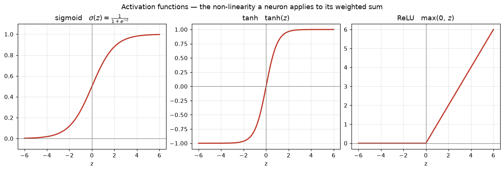
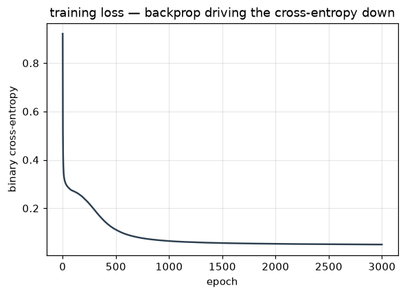
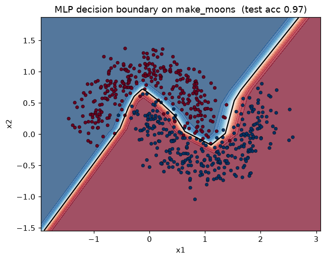

# Unit 10 — Neural Networks

Every model so far drew a boundary of a fixed shape: a straight line (logistic regression, linear
SVM), an axis-aligned staircase (a tree), a kernel's curve. A neural network is different — you give
it a stack of simple units and it *learns what shape the boundary should be* from the data. That is
the whole appeal, and the reason deep learning eventually ate computer vision and language.

We build it up in order: one neuron (the perceptron), why one neuron isn't enough (XOR), then many
neurons in layers (the MLP), how it predicts (forward propagation), and how it learns
(backpropagation). The math stays honest but the picture in your head is simple.

## The neuron — a weighted sum plus a squash

One artificial neuron does two things. It takes a weighted sum of its inputs, then passes that
through a non-linear **activation** `g`:

```
z = w·x + b          the linear score (a weighted vote of the features)
a = g(z)             the activation (the neuron's output)
```

Symbols, all of them:

| Symbol | Meaning |
|--------|---------|
| `x`    | the input, a vector of `n` features |
| `w`    | weights, one per input |
| `b`    | bias / threshold (a scalar) |
| `z`    | pre-activation, the linear score `w·x + b` |
| `g`    | activation function (step, sigmoid, tanh, ReLU) |
| `a`    | the neuron's output `g(z)` |

This is literally logistic regression when `g` is the sigmoid. The neuron is not a new idea — it's
the old linear score with a squash on top. The power comes from wiring many of them together.

## The perceptron

Rosenblatt's **perceptron** (1958) is a single neuron with a *step* activation:

```
g(z) = 1 if z ≥ 0  else  0
```

It predicts a class directly. To train it, Rosenblatt gave a rule that only touches the weights when
the neuron gets an example wrong:

```
w ← w + α (y − ŷ) x
b ← b + α (y − ŷ)
```

If the prediction was right, `y − ŷ = 0` and nothing moves. If it predicted 0 but should have said 1,
it nudges the weights *toward* `x`; if it over-predicted, *away* from `x`. The **perceptron
convergence theorem** guarantees this finds a separating boundary in finite steps — but only if one
exists, i.e. only if the classes are **linearly separable**.

`perceptron.py` trains it on the logic gates. AND and OR both reach 100% accuracy — a single line
splits the 0s from the 1s:

```
AND:  w=[0.2 0.1]  b=-0.20   acc=1.00
OR:   w=[0.1 0.1]  b=-0.10   acc=1.00
XOR:  w=[-0.1  0.]  b=+0.00   acc=0.50
```

## What one neuron can't do — the XOR problem

XOR is 1 when exactly one input is 1:

| x₁ | x₂ | XOR |
|----|----|-----|
| 0  | 0  | 0   |
| 0  | 1  | 1   |
| 1  | 0  | 1   |
| 1  | 1  | 0   |

Plot those four points. The two 1s sit on one diagonal, the two 0s on the other. **No single straight
line** can put both 1s on one side and both 0s on the other — XOR is not linearly separable. So the
perceptron never gets past 50%, no matter how long it trains.

> Minsky and Papert's 1969 book *Perceptrons* proved exactly this, and the field's funding dried up
> for a decade — the first "AI winter". The fix was known in principle (add a hidden layer) but a way
> to *train* the hidden layer efficiently only became popular with backprop in the 1980s.

The escape is to stack neurons. One hidden layer can carve the input into regions a second layer
recombines — and XOR falls immediately. That stack is the multilayer perceptron.

## Activation functions

The activation is what makes a network non-linear. Without it, stacking layers is pointless (see the
next section). The three you must know:



| Activation | Formula | Range | Derivative | Notes |
|------------|---------|-------|-----------|-------|
| sigmoid | `1/(1+e^⁻ᶻ)` | (0, 1) | `σ(1−σ)` | squashes to a probability; saturates, gradients vanish |
| tanh | `(eᶻ−e^⁻ᶻ)/(eᶻ+e^⁻ᶻ)` | (−1, 1) | `1−tanh²` | zero-centred, usually beats sigmoid in hidden layers |
| ReLU | `max(0, z)` | [0, ∞) | `1 if z>0 else 0` | cheap, no saturation for z>0, the default hidden unit |

**Why ReLU won.** Sigmoid and tanh flatten out at the ends — their derivative goes to ~0, so in a deep
stack the error signal shrinks toward nothing as it flows back (the **vanishing gradient** problem)
and the early layers barely learn. ReLU's slope is a flat 1 for all positive `z`, so the gradient
passes straight through, and `max(0, z)` is one comparison; its wart is "dead" units (a neuron stuck
at `z<0` outputs 0 forever), which leaky-ReLU patches.

Output-layer activation is chosen by the task, not by taste: **sigmoid** for binary (one probability),
**softmax** for multiclass (a probability distribution over `K` classes), **none/linear** for
regression (an unbounded number).

## The multilayer perceptron (MLP)

Stack a **hidden layer** of neurons between input and output. Each hidden unit is its own weighted
sum + activation; the output layer takes the hidden activations as *its* input.

Here is the point that justifies the activation function. Suppose there were no `g` — every layer
just a linear map. Then

```
output = W₂(W₁x + b₁) + b₂ = (W₂W₁)x + (W₂b₁ + b₂)
```

which is *still linear* in `x`. Ten stacked linear layers collapse into one. The non-linear `g`
between layers is exactly what stops that collapse and lets the network represent curved boundaries.

Layout for a 2-layer net (one hidden layer of `h` units, one output):

```
input x  →  [W₁, b₁]  →  g  →  hidden a₁  →  [W₂, b₂]  →  output
 (n)          (n×h)                (h)          (h×1)
```

## Forward propagation

Forward propagation is just evaluating the network left to right. For a batch `X` (m examples × n
features), ReLU hidden, sigmoid output:

```
Z₁ = X W₁ + b₁          shape (m, h)      hidden pre-activations
A₁ = ReLU(Z₁)           shape (m, h)      hidden activations
Z₂ = A₁ W₂ + b₂         shape (m, 1)      output pre-activation
A₂ = σ(Z₂)              shape (m, 1)      predicted probabilities ŷ
```

That's the whole prediction. The art is finding the weights.

## The loss

For binary classification we reuse Unit 4's **binary cross-entropy**, averaged over the batch:

```
J = −(1/m) Σ [ yᵢ log(ŷᵢ) + (1−yᵢ) log(1−ŷᵢ) ]
```

Regression outputs swap in MSE; softmax multiclass uses categorical cross-entropy. Training = adjust
every weight to make `J` small.

## Backpropagation

We can't solve for the weights in closed form, so we do gradient descent — which needs `∂J/∂W` for
*every* weight, including the ones buried in the hidden layer. **Backpropagation is the chain rule
applied layer by layer, from the loss backward to the inputs.** The intuition: the output error is
known, so push it *backwards*, handing each layer its share of the blame in proportion to how much it
contributed forward.

For the 2-layer net above the gradients come out clean. Start at the output — and here the sigmoid +
cross-entropy combine into the same tidy residual we saw in logistic regression:

```
dZ₂ = (A₂ − y) / m                          how wrong the output was
dW₂ = A₁ᵀ dZ₂          db₂ = Σ dZ₂          output-layer gradients
```

Now flow the error back through `W₂` into the hidden layer, and un-do the ReLU:

```
dA₁ = dZ₂ W₂ᵀ                                blame arriving at the hidden activations
dZ₁ = dA₁ ⊙ (Z₁ > 0)                         ReLU passes gradient only where it was active
dW₁ = Xᵀ dZ₁           db₁ = Σ dZ₁           input-layer gradients
```

`⊙` is element-wise product. Notice the pattern: each layer's weight gradient is `(its input)ᵀ ×
(its incoming error)`, and the error is relayed to the previous layer through that layer's own
weights. Once you have the gradients, the update is plain gradient descent:

```
W ← W − α · dW          b ← b − α · db          (α = learning rate)
```

Repeat forward → backward → update for many epochs. The loss falls:

```
epoch    0   loss 0.9214
epoch  500   loss 0.1113
epoch 1500   loss 0.0562
epoch 2999   loss 0.0501
```



`mlp_scratch.py` is this net, ~40 lines of numpy, and it solves the two moons — a problem no straight
line can touch — at 0.97 test accuracy, matching sklearn's `MLPClassifier`.

## Gradient descent variants

One knob is *how many examples you look at before each weight update*. **Batch** GD uses the whole
training set per step — exact but slow; **SGD** updates after every single example — noisy and cheap,
and the noise can bump it out of poor minima; **mini-batch** GD (32–256 per step) is the practical
middle ground everyone uses. On top of it, optimisers like **momentum** and **Adam** adapt the step
size per weight to converge faster (sklearn's default solver is Adam).

| Variant | Examples per update | Trade-off |
|---------|--------------------|-----------|
| Batch | all `m` | exact gradient, slow, memory-heavy |
| SGD | 1 | fast, very noisy, can escape local minima |
| Mini-batch | 32–256 | the standard — vectorised and stable |

## Overfitting, and the practical tool

A big network has enough weights to memorise the training set, so regularisation matters more here
than anywhere. Two techniques specific to nets: **dropout** randomly zeroes a fraction of hidden
units each training step, forcing the network not to rely on any one neuron (a cheap ensemble
effect); **early stopping** watches the validation loss and halts the moment it starts rising, before
the model overfits. Plain L2 weight decay on the weights applies here too.

You would not hand-write backprop in practice — you write the *architecture* and let
**Keras/TensorFlow** or **PyTorch** compute the gradients automatically (autodiff) and run on a GPU.
`mlp_scratch.py` exists so you understand what those libraries are doing under the hood;
`mlp_sklearn.py` is the "just use the library" version.

## Why deep learning

Add more hidden layers and the network learns a **hierarchy of features** on its own. On images the
first layer learns edges, the next combines them into corners and textures, the next into object
parts, the last into whole objects — nobody hand-designed those features, the network discovered them
because they made the loss small. That is **representation learning**, and it's why deep nets replaced
hand-crafted feature engineering in vision and NLP. They need lots of data and compute and are hard to
interpret, so for a small table of tidy features a gradient-boosted tree often still wins — reach for
deep learning when the raw input is rich (pixels, audio, text) and plentiful.



The MLP wraps a smooth non-linear boundary around each moon — impossible for a single perceptron.

## Worked example — a forward pass by hand

A tiny 2→2→1 net, ReLU hidden, sigmoid output. Input `x = [1, 0]`.

```
W₁ = [[ 1, −1],      b₁ = [0, 0]
      [ 1,  1]]
W₂ = [[1],           b₂ = [0]
      [1]]
```

1. Hidden pre-activation: `z₁ = x W₁ = [1·1+0·1,  1·(−1)+0·1] = [1, −1]`
2. Hidden activation (ReLU): `a₁ = [max(0,1), max(0,−1)] = [1, 0]`
3. Output pre-activation: `z₂ = a₁ W₂ = 1·1 + 0·1 = 1`
4. Output (sigmoid): `ŷ = σ(1) = 1/(1+e⁻¹) = 0.731`

So the network outputs 0.731 → class 1. The second hidden unit fired a negative score and ReLU
clipped it to 0, so it contributed nothing — that gating is exactly what lets hidden units specialise.

## Solved problems

**Q1. For the net above, what does it output for `x = [0, 1]`?**

**Ans:** `z₁ = [0·1+1·1, 0·(−1)+1·1] = [1, 1]`; ReLU leaves it `a₁ = [1, 1]`; `z₂ = 1+1 = 2`;
`ŷ = σ(2) = 0.881`. Both hidden units fire this time, so the output is more confident than in the
worked example.

**Q2. How many trainable parameters are in a 3 → 4 → 2 network (input 3, one hidden layer of 4,
output 2)?**

**Ans:** A layer with `n_in` inputs and `n_out` units has `n_in·n_out` weights + `n_out` biases.
Hidden: `3·4 + 4 = 16`. Output: `4·2 + 2 = 10`. Total **26**. (Same rule on the net in
`mlp_scratch.py`, 2→16→1: `2·16+16 = 48` plus `16·1+1 = 17`, so **65** weights learn to separate the
moons.)

**Q3. Which activations would you use for the hidden layers and the output of (a) a spam/not-spam
classifier, (b) a 10-digit classifier, (c) a house-price predictor?**

**Ans:** Hidden layers: **ReLU** in all three — it's the cheap, non-saturating default. Output:
(a) **sigmoid** — one probability for the binary label; (b) **softmax** — a probability distribution
over the 10 mutually-exclusive classes; (c) **linear / no activation** — price is an unbounded real
number, so don't squash it.

## Code

- `perceptron.py` — Rosenblatt's perceptron from scratch. Learns AND and OR to 100%, sticks at 50%
  on XOR (not linearly separable). Also draws `activations.png` (sigmoid, tanh, ReLU).
- `mlp_scratch.py` — the centrepiece: a 2-layer net (ReLU hidden + sigmoid output) with forward pass
  and backprop written out in numpy, trained on `make_moons`. Prints the loss falling and ~0.97 test
  accuracy, matching sklearn's `MLPClassifier` on the same split. Saves `loss_curve.png` and
  `nn_boundary.png`.
- `mlp_sklearn.py` — `MLPClassifier` on the digits data (10-class), ~0.96 test accuracy — the tool
  you'd actually use once the mechanics are clear.

Remember: a neuron is `g(w·x+b)`; one can't do XOR; a hidden layer + a non-linearity can. Forward
= evaluate left to right; backprop = chain-rule the error right to left; then gradient-descend.
