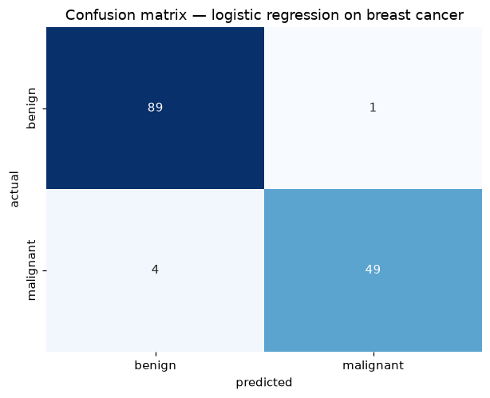
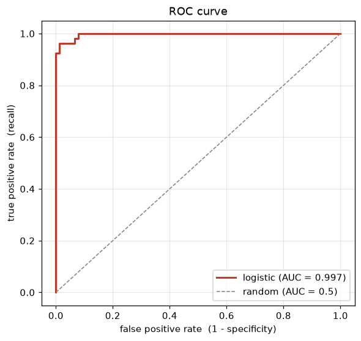
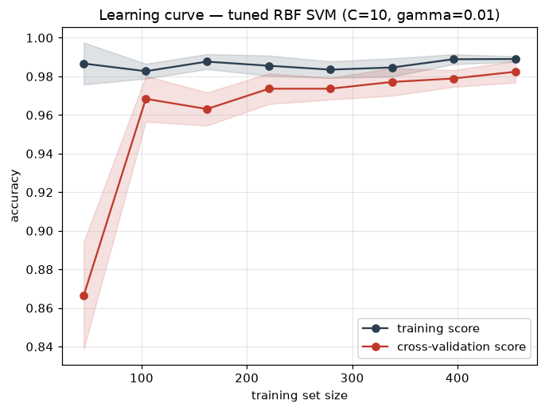

# Unit 11 — Model Evaluation

You have trained a classifier and it reports 97% accuracy. Ship it? Not yet — a single accuracy number
can hide the mistakes that matter, be flattered by luck in the split, or hide a model that peeked at the
test data. This unit is about measuring *honestly*: the right metric, a trustworthy estimate, discipline.

## The one-number trap

Accuracy is `(correct predictions) / (total predictions)`. For a balanced problem with equal-cost
mistakes it is fine. It falls apart the moment either assumption breaks.

Take fraud detection: 999 legitimate transactions for every 1 fraud. A model that predicts "legit,
always" — a single `return 0` — scores **99.9% accuracy** and catches zero fraud. It is worthless, yet
the number looks brilliant: accuracy rewards being right about the boring majority while missing every
case you built the system for. The flaw is that it weights every class and every mistake equally (a
missed cancer is not a bounced newsletter). We need to see *which kind* of mistake the model makes.

## The confusion matrix

Fix a **positive** class (the thing you detect — fraud, spam, malignant tumour) and split every
prediction into four buckets by comparing it against the truth:

| | predicted positive | predicted negative |
|---|---|---|
| **actually positive** | TP (true positive) | FN (false negative) |
| **actually negative** | FP (false positive) | TN (true negative) |

- **TP** — flagged it, and it really was positive. A hit.
- **TN** — passed on it, and it really was negative. Correct rejection.
- **FP** — flagged it, but it was negative. A *false alarm* (Type I error).
- **FN** — passed on it, but it was positive. A *miss* (Type II error).

Every metric below is a ratio of these four counts, and the whole art of evaluation is deciding which
of FP and FN hurts more — you almost never get to drive both to zero.

> Mnemonic that stuck: the second word is what you predicted, the first is whether you were right. A
> "false negative" = you said negative and that was false — a miss. Untangled this the night before IA2.

## Precision, recall, F1

From the four counts:

```
precision = TP / (TP + FP)      of the ones I flagged, how many were right?
recall    = TP / (TP + FN)      of the ones that were positive, how many did I catch?
F1        = 2 · (precision · recall) / (precision + recall)
```

- **Precision** — when the model says positive, do I trust it? Low precision = false alarms. Matters
  when acting on a positive is expensive or annoying.
- **Recall** (sensitivity, TPR) — of everything I should have caught, how much did I? Low recall =
  misses. Matters when a miss is dangerous.
- **F1** — the *harmonic* mean of the two, one number that stays low unless *both* are decent. Harmonic,
  not arithmetic, so you cannot buy a good F1 with 1.0 precision and 0.02 recall.

### The precision–recall tradeoff

They pull against each other. A classifier outputs a score; you pick a **threshold** above which you
call it positive. Raise it and precision rises but recall drops (borderline positives slip through);
lower it and recall rises but precision falls. You cannot maximise both — pick by which error is cheaper.

| Problem | Costlier mistake | Optimise for |
|---|---|---|
| Cancer screening | FN — missing a real tumour | **recall** (catch them all, tolerate false alarms) |
| Spam filter | FP — junking a real email | **precision** (never bin a good message) |
| Fraud alerts to humans | FP — wasting investigators | precision, with recall as a floor |

> Spam vs cancer is the exam's favourite pair. Spam: a false positive bins your boss's email — guard
> precision. Cancer: a false negative sends a sick patient home — guard recall. Same math, opposite dial.

### Worked: read the metrics straight off the matrix

`metrics.py` trains logistic regression on the breast-cancer data with **malignant** as the positive
class. The test confusion matrix comes out:

```
            predicted
           benign  malignant
benign       89        1        <- TN=89, FP=1
malignant     4       49        <- FN=4,  TP=49
```

With TP = 49, FP = 1, FN = 4, TN = 89, straight from the definitions:

```
precision = 49 / (49 + 1)  = 49/50 = 0.980
recall    = 49 / (49 + 4)  = 49/53 = 0.925
F1        = 2 · (0.980 · 0.925) / (0.980 + 0.925) = 0.951
accuracy  = (49 + 89) / 143 = 0.965
```

The script asserts these hand values equal `precision_score`/`recall_score`/`f1_score` — that is all
sklearn does. The model is *precise* (1 false alarm) but misses 4 of 53 tumours; a screener would lower
the threshold, trading precision for recall.



### Why accuracy fails on imbalance — with numbers

Back to the 999:1 fraud split (10 000 transactions, 10 fraud): the "always legit" model gets
`TP=0, FP=0, FN=10, TN=9990`, so **accuracy = 0.999** but **recall = 0.000** (precision undefined — it
flagged nothing). Precision and recall expose the emptiness that accuracy hides. On imbalanced data
report precision/recall/F1 (or AUC below), never accuracy alone.

## The ROC curve and AUC

Precision and recall live at *one* threshold, but the threshold is a dial — a model that looks poor at
0.5 might be excellent at 0.3. The **ROC curve** shows the whole dial: sweep the threshold high to low
and at each setting plot

```
TPR = TP / (TP + FN) = recall          (y-axis, want high)
FPR = FP / (FP + TN) = 1 - specificity (x-axis, want low)
```

A very high threshold flags nothing (TPR = 0, FPR = 0, bottom-left); a very low one flags everything
(TPR = 1, FPR = 1, top-right); in between the curve traces the tradeoff. A perfect model shoots up the
left edge to (0, 1) then across the top; random guessing lies on the diagonal `TPR = FPR`.

**AUC** is the area under that curve, in [0, 1]: **1.0** is perfect ranking, **0.5** a coin toss, **<
0.5** worse than random (usually a flipped label). Interpretation: **AUC is the probability the model
ranks a random positive above a random negative** — threshold-free, so it measures ranking quality
before you have picked an operating point, more informative than accuracy on imbalance. The logistic
model scores **AUC = 0.997**, so the ROC curve hugs the top-left corner.



> On heavy imbalance ROC can look optimistic — a huge TN count keeps FPR tiny — so when positives are
> rare a precision-recall curve tells the harder truth.

## Cross-validation — one split is not enough

Judge a model on a single train/test split and the score depends on *which* rows landed in the test
set — an easy draw flatters it, an unlucky one punishes it. Same model, same data, wobbly estimate.

**k-fold cross-validation** removes the luck. Split the data into `k` equal folds, train on `k-1` and
test on the held-out one, rotating so every fold is the test set exactly once. Average the `k` scores
for the estimate, take their spread as the uncertainty — every row trains and tests (never at once), so
nothing is wasted and no single split decides.

`cross_validation.py` makes it concrete on breast-cancer:

```
5-fold CV (accuracy):
  logistic   0.9789 +/- 0.0131
  svm-rbf    0.9772 +/- 0.0043

single 75/25 split, 10 different seeds:  0.958 -> 0.993   (spread 0.035)
5-fold mean,        the same 10 seeds:   0.977 -> 0.984   (spread 0.007)
```

The single-split score swings ~5x wider than the CV mean across the same seeds — that stability is why we use CV.

**Stratified** k-fold keeps each fold's class balance equal to the full set's; without it a fold could
get too few positives and score misleadingly — the imbalance problem inside the validation. Use
`StratifiedKFold` for classification (the default in `cross_val_score`). Rule of thumb `k = 5` or `10`;
bigger `k` means less bias but more compute, `k = n` is leave-one-out.

## Train / validation / test — and data leakage

Cross-validation estimates performance, but the moment you use those scores to *choose* something —
which model, which hyperparameters — you start fitting to the validation data. So three roles:

- **Train** — fit the model's parameters.
- **Validation** — tune hyperparameters and pick the model (this is what CV is for).
- **Test** — touched *once*, at the very end, for the final honest number.

Tune against the test set and your reported score is optimistic — you leaked the test set into your
choices. **Data leakage** is the insidious version: any information from outside the training fold
sneaking into training. The classic slip is scaling before splitting —

```
X = StandardScaler().fit_transform(X)   # WRONG: mean/std computed over test rows too
X_train, X_test = train_test_split(X)
```

The scaler saw the test set's statistics, so the model got a peek it won't have in production and the
score inflates. The fix is a **Pipeline** — bundle scaler and model so it fits on each fold's training
part only (both scripts do this). Other leaks: imputing or feature-selecting before the split.

## Hyperparameter tuning — grid vs random search

Hyperparameters (SVM's `C` and `gamma`, a tree's depth, k in KNN) are set by you, not learned. Tuning
= searching for the combination with the best cross-validated score.

- **Grid search** — try *every* combination of listed values. Exhaustive and reproducible, but the cost
  explodes: 4 `C` x 4 `gamma` x 5 folds = 80 fits, exponential in the number of knobs.
- **Random search** — sample combinations at random for a fixed budget. When only a couple of knobs
  matter it finds good values faster, and is the better default past two or three hyperparameters.

`grid_search.py` runs `GridSearchCV` over an RBF SVM:

```
best params: {'svc__C': 10, 'svc__gamma': 0.01}
best CV accuracy: 0.9824       (16 combos x 5 folds)
```

`GridSearchCV` then refits the winner on all the data (`best_estimator_`), ready for the test set.

## Learning curves — diagnosing bias vs variance

A **learning curve** tells you *why* a model is or is not good enough, and whether more data would
help. Plot training score and cross-validation score as the training set grows:

- **High bias (underfit)** — both curves plateau low and close together. Too simple to even fit the
  training data; more data will not help — you need a richer model or better features.
- **High variance (overfit)** — training score high, validation well below it, a persistent **gap**.
  The model memorises; more data usually helps (curves converge), or add regularisation.
- **Just right** — both curves high and nearly touching.



The tuned SVM sits around 0.99 training, 0.982 cross-validation, gap closing to ~0.007 by the full set
— well-fit, not obviously starved for data. A wide gap would send me to more regularisation (lower
`C`); both curves stuck at 0.85 would send me to a more expressive model.

## The bias–variance tradeoff, revisited

Everything here circles back to one decomposition of expected test error:

```
error = bias² + variance + irreducible noise
```

- **Bias** — error from wrong assumptions (too simple a model). High bias underfits.
- **Variance** — error from sensitivity to the particular training set (too complex). High variance overfits.
- **Noise** — irreducible, the floor you cannot beat.

Turn complexity up and bias falls but variance rises; turn it down and the reverse. The best model sits
at the bottom of the U-shaped total error — CV gives a trustworthy estimate of it, learning curves say
which term dominates, and tuning walks the dial to that minimum.

> The one line I keep: **high bias = both errors high (underfit); high variance = train low, test high
> (overfit).** Everything else is detail.

## Metrics cheat-sheet

| Metric | Formula | Reach for it when |
|---|---|---|
| Accuracy | `(TP+TN)/all` | balanced classes, equal-cost errors |
| Precision | `TP/(TP+FP)` | false alarms are costly (spam) |
| Recall / TPR | `TP/(TP+FN)` | misses are costly (cancer, fraud) |
| Specificity | `TN/(TN+FP)` | you care about the negative class |
| F1 | `2PR/(P+R)` | one number, imbalanced, both matter |
| ROC-AUC | area under TPR–FPR | threshold-free ranking quality |

## Solved problems

**Q1.** A model on a screening test gives TP = 40, FP = 10, FN = 20, TN = 930. Compute accuracy,
precision, recall and F1, and say which is most misleading here.

**Ans:** Total = 1000, positives = 60 (imbalanced, 6%).

```
accuracy  = (40 + 930) / 1000 = 0.970
precision = 40 / (40 + 10)    = 0.800
recall    = 40 / (40 + 20)    = 0.667
F1        = 2(0.8)(0.667)/(0.8+0.667) = 0.727
```

**Accuracy (0.97) is the most misleading** — it rides the 930 easy negatives while the model misses a
third of the positives (recall 0.667). On a screening test a miss is the dangerous error, so recall is
the number to report and improve.

**Q2.** Your spam filter runs at recall 0.99 and precision 0.70. Users complain that real emails keep
landing in spam. Which metric is the problem, and which way do you move the decision threshold?

**Ans:** The complaint is **false positives** — real mail flagged as spam — a **precision** problem
(precision 0.70 means 30% of flagged mail is legitimate). **Raise the threshold** so the filter only
flags what it is confident about: precision rises, false alarms drop, and the small recall cost (a few
spam in the inbox) is worth it, because a binned real email hurts far more than a missed spam.

**Q3.** A model scores 0.99 training accuracy and 0.82 cross-validation accuracy. Name the problem,
what the learning curve would look like, and two fixes.

**Ans:** A large train–validation gap (0.17) is **high variance / overfitting** — the model memorises
the training set. The learning curve would show a high training curve and a much lower validation curve
with a persistent gap. Fixes: (1) **regularise** — increase the penalty, lower SVM `C`, or cap tree
depth; (2) **more training data**, which pulls the curves together. Fewer features or an ensemble like
a random forest also help by averaging out the variance.
