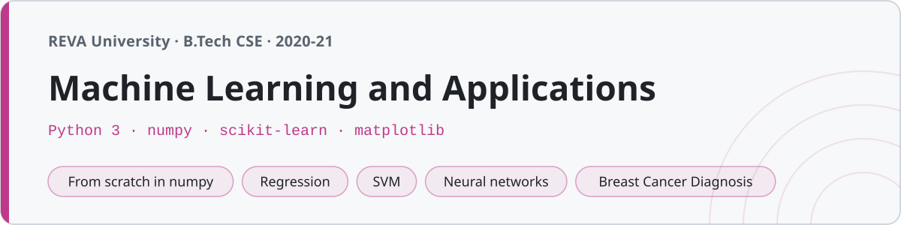

<p align="center"></p>

# Machine Learning and Applications

Notes, code and a project from the Machine Learning course at **REVA University, Bengaluru** (B.Tech CSE, seventh semester, 2020–21). This is the course that ties the whole degree together — the statistics, the linear algebra, the programming — into models that learn from data.

The aim of this repo is to make hard ideas easy to study. Every unit has **notes** that start from the intuition before the math, **code you can read line by line** — usually the algorithm written from scratch in numpy *and* the scikit-learn way you'd actually use — and a **figure** wherever a picture explains it faster than a paragraph. Everything runs, and every number in the notes and lab records is the real output of running it.

## Structure

| Folder | Unit | Core idea |
|---|---|---|
| `01-introduction/` | Foundations | Types of ML, the pipeline, overfitting & the bias–variance tradeoff |
| `02-data-preprocessing/` | Data prep | Missing values, encoding, scaling, stratified splits, EDA |
| `03-linear-regression/` | Linear regression | Gradient descent & the normal equation (from scratch), R², regularization |
| `04-logistic-regression/` | Logistic regression | Sigmoid, cross-entropy, decision boundaries |
| `05-knn-and-naive-bayes/` | KNN & Naive Bayes | Lazy learning, distance, Bayes' theorem |
| `06-decision-trees-and-ensembles/` | Trees & ensembles | Entropy/Gini, Random Forest, bagging, boosting |
| `07-support-vector-machines/` | SVM | Max-margin, the kernel trick |
| `08-clustering/` | Clustering | k-means (from scratch), elbow, hierarchical, DBSCAN |
| `09-dimensionality-reduction/` | Dimensionality reduction | PCA (from scratch), explained variance, t-SNE |
| `10-neural-networks/` | Neural networks | Perceptron, forward pass, **backprop in numpy** |
| `11-model-evaluation/` | Evaluation | Confusion matrix, precision/recall/F1, ROC-AUC, cross-validation |
| `notes/` | — | `quick-reference.md`, `exam-prep.md`, and a `math-for-ml.md` refresher |
| `lab/` | — | The twelve lab experiments |
| `project/` | — | **Breast Cancer Diagnosis** — an end-to-end classification project |

## Running the code

Everything is plain Python 3 on the standard 2020 ML stack — numpy, pandas, matplotlib, scikit-learn, seaborn.

```sh
python -m venv venv && source venv/bin/activate
pip install numpy pandas matplotlib scikit-learn seaborn scipy
```
```sh
python 03-linear-regression/linear_regression_scratch.py
```

Scripts save their plots as `.png` files next to the code (those are committed — they're the visualizations), so on a headless machine set `MPLBACKEND=Agg`. Every model uses a fixed random seed, so you get the same numbers and figures every run.

The datasets are scikit-learn's built-in ones (iris, wine, breast cancer, digits, make_blobs/moons) so nothing needs downloading. The two classic from-scratch lab programs that need their own tiny data — FIND-S and ID3 — carry it as small CSVs (`enjoysport.csv`, `playtennis.csv`) in their folders.

## From scratch *and* scikit-learn

Most units implement the algorithm twice on purpose. The from-scratch numpy version shows you the mechanics — the gradient-descent loop, the k-means assign/update steps, the eigen-decomposition behind PCA, the backprop chain rule — and then the scikit-learn version shows the practical way. Where both exist, the script prints them side by side to show they agree (the hand-rolled linear regression lands on the same weights as `LinearRegression`; the from-scratch PCA reproduces sklearn's explained-variance ratios).

## Lab

Twelve experiments. The first four are the classic written-from-scratch programs (FIND-S, Candidate-Elimination, ID3, Backpropagation); the rest cover the practical algorithms. Each folder is the full record — aim, dataset, program, the real output, result.

| # | Experiment | Date |
|---|---|---|
| 1 | FIND-S algorithm | 25/09/2020 |
| 2 | Candidate-Elimination | 02/10/2020 |
| 3 | ID3 decision tree | 16/10/2020 |
| 4 | Backpropagation (from scratch) | 23/10/2020 |
| 5 | Naive Bayes | 06/11/2020 |
| 6 | k-Nearest Neighbors | 13/11/2020 |
| 7 | Linear regression | 27/11/2020 |
| 8 | Logistic regression | 04/12/2020 |
| 9 | SVM classifier | 11/12/2020 |
| 10 | k-Means & EM clustering | 18/12/2020 |
| 11 | PCA | 08/01/2021 |
| 12 | Model evaluation | 15/01/2021 |

## Project — Breast Cancer Diagnosis

The `project/` folder is a complete supervised-learning project on the Wisconsin breast-cancer dataset (569 samples, 30 features, malignant vs benign): exploratory analysis, preprocessing, a comparison across Logistic Regression, KNN, Decision Tree, Random Forest and SVM, hyperparameter tuning of the best one, and a final evaluation with a confusion matrix and ROC curve. The report walks through the whole thing and the tuned model lands in the high-0.9s. It runs end to end.

## A note on the code

It reads like a student wrote it, because the point was to understand the algorithms, not to build a library. The variable names are the ones everyone uses (`X`, `y`, `X_train`, `clf`, `model`), the code isn't narrated with a comment on every line, and the plots are the plain matplotlib ones you make while learning. What's here has been run — the accuracies, the R² values, the confusion matrices in the notes and lab records are the actual output.
