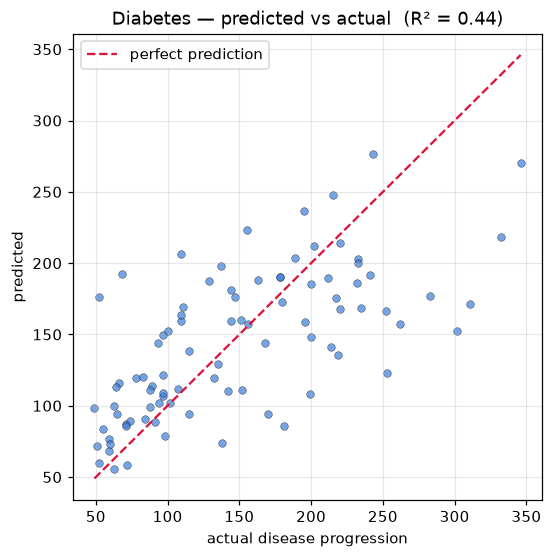

# Experiment 7 — Linear Regression

**Date:** 27/11/2020

## Aim
Fit a multiple linear regression model and report its coefficients, MSE, and R² score.

## Dataset
The `diabetes` dataset built into scikit-learn — 442 patients, 10 standardised baseline features (age, sex, BMI, blood pressure, six serum measurements), target is disease progression one year on. Split 80/20.

## Program
`linear_regression.py` — fits `LinearRegression`, prints the ten coefficients and the intercept, then the MSE, RMSE, and R² on the test set. Saves a predicted-vs-actual scatter as `fit.png`.

## Output
```
coefficients:
  age     -30.62
  sex    -272.25
  bmi     528.85
  bp      327.70
  s1     -581.02
  s2      332.97
  s3      -27.97
  s4      139.28
  s5      665.08
  s6       61.91
intercept: 151.43

MSE:  2992.58
RMSE: 54.70
R2:   0.4384
```



## Result
The model explains about 44% of the variance in disease progression (R² = 0.4384, RMSE ≈ 54.7). BMI and serum measure s5 carry the largest positive weights, matching the known clinical drivers.
