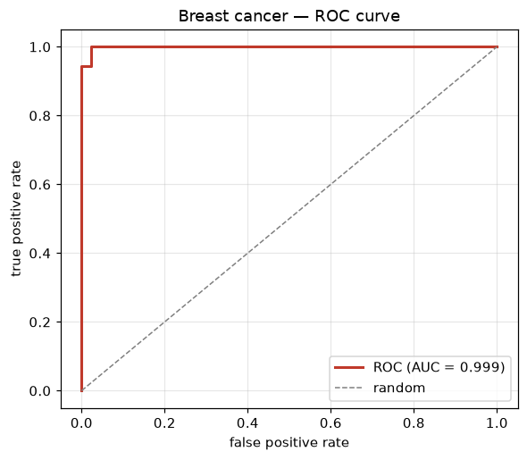

# Experiment 8 — Logistic Regression

**Date:** 04/12/2020

## Aim
Classify tumours as malignant or benign with logistic regression; report accuracy, confusion matrix, classification report, and the ROC curve.

## Dataset
The `breast_cancer` dataset built into scikit-learn — 569 samples, 30 features from digitised cell-nucleus images, two classes (malignant/benign). Split 80/20 with stratification; features standardised before fitting.

## Program
`logistic_regression.py` — fits `LogisticRegression`, prints accuracy, the confusion matrix and per-class report, then computes the ROC curve and AUC from the predicted probabilities. Saves the curve as `roc.png`.

## Output
```
test accuracy: 0.9912

confusion matrix (rows = true, cols = predicted):
[[41  1]
 [ 0 72]]

classification report:
              precision    recall  f1-score   support

   malignant       1.00      0.98      0.99        42
      benign       0.99      1.00      0.99        72

    accuracy                           0.99       114
   macro avg       0.99      0.99      0.99       114
weighted avg       0.99      0.99      0.99       114

ROC AUC: 0.9987
```



## Result
Logistic regression classifies the test set at 99.12% accuracy with a single false positive and no missed malignancies, and an ROC AUC of 0.9987 — near-perfect separation of the two classes.
