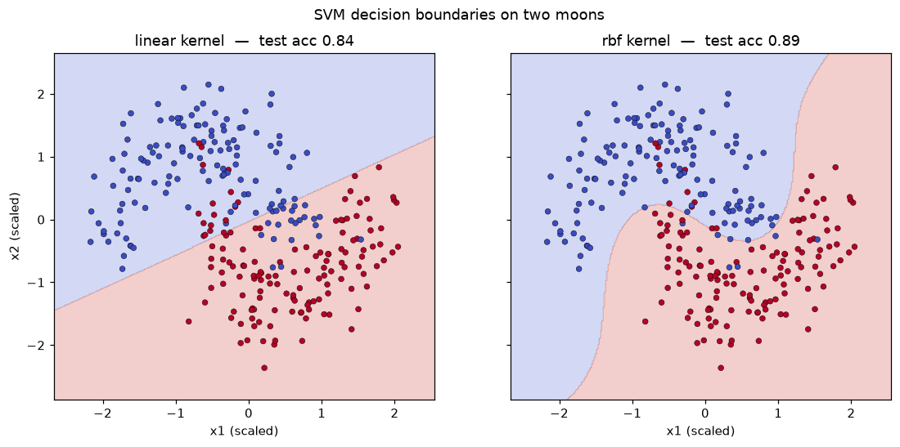

# Experiment 9 — SVM Classifier

**Date:** 11/12/2020

## Aim
Train a support vector machine with a linear and an RBF kernel on a non-linearly separable dataset and compare their accuracy.

## Dataset
`make_moons` — 400 points in two interlocking crescents (noise 0.25), a 70/30 stratified train/test split. Features standardised before fitting.

## Program
`svm.py` — fits `SVC(kernel="linear")` and `SVC(kernel="rbf")`, prints test accuracy and support-vector count for each, and plots both decision boundaries into `svm.png`.

## Output
```
linear kernel  test accuracy: 0.842   support vectors: 91
rbf    kernel  test accuracy: 0.892   support vectors: 80
```



## Result
The RBF kernel (0.892) beats the linear kernel (0.842): a straight boundary cannot cut apart the interlocking moons, while the RBF kernel bends around them and needs fewer support vectors to do it.
