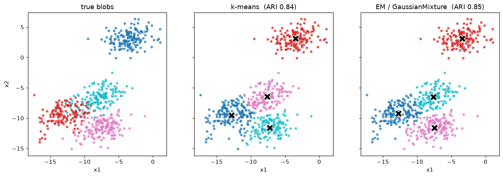

# Experiment 10 — k-Means Clustering vs EM

**Date:** 18/12/2020

## Aim
Cluster the same data with k-Means and with the EM algorithm (Gaussian mixture) and compare the two using the adjusted Rand index and the silhouette score.

## Dataset
`make_blobs` — 600 points, 4 centres, then multiplied by a shear matrix so the blobs come out elliptical rather than round. The true labels are used only to score the clusterings, not to fit them.

## Program
`kmeans_em.py` — fits `KMeans(n_clusters=4)` and `GaussianMixture(n_components=4)` on the same X, prints ARI and silhouette for each, and plots true / k-means / EM assignments side by side in `kmeans_vs_em.png`.

## Output
```
                  ARI     silhouette
k-means         0.837    0.555
EM (GaussMix)   0.848    0.550

k-means inertia: 2796.2
GMM converged:   True   log-likelihood: -4.922
```



## Result
Both recover the four groups well, but EM edges ahead on ARI (0.848 vs 0.837) because its full-covariance Gaussians fit the stretched, elliptical blobs, whereas k-Means assumes round clusters of equal size and mislabels a few points along the slanted boundaries.
