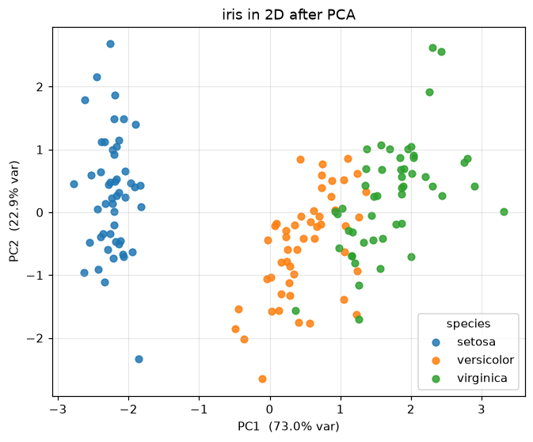

# Experiment 11 — Principal Component Analysis

**Date:** 08/01/2021

## Aim
Reduce a four-feature dataset to two dimensions using PCA, report how much variance each component keeps, and plot the data coloured by class.

## Dataset
`load_iris` — 150 flowers, 4 features (sepal/petal length and width), 3 species. Features are standardised before PCA so no single feature dominates the variance.

## Program
`pca.py` — fits sklearn's `PCA`, prints the explained-variance ratio of each component, and scatters the first two components in `pca.png`.

## Output
```
explained variance ratio per component:
  PC1: 0.7296
  PC2: 0.2285
  PC3: 0.0367
  PC4: 0.0052
first two components: 95.8% of total variance
sum of all ratios: 1.0000
```



## Result
The first two principal components hold 95.8% of the variance, so the 4D data collapses to a 2D plot with almost no loss. In that plot setosa sits cleanly apart while versicolor and virginica overlap slightly, matching what the full-dimensional classifiers see.
