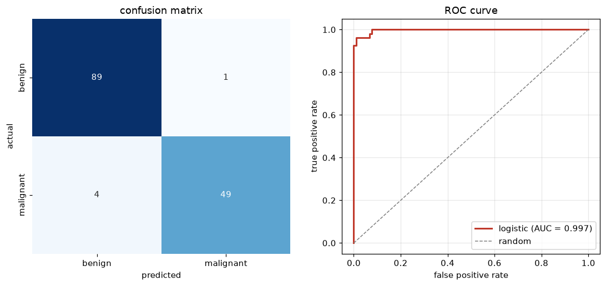

# Experiment 12 — Model Evaluation

**Date:** 15/01/2021

## Aim
Evaluate a classifier thoroughly: 5-fold cross-validation, a confusion matrix, precision/recall/F1, and the ROC-AUC.

## Dataset
`load_breast_cancer` — 569 samples, 30 features. Labels are flipped so malignant = 1 is the positive class (the one we care about catching). A `StandardScaler` sits inside the pipeline so scaling happens per fold with no leakage.

## Program
`evaluation.py` — cross-validates a scaled logistic regression, then refits on a 75/25 split to print the confusion matrix, `classification_report`, and ROC-AUC, and saves the confusion matrix and ROC curve to `evaluation.png`.

## Output
```
5-fold CV accuracy: [0.991 0.982 0.974 0.956 0.991]
                    0.9789 +/- 0.0131

confusion matrix:
[[89  1]
 [ 4 49]]

hold-out accuracy: 0.9650

              precision    recall  f1-score   support

      benign       0.96      0.99      0.97        90
   malignant       0.98      0.92      0.95        53

    accuracy                           0.97       143
   macro avg       0.97      0.96      0.96       143
weighted avg       0.97      0.97      0.96       143

ROC AUC: 0.9969
```



## Result
The model averages 97.9% accuracy across the five folds with a small spread (±0.013), and on the hold-out set scores 0.965 accuracy with an ROC-AUC of 0.997. The 4 false negatives (malignant read as benign) are the costly errors here, which is why recall on the malignant class (0.92) matters more than the headline accuracy.
