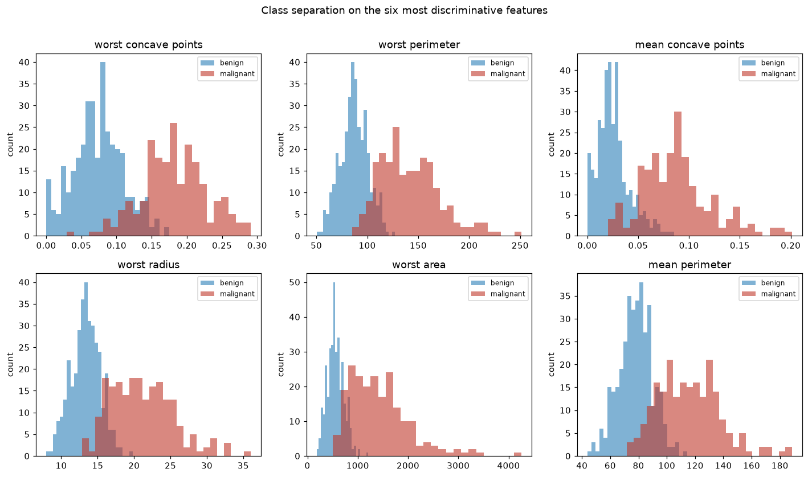
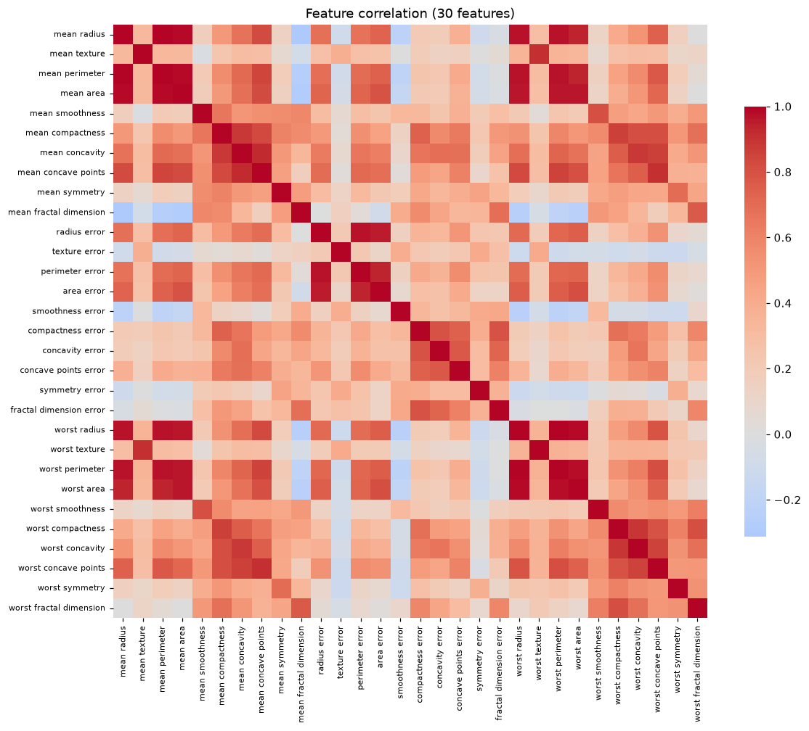
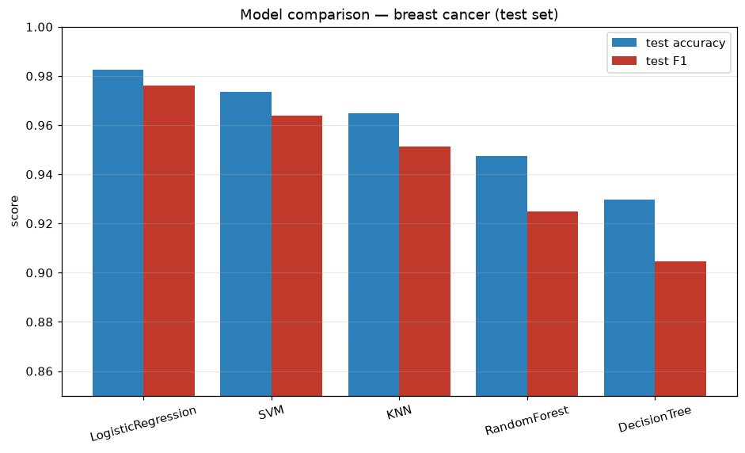
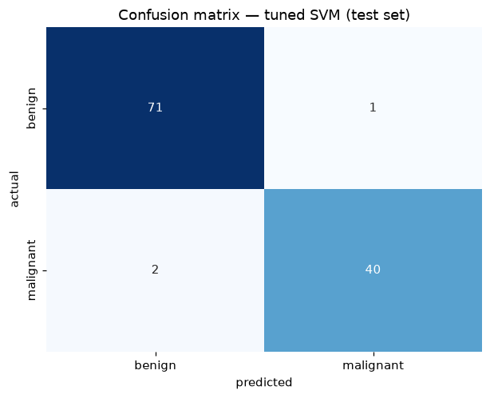
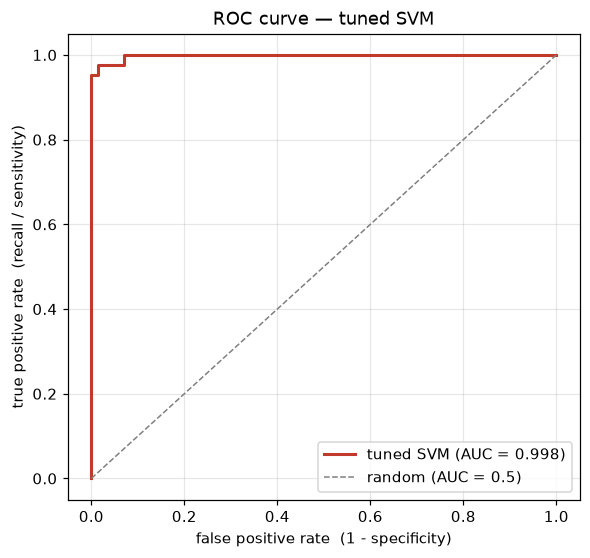

# Predicting Breast Cancer Diagnosis

A supervised machine-learning project on the Wisconsin Diagnostic Breast Cancer dataset:
given 30 measurements taken from a digitised image of a breast-mass biopsy, predict whether
the mass is **malignant** or **benign**. This is the end-to-end project for the Machine
Learning course — EDA, preprocessing, a comparison across five classifiers, hyperparameter
tuning of the strongest one, and a final evaluation.

## Problem statement

A fine-needle aspirate of a breast lump is imaged, and for each cell nucleus ten shape and
texture properties are measured (radius, texture, perimeter, area, smoothness, compactness,
concavity, concave points, symmetry, fractal dimension). For each property the dataset
records the **mean**, the **standard error**, and the **worst** (largest) value across the
nuclei — so 10 × 3 = 30 features per sample. The task is binary classification: **malignant
(1)** or **benign (0)**.

The error that matters most is a **missed malignant case** (a false negative — telling a
patient they are fine when the tumour is cancerous). So beyond raw accuracy, the metric to
watch is **recall on the malignant class** = the fraction of real cancers the model catches.

## Dataset

scikit-learn's built-in `load_breast_cancer` (the UCI / Wisconsin Diagnostic set) — no
download needed.

| | |
|---|---|
| Samples | 569 |
| Features | 30 (all numeric, real-valued) |
| Classes | benign 357 (62.7%), malignant 212 (37.3%) |
| Missing values | none |

The classes are moderately imbalanced (roughly 2:1 benign to malignant), so the split is
**stratified** to keep that ratio in both train and test.

## Approach

The pipeline is split across five scripts, all sharing one fixed train/test split via
`dataset.py` so every step works off exactly the same data:

1. `data_exploration.py` — EDA
2. `models.py` — train and compare five classifiers
3. `tuning.py` — grid-search the most promising model
4. `evaluation.py` — final evaluation of the tuned model

Split: 80/20 stratified, `random_state=1`. Features are standardised with `StandardScaler`
**fit on the training set only** (inside a `Pipeline`, so the cross-validation folds don't
leak). Every model and split has a fixed seed, so the numbers below reproduce exactly.

## EDA

The two classes separate cleanly on the size- and shape-related features. Ranking each
feature by how far apart the class means sit (in pooled-standard-deviation units), the most
discriminative are `worst concave points` (2.63), `worst perimeter` (2.53), `mean concave
points` (2.48) and `worst radius` (2.48). Malignant tumours are larger and more irregular —
their histograms sit clearly to the right of the benign ones.



The 30 features are also **heavily correlated with each other**: `mean radius` ↔ `mean
perimeter` is 0.998, and the radius/perimeter/area trio is essentially one measurement of
size expressed three ways. That redundancy is why a linear model does so well here, and it
is the kind of structure PCA would collapse.



## Models compared

Five classifiers, each behind a `StandardScaler` pipeline, scored on the held-out test set
and by 5-fold cross-validation on the training set (`cv_mean`):

| Model | Accuracy | Precision | Recall | F1 | CV mean |
|---|---|---|---|---|---|
| Logistic Regression | 0.9825 | 0.9762 | 0.9762 | 0.9762 | **0.9802** |
| SVM (RBF) | 0.9737 | 0.9756 | 0.9524 | 0.9639 | 0.9670 |
| KNN (k=5) | 0.9649 | 0.9750 | 0.9286 | 0.9512 | 0.9604 |
| Random Forest | 0.9474 | 0.9737 | 0.8810 | 0.9250 | 0.9604 |
| Decision Tree | 0.9298 | 0.9048 | 0.9048 | 0.9048 | 0.9275 |



Logistic regression and the RBF SVM are the two front-runners, within about a point of each
other; the single decision tree trails (it overfits without the averaging that the forest
gives). A linear model doing this well is expected — with 30 correlated size/shape features
the malignant and benign clouds are close to linearly separable after scaling.

## Tuning

Logistic regression peaks at its default regularisation (`C=1`), so there is nothing to
tune there. The **SVM**, on the other hand, ships with `gamma='scale'`, which is rarely
optimal — so that is the model worth tuning. Grid-search over `C ∈ {0.1, 1, 10, 100}` and
`gamma ∈ {scale, 1e-4, 1e-3, 1e-2, 1e-1}` with 5-fold CV:

```
default SVM (C=1, gamma=scale) CV accuracy: 0.9670
best params: {'svc__C': 100, 'svc__gamma': 0.001}
best CV accuracy: 0.9824
improvement over default SVM: +0.0154
```

Tuning lifts the SVM from 0.9670 to **0.9824** CV accuracy — past logistic regression's
0.9802 — so the **tuned SVM is the final model**. The winning combination is a *small*
gamma (a wide, smooth RBF kernel that doesn't chase noise) with a *large* C (a hard margin
that fits the training points closely).

## Final evaluation

The tuned SVM (`C=100, gamma=0.001`) on the untouched test set:

```
test accuracy: 0.9737
confusion matrix:
[[71  1]
 [ 2 40]]
ROC AUC: 0.9980
```

| Class | Precision | Recall | F1 | Support |
|---|---|---|---|---|
| benign | 0.9726 | 0.9861 | 0.9793 | 72 |
| malignant | 0.9756 | 0.9524 | 0.9639 | 42 |

Of the 114 test cases the model gets 111 right. It **misses 2 of 42 malignant tumours**
(false negatives) and raises **1 false alarm** on a benign one. The ROC curve is almost in
the top-left corner with AUC ≈ 0.998, so the ranking of cases by risk is near-perfect —
where the decision threshold gets set is essentially a policy choice about how much to
favour catching every cancer over avoiding false alarms.




## Results summary

- Best model at default settings: **logistic regression**, 0.9802 CV / 0.9825 test accuracy.
- After tuning, the **RBF SVM** (`C=100, gamma=0.001`) reaches **0.9824 CV accuracy** and is
  the final model, with **0.974 test accuracy, 0.964 malignant F1, and 0.998 ROC-AUC**.
- The two missed malignant cases are the number to keep pushing down; the near-1.0 AUC says
  the headroom is in threshold choice, not in the model.

## How to run

Everything uses scikit-learn's built-in dataset, so nothing to download. Figures are saved
next to the code (headless), so set the Agg backend:

```sh
cd project
MPLBACKEND=Agg python data_exploration.py
MPLBACKEND=Agg python models.py
MPLBACKEND=Agg python tuning.py
MPLBACKEND=Agg python evaluation.py
```

Run them in that order (or independently — each reloads the same fixed split from
`dataset.py`). Seeds are fixed throughout, so every number and figure above reproduces.

## Files

| File | What it does |
|---|---|
| `dataset.py` | Shared loader: fixed stratified split, malignant = 1 |
| `data_exploration.py` | EDA — class balance, class separation, correlation heatmap |
| `models.py` | Trains and compares the five classifiers |
| `tuning.py` | Grid-searches the SVM |
| `evaluation.py` | Final evaluation of the tuned SVM |
