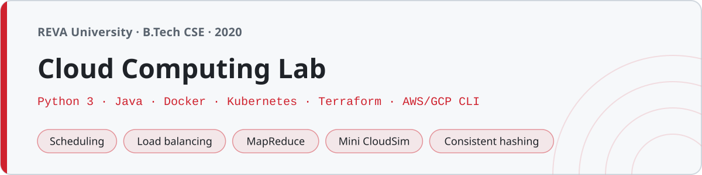

<p align="center"></p>

# Cloud Computing Lab

Code and lab records from the Cloud Computing Lab at **REVA University, Bengaluru** (B.Tech, sixth semester, 2020) — the same semester as Data Mining. A cloud course is part algorithms and part systems, so this is a mix: **Python** simulations for the concepts (scheduling, load balancing, MapReduce, a small cloud simulator), a bit of **Java** for the Hadoop side, real **Docker / Kubernetes / Terraform** artifacts, **shell** scripts for the AWS/GCP CLIs, and **markdown lab records** for the hands-on VM and platform experiments.

Nothing here touches a real cloud account — the AWS/GCP scripts are the commands you'd run (with placeholders), and everything else runs locally or is simulated in memory.

## Structure

| Folder | What's in it | Mostly |
|---|---|---|
| `01-introduction/` | Service/deployment models, cost calculator | Python |
| `02-virtualization/` | Hypervisors, VM placement, migration, overcommit | Python |
| `03-distributed-computing/` | CAP, Lamport & vector clocks, consistent hashing, quorum, 2PC | Python |
| `04-mapreduce-hadoop/` | Word count, inverted index, matrix multiply (Python + Java) | Python/Java |
| `05-scheduling/` | FCFS, SJF, round robin, priority, min-min, max-min | Python |
| `06-load-balancing/` | Round robin, weighted, least-connections, IP hash, throttled | Python |
| `07-cloud-simulation/` | A small from-scratch CloudSim (datacenter, VMs, cloudlets) | Python |
| `08-containers-orchestration/` | Dockerfile, compose, k8s manifests, a container scheduler | Docker/K8s/Py |
| `09-cloud-storage-security/` | Object store, replication, encryption, IAM, erasure coding | Python |
| `10-cloud-platforms/` | AWS/GCP CLI scripts, Terraform | Shell/HCL |
| `lab/` | The 14 lab items — Python sims + platform lab records | Python/Markdown |

Each topic folder has a `NOTES.md` with the concepts and the algorithms.

## Running

The Python simulations are standard-library only — no `pip install` needed:

```sh
python3 05-scheduling/05_min_min.py            # min-min task-to-VM mapping + makespan
python3 06-load-balancing/01_round_robin.py    # requests cycle across the servers
python3 07-cloud-simulation/04_cloud_sim.py    # datacenter + broker, prints makespan and cost
```

The Java word count is plain Java (no Hadoop JARs), so it compiles and runs standalone:

```sh
cd 04-mapreduce-hadoop && javac WordCount.java && java WordCount
```

The container app is a tiny stdlib web server that the `Dockerfile` packages:

```sh
cd 08-containers-orchestration
python3 app.py            # serves on :8080  (or docker build -t cc-web . && docker run -p 8080:8080 cc-web)
```

## The infrastructure files

`08-containers-orchestration/` and `10-cloud-platforms/` hold the real artifacts — a `Dockerfile`, a `docker-compose.yml` (web + redis), Kubernetes `Deployment`/`Service` manifests, and Terraform (`main.tf`, `variables.tf`) for an EC2 instance and an S3 bucket. The shell scripts in `10-cloud-platforms/` are AWS-CLI and gcloud command sequences with placeholder values (`ami-xxxxx`, `<your-key>`, `my-bucket`) — they're valid bash but need real credentials to actually run, so they're kept as examples.

## Lab

`lab/` is a mix, which is how the lab actually ran: six Python simulations (CloudSim scheduling, MapReduce word count, load balancing, VM allocation, consistent hashing, replication) and eight markdown **lab records** for the hands-on parts — creating a VM in VirtualBox, building and running a Docker container, deploying to Minikube, launching EC2 and S3, Google App Engine, and OpenStack with DevStack. The records have the real commands, dated across the semester.

## A note on the code

Sixth-semester lab code — short names (`vm`, `host`, `lb`, `sched`, `mk`), the simulation written out plainly rather than cleverly, the YAML and Dockerfiles hand-written the way you'd actually write them. It's meant to be read and run, and it is the code as submitted.
