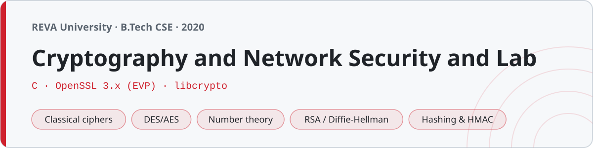

<p align="center"></p>

# Cryptography and Network Security and Lab

Coursework from Cryptography and Network Security at **REVA University, Bengaluru** (B.Tech, sixth semester, 2020). Notes on the concepts — from classical ciphers to number theory, public-key crypto, hashing and network security — and the lab in C.

The classical ciphers and the number-theory / public-key algorithms are written **from scratch**, because implementing them is how you actually understand them. AES, DES, the SHA/MD5 hashes and the digital signatures use **OpenSSL's EVP interface** — hand-rolling AES is exactly where subtle bugs hide, and the point of those exercises is to use a real primitive correctly. Every program is checked against a published test vector.

## Structure

| Folder | Topic | Code |
|---|---|---|
| `01-introduction/` | CIA triad, X.800 attacks/services/mechanisms, security model | notes |
| `02-classical-ciphers/` | Caesar, monoalphabetic, affine, Atbash, Vigenère, Vernam, Playfair, Hill, Rail Fence, columnar transposition | C |
| `03-symmetric-ciphers/` | AES (ECB/CBC), DES (CBC) via OpenSSL EVP | C |
| `04-number-theory/` | GCD, extended Euclid, modular exponentiation, Euler's totient, primality, CRT | C |
| `05-public-key/` | RSA, Diffie-Hellman, ElGamal (from scratch) | C |
| `06-hash-functions/` | MD5, SHA-256, the SHA family | C |
| `07-message-auth/` | HMAC, RSA digital signatures | C |
| `08-key-management/` | key distribution, KDC, X.509, PKI, Kerberos | notes |
| `09-network-security/` | IPSec, SSL/TLS, PGP/S-MIME, firewalls, IDS | notes |
| `lab/` | lab manual indexing every program | — |
| `notes/` | number-theory reference, exam prep | — |

## Building

Plain-C programs (classical ciphers, number theory, public key):
```sh
cc 02-classical-ciphers/caesar.c -o caesar && ./caesar          # HELLO -> KHOOR
cc 05-public-key/rsa.c -o rsa && ./rsa                          # enc(65)=2790, dec=65
```

The OpenSSL programs (AES, DES, hashes, HMAC, signatures) link `libcrypto`:
```sh
cc 03-symmetric-ciphers/aes_ecb.c -lcrypto -o aes && ./aes      # 69c4e0d86a7b0430d8cdb78070b4c55a
cc 06-hash-functions/sha256.c -lcrypto -o sha256 && ./sha256    # SHA-256("abc") = ba7816bf...15ad
```
They use the EVP API (OpenSSL 3.x), not the deprecated low-level calls. Each source carries its plain build line on the first comment line. On a Mac with Homebrew OpenSSL, add `-I$(brew --prefix openssl@3)/include -L$(brew --prefix openssl@3)/lib`.

## The test vectors

These are the ones worth knowing the code gets right:

| Program | Input | Output |
|---|---|---|
| aes_ecb | FIPS-197 key/plaintext | `69c4e0d86a7b0430d8cdb78070b4c55a` |
| sha256 | "abc" | `ba7816bf8f01cfea414140de5dae2223b00361a396177a9cb410ff61f20015ad` |
| md5 | "abc" | `900150983cd24fb0d6963f7d28e17f72` |
| rsa | p=61, q=53, e=17 | n=3233, d=2753, enc(65)=2790, dec=65 |
| diffie_hellman | p=23, g=5, a=6, b=15 | shared secret = 2 |
| caesar | HELLO, shift 3 | KHOOR |
| vigenère | HELLO, key KEY | RIJVS |

## A couple of notes on the code

- **Single DES needs OpenSSL's legacy provider.** OpenSSL 3 moved single DES out of the default provider, so `des_cbc.c` loads the legacy provider at startup (`OSSL_PROVIDER_load(NULL, "legacy")`) — otherwise `EVP_des_cbc()` comes back NULL and you get empty output. 3DES (`EVP_des_ede3_cbc`) is still in the default provider if the legacy one isn't available.
- **`aes_ecb.c` turns padding off** (`EVP_CIPHER_CTX_set_padding(ctx, 0)`) so a single 16-byte block encrypts to exactly 16 bytes and reproduces the published vector; `aes_cbc.c`/`des_cbc.c` keep PKCS#7 padding for arbitrary-length input.
- **Primality uses Miller-Rabin**, not a plain Fermat test, so it correctly flags Carmichael numbers like 561 as composite.
- The Playfair and columnar-transposition programs pad with `X`, so a round trip recovers the padded plaintext (a trailing `X`) — that's inherent to the cipher, not a bug.
