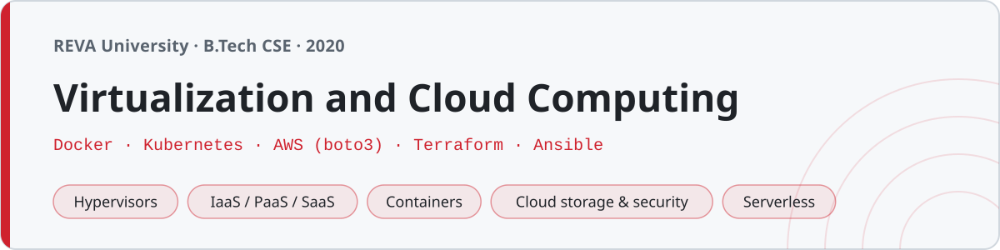

<p align="center"></p>

# Virtualization and Cloud Computing

My notes and lab work for **Virtualization and Cloud Computing** at **REVA University, Bengaluru** (B.Tech, 2020). Theory from virtualization fundamentals through the cloud service models, and a lab side that goes hands-on with VirtualBox/KVM, Docker, Kubernetes, AWS and a bit of infrastructure-as-code.

131 files — notes in markdown, and lab artifacts you can actually run against the real tools (Dockerfiles, compose files, k8s manifests, boto3 scripts).

## Structure

Folders in the order the topics were taught.

| Folder | What's in it | Files |
|---|---|---|
| `01-introduction/` | What virtualization and cloud are, history, benefits | 6 |
| `02-virtualization-basics/` | Types, hypervisors (type 1 vs 2), full/para/hardware-assisted | 9 |
| `03-virtualization-lab/` | VirtualBox (`VBoxManage`), KVM (`virsh`), a Vagrantfile | 10 |
| `04-cloud-computing-basics/` | NIST definition, the 5 characteristics, deployment models | 8 |
| `05-cloud-service-models/` | IaaS, PaaS, SaaS, FaaS, with a comparison table | 6 |
| `06-containers-docker/` | Containers vs VMs, Docker architecture, images, networking, volumes | 7 |
| `07-docker-lab/` | Dockerfiles (Flask, nginx, multi-stage) + docker-compose stacks | 16 |
| `08-kubernetes/` | Architecture notes + pod/deployment/service/configmap manifests | 13 |
| `09-aws-cloud/` | EC2/S3/IAM/VPC notes + AWS CLI scripts + boto3 | 14 |
| `10-cloud-storage-security/` | Storage types, security, IAM, encryption, compliance | 8 |
| `11-advanced-topics/` | Serverless, microservices, SDN, edge, IaC (Terraform + Ansible) | 10 |
| `lab/` | The 14 numbered lab records with their artifacts | 25 |

## Using the lab artifacts

These target the real tools. The versions are pinned to what we used in 2020, so nothing here assumes anything newer.

```sh
# Docker
cd 07-docker-lab/flask-app
docker build -t flask-app .
docker run -p 5000:5000 flask-app

# a multi-container stack
cd 07-docker-lab/compose-flask-redis
docker-compose up

# Kubernetes (against any cluster / minikube)
kubectl apply -f 08-kubernetes/deployment.yaml
kubectl apply -f 08-kubernetes/service_nodeport.yaml

# AWS (needs your own credentials configured)
python3 09-aws-cloud/s3_create_bucket.py
```

The compose files use `version: "3.8"`, the Kubernetes Deployments use `apps/v1`, images are pinned (`nginx:1.19`, `mysql:5.7`, `python:3.8-slim`), and the boto3 scripts use the AWS API as it was in 2020.

## A note on what's verified

The notes are exam-prep notes, checked for the facts (the NIST five characteristics, S3=object / EBS=block / EFS=file, type-1 vs type-2 hypervisors, the Kubernetes control-plane components). The scripts and manifests are syntactically valid and use the right 2020 API versions, but they were written to run against a real Docker daemon, a real cluster and a real AWS account — this repo is the coursework, not a live deployment.

## The bugs I actually hit

The commit history has a few of the real ones:

- A Kubernetes Deployment that wouldn't apply because it still used `apiVersion: extensions/v1beta1` — removed in Kubernetes 1.16, so it had to become `apps/v1`.
- A Deployment whose `selector.matchLabels` didn't match the pod template's labels, so it managed no pods.
- An S3 `create_bucket` call that failed outside `us-east-1` until it passed `CreateBucketConfiguration` with the `LocationConstraint`.

## Lab

`lab/` holds the 14 numbered exercises — from creating a VM in VirtualBox and Vagrant, through building Docker images and compose stacks, deploying to Kubernetes, launching EC2 and S3 with boto3, and finishing with Terraform, Ansible and a Lambda handler. Each writeup has the aim, the actual commands, and what the output looked like.
