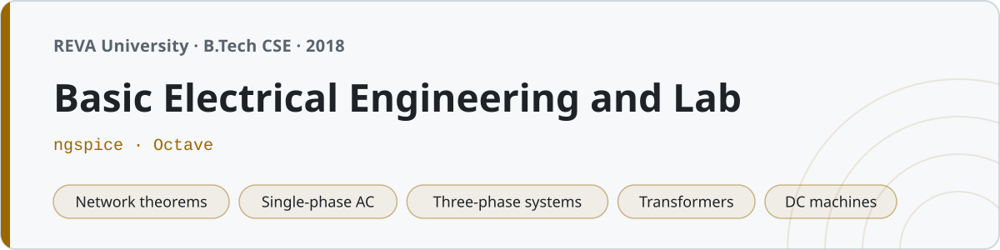

<p align="center"></p>

# Basic Electrical Engineering and Lab

Notes, circuit simulations and lab records from Basic Electrical Engineering at **REVA University, Bengaluru** (B.Tech, first year, even semester 2018).

Ten units of notes, 27 ngspice netlists, 43 Octave scripts and the twelve lab experiments. The simulations weren't required by anyone — I started writing netlists because checking a Thevenin equivalent by hand three times and getting three answers was getting old.

## Structure

| Folder | Unit | Files |
|---|---|---|
| `01-dc-fundamentals/` | Ohm's law, KVL, KCL, mesh and nodal analysis, star-delta | 9 |
| `02-network-theorems/` | Thevenin, Norton, superposition, max power transfer, reciprocity | 8 |
| `03-ac-fundamentals/` | Sinusoids, RMS and average values, form factor, phasors | 6 |
| `04-single-phase-ac/` | RL, RC, RLC series and parallel, power triangle, resonance | 8 |
| `05-three-phase-systems/` | Star and delta, line/phase relations, two-wattmeter method | 5 |
| `06-transformers/` | EMF equation, OC/SC tests, losses, efficiency, regulation | 6 |
| `07-dc-machines/` | EMF and torque equations, back EMF, speed control | 5 |
| `08-ac-machines/` | Induction motors, slip, torque-slip curve, alternators | 5 |
| `09-measuring-instruments/` | PMMC, moving iron, wattmeter, shunts and multipliers | 5 |
| `10-wiring-and-safety/` | Domestic wiring, fuses, MCB, earthing, energy tariff | 4 |
| `notes/` | Formula sheet, units and symbols, exam prep list | 3 |
| `lab/` | The twelve lab experiments, one folder each | 31 |

Each unit folder has a `notes.md`, the netlists for the circuits in it, and Octave scripts for the numericals.

## Running the simulations

**ngspice** for the circuits:

```sh
cd 02-network-theorems
ngspice -b thevenin.cir
```

Every netlist carries the answer it should produce as a trailing comment, so you can check it without knowing the circuit:

```
* expected: V(2)=8V (=Vth); loaded original V(12)=4V equals equivalent V(22)=4V
```

The DC circuits use a `.control` block with `op` rather than a bare `.op`, because `.print dc` only works after a `.dc` analysis and ngspice will tell you so. Resistor current is `@r1[i]`, not `i(r1)` — `i()` only takes a voltage source.

**Octave** for the calculations:

```sh
cd 06-transformers
octave transformer_efficiency.m
```

The plotting scripts check `available_graphics_toolkits()` first, so they run headless without dying. On a machine with a display they draw the figure.

Install both with `brew install ngspice octave` (or `apt install ngspice octave`).

## Lab

Twelve experiments, each folder a full record: aim, apparatus, circuit, theory, procedure, observations, calculations, result.

| # | Experiment | Date | Simulated |
|---|---|---|---|
| 1 | Verification of Ohm's law | 31/01/2018 | ngspice |
| 2 | Verification of KVL and KCL | 07/02/2018 | ngspice |
| 3 | Verification of Thevenin's theorem | 14/02/2018 | ngspice |
| 4 | Verification of superposition theorem | 21/02/2018 | ngspice |
| 5 | Maximum power transfer | 07/03/2018 | ngspice |
| 6 | Series resonance | 14/03/2018 | ngspice |
| 7 | Parallel resonance | 21/03/2018 | ngspice |
| 8 | Three phase power by two-wattmeter method | 04/04/2018 | — |
| 9 | OC and SC test on a single phase transformer | 11/04/2018 | — |
| 10 | Speed control of a DC shunt motor | 25/04/2018 | — |
| 11 | Staircase wiring | 09/05/2018 | — |
| 12 | Fluorescent lamp wiring | 16/05/2018 | — |

Experiments 8 to 12 are on real machines and a real three-phase supply. There is no netlist for them because there is nothing honest to simulate — a squirrel cage rotor is not four resistors. Those folders have the record and, where there's arithmetic worth keeping, an Octave script.

Two of them are worth reading:

- **Experiment 7, parallel resonance.** The textbook says line current is minimum at resonance. For a real coil with resistance that isn't quite true: the unity-power-factor frequency is `f_r = (1/2π)√(1/LC − R²/L²)` = 1583.6 Hz, but the current-magnitude minimum sits about 8 Hz higher. ngspice shows both. The record defines resonance as unity power factor and says so.
- **Experiment 8, two-wattmeter method.** When the power factor drops below 0.5, W2 goes negative and you have to reverse the current coil to read it. The table includes that row.

## A note on the numbers

The theoretical columns are derived, the netlists are run, and the Octave scripts print what the tables claim. Where a table has a "measured" column it carries the kind of one-to-three percent error a moving-iron meter in a first-year lab actually gives you, and the percentage error column is arithmetically consistent with the two columns beside it.
